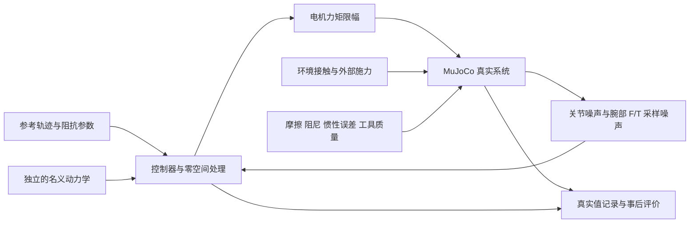

# 实现与论文的对应关系

**当前范围：A、B、C、D、F。用户已要求暂缓 E 砂轮机；默认批量运行与测试据此排除 E，见 [AGENTS.md](../AGENTS.md) 和 [当前范围报告](results/reproduction-fr3/REPORT.md)。下文 E 的实现说明与结果只作为已完成工作的历史记录保留。**

当前默认配置为 `fr3`：明确适配的 A/B/C/D/F 全部采用 1 kHz 控制/传感器，见 [134+51 次验证](results/reproduction-fr3/REPORT.md)。并列配置 `fr3v2` 见 [134+148 次验证](results/reproduction-fr3v2/REPORT.md)。`paper` 保留原任务矩阵和反馈增益，其[此前对照结果](results/reproduction-active/REPORT.md)不被覆盖。另有 [133 次适配审计](results/fr3-adaptation/REPORT.md)，包含 9 次提前终止。原 137 次运行与 14 次积分步长检查是历史 4 kHz 数据，见 [历史结果](results/RESULTS.md)。工程通过不等于论文全部性能结论复现。

此前 C 审计恢复了论文矢量轨迹，加入转角挡块、命令滤波开关、原增益对照、虚拟积分收敛和能量端口诊断，见 [机制证据审计](C_MECHANISM_AUDIT.md) 与 [C 机制结果](results/c-mechanism/REPORT.md)。这些修正已接入当前活动实验流程，保留 `legacy` 配置用于历史复算。

## 当前 fr3 配置

用户确认未知工具质量、接触材料和命令滤波保留为明确仿真假设；后续又明确暂缓 E。以下是 A/B/C/D/F 的仿真适配，不是 FR3 实物标定或论文原参数。

`fr3imp/profiles.py` 统一定义默认参数；所有控制器共享该实验的任务、环境、操作者和接口。`impedance_overrides` 只覆盖明确提供的轴矩阵，日志保存最终值。命令行 `--inertia-scale` 作用于所选 profile 的参数，而不是重新从原论文矩阵开始。

|实验|Λ、D、K 相对原参数|反馈调整|
|---|---|---|
|A|不变|H∞ 基准 ×.25；NRIC G 不变|
|B/F|Λ 全轴 ×.125；D 全轴 ×sqrt(.125)；K 不变|同上；F 另乘相对倍率 .25/.5/1|
|C|仅 x/y：Λ×.25，D×.5；K 不变；z 和角轴保持原值|H∞ ×.25；NRIC G 不变|
|D|角轴 Λ/D/K 均 ×.25，保留各轴阻尼比和固有频率；平移不变|H∞ ×.25；NRIC G×.25；SMC 原增益不变|

H∞ 使用有效 `alpha` 乘 `diag(1100,1100,1100,150,150,150)`；当前基准为 `diag(275,275,275,37.5,37.5,37.5)`。F 的文件名后缀 .25/.5/1 表示相对基准，实际有效 α=.0625/.125/.25，并另存于 `controller_parameters.alpha`；`paper` 的同名后缀则仍为绝对 α。图和报告区分两者。

D 的旋转任务为 Λ=(.5,.1,.1)、D=(5,.5,1)、K=(0,50,2.5)。虚拟手 yaw/pitch 弹簧先乘 4，合成广义力矩再乘 .25，因此有效弹簧仍为 40/120 Nm/rad，阻尼变为 .2 Nm·s/rad，上限为 3 Nm。滚转引导仍采用 300/8、上限 18 Nm，并保持至第二阶段结束。该支撑只是作用于真实机械模型的被动弹簧/阻尼，不覆盖关节或末端状态；它是为比较各控制器约 90° 姿态响应加入的显式假设，与原论文自由滚转释放不同。

选择依据及不利结果全部保留：统一降低任务惯量会损害 C/D；统一降低 NRIC G 则消除 B/C 的导纳抖振；只调 H∞ 增益不能解决 D 的大交互力矩。最终配置定位到任务轴和可实现力矩范围，不能据此宣称算法在任意调参下都具有相同排名。B 未复现原机急停，D 的每项静态误差排名也不等于原文；这些边界随结果一起报告。

## fr3v2 配置

`fr3v2` 是与 `fr3` 并列的另一套仿真假设，`fr3` 及其结果保留作对照。它恢复论文的任务阻抗、NRIC 增益和 D 虚拟操作者，把差异从“改任务”移到“改平台”。结果和不利证据见 [fr3v2 报告](results/reproduction-fr3v2/REPORT.md)。

- 任务与控制：A/B/C/D/F 的 Λ/D/K、NRIC G 与 `paper` 相同。H∞ 基准仍为有效 α=.25，F 的有效 α=.0625/.125/.25。D 的虚拟手弹簧和力矩不缩放，第二阶段没有滚转支撑。
- 关节摩擦：`friction_scale=3`，所有实验相同。依据是 F 的 REF 量级和“普通阻抗在 B 中仍能碰到墙”。这不是 FR3 的摩擦标定；×3.5 起普通阻抗就碰不到墙。
- F/T 延迟：`delay_samples=3`（3 ms），所有控制器相同。延迟只作用于力/力矩测量，关节反馈不延迟。
- 接触：B/F 为 `solref=(.02,.4), solimp=(.95,.99,.001)`，C 为 `solref=(.04,.3), solimp=(.9,.95,.001)`。把 MuJoCo 接触默认的临界阻尼改成欠阻尼，减小接触带来的相位超前。未对应任何实测材料。

这三项平台假设的取值在比较中明显影响控制器之间的差距，导纳的不稳定尤其依赖高增益内环和延迟同时存在，影响大小见报告。因此不能把它们当成原机的失稳机理。

`control_overrides` 的 `nric_gain_vector` 可替换七轴 NRIC G，`fr3v2` 的 `matched_G` 敏感性案例用它测试带宽匹配的增益。

`evaluation.py` 新增的 `*_stiff_axes_*` 与 `dynamic_impedance_position_gap_mean_m` 只统计 K>0 的轴。K=0 轴（C 的 z、D 的 roll）没有确定的静止位置，积分参考会漂移，旧键 `dynamic_impedance_position_rmse_m` 因此在 C 中偏大，但为对照旧结果仍保留。`equilibrium_position_error_measured_*`、`force_tracking_measured_rmse_N` 和 D 的 `*_equilibrium_error_measured_mae_rad` 用测量 F/T，与论文图的口径一致。旧的 `fr3` 记录没有这些键，三方对照从保存的轨迹重算。

## D 的操作者模型

`run_experiment` 的 `operator_model` 默认为 `grasp`，即原有的虚拟手弹簧。`fig11_replay` 是并列选项，通过 `operator_replay` 传入 `column`、`scale`、`grip`，目前只由 [`validate_d_operator.py`](../scripts/validate_d_operator.py) 使用，默认运行和 `fr3v2` 结果都不受影响。结果见 [D 操作者报告](results/d-operator/REPORT.md)。

- 数据：[`digitize_paper_d.py`](../scripts/digitize_paper_d.py) 从论文 PDF 第 17 页的矢量线恢复 Fig. 11，写入 `fr3imp/data/paper_d_curves.npz`。力矩按 `-m/K` 的绘图方式还原为外力矩 `m`（roll 为 `-m`）。该文件计入运行时代码哈希。
- 输入：开环施加，幅值为 `scale × operator_scale`，并关于 x-z 平面镜像（`REPLAY_MIRROR`），滚转仍为 +90°。力矩先按功率对偶经 Euler 速率映射转换。时长 30 s，而不是 `grasp` 的 35 s。
- 滚转：K=0，开环到不了 90°，所以 13–17.5 s 用闭环引导。其余时间没有支撑。
- 握持：`grip>0` 时，只在操作者施力期间叠加一个跟随论文运动的弹簧（yaw 为 `grip`，pitch 为 3 倍）。默认 `grip=0`，只用于敏感性检查。
- `scale=.6` 由 FR3 腕部 12 Nm 决定，只看 H∞ 是否跑完，没有看控制器之间的差距。

`fr3imp` 里的导纳、普通阻抗、SMC 和 H∞ 都按论文公式保留 `-JᵀF`。[`validate_d_admittance.py`](../scripts/validate_d_admittance.py) 里的 `feedthrough` 变体去掉这一项，只用于[导纳差距诊断](results/d-admittance/REPORT.md)，不是论文控制器，也不属于任何配置。变体放在脚本里，因此不改变运行时代码哈希。

## paper 对照配置与共同场景

下列场景、时序和模型修正由 `paper`、`fr3`、`fr3v2` 共用；`fr3` 和 `fr3v2` 的任务/控制/平台参数以上两节为准。E 条目只保留此前 `paper` 实现的历史说明。

- 共同接口：控制/关节反馈/F/T 均为 1 kHz，物理 4 子步；力信号不低通。命令低通 100 Hz，使用现有 `TorqueInterface`，并非完整 FCI 补偿模型。所有控制器同一接口。`--command-cutoff 0` 可显式关闭。
- `paper` 控制参数：α=1、NRIC G 使用论文值；F 为 .25/.5/1。两种新 profile 的导纳虚拟模型每周期均为 4 个 RK4 子步，双向补偿在 RK4 阶段更新，真实反馈不额外采样。混合能量端口使用 `physical`。历史 `legacy` 的 C 仍保留 α=.25/G×.1。
- A/B/F：由图 6 矢量线恢复 `dx=.13 sin(πt/6), dy=.13 sin(πt/12)`；半幅误差 <0.03 mm，分块相位核对误差 <0.00025 rad。A 按正文使用同一自由运动轨迹，F 明确重复 B。起始关节 `[0,-.5,0,-2.3,0,1.8,-.7853]` 把轨迹中心移至约 `[.402,0,.416] m`，避免原 home 处的大轨迹伸直奇异。实际、名义模型、积分初值与零空间姿态参考统一使用此姿态。
- B/F：墙面方向由图 6 接触线估计为 `dx-dy=.125 m`，含球尖半径和墙厚补偿，产生 x/y 双向适应。不是原 CAD。
- C：100×300 mm 图示轨迹与有转角挡块，原 home 不变，`10+3 sin(t) N` 目标不变。
- B/E/F 接触：`solref=(.02,1), solimp=(.5,.5,.001)`；B 约 26 N / 0.7 mm，对应约 33 kN/m 的动态段比值，仍远大于任务 K=400 N/m。这个比值不是独立静态材料标定。C 用 `(.04,1),(.5,.5,.001)` 软笔尖。保留旧硬接触敏感性，不把共同数值抖动归因于某一种控制器。
- D：两次正/负 yaw 和 pitch 握持/释放，中间 13–20 s 滚转至约 90°；虚拟手采用 yaw/pitch 刚度 40/120 Nm/rad、阻尼 .8 Nm·s/rad、目标 ±.75/±.12 rad、物理握持命令对应广义力矩限幅 ±12 Nm。滚转采用 300/8、限幅 ±18 Nm。通过 `E.T` 的逆映射生成物理力矩，避免翻转后轴的混淆。10 组确定的参数变化 × 3 次噪声重复仍不是 30 名真人。
- E：从表面上方 70 mm 接近，6 s 内目标降至表面以下 8 mm；接触约在 5 s。默认采用 1.8 kg 工具、内部偏心转子和 100 mm 旋转圆盘，见下节。所有控制器使用相同物理参数与测量条件。`--grinder-model external` 可重跑上一版 0.4 kg 点接触与外加振动力近似。

新增 `evaluation.py` 从真实外力独立积分完整期望阻抗微分方程，支持 K=0 轴；解析的临界阻尼阶跃和零刚度测试验证积分器。F 同时记录 REF 范数的时间均值/标准差（论文图 16 的口径）和旧 RMS。接触检测与最长连续限幅分别记录，图中力曲线不再以 5 ms 抽样掩盖高频峰值。

此前 `paper` 结果仍有边界：B 的普通导纳未出现原机急停；C 的抖振时段和误差比不同；D 的导纳/H∞ 差距较小。`fr3` 的对应结果与剩余差异见当前报告。原论文是不同惯量、驱动和摩擦条件的 Indy7，不能将缺失现象写成已经复现。

`--inertia-scale` 显式改变所选 profile 的 Λ 并按平方根改变 D，保留 K 和每轴阻尼比。`--operator-stiffness-scale` 覆盖 D 的 yaw/pitch 虚拟握持尺度，不改变该 profile 的后级力矩缩放和滚转支撑设置。运行配置保存实际使用的 Λ/D/K、握持尺度、力矩尺度和支撑开关。

## E 的内部转子与接触模型（已暂缓，历史实现）

[Bosch 原厂 GWS 7-100 ET 资料](https://www.bosch-pt.com.my/my/en/products/gws-7-100-et-06013885L0)给出质量 1.8 kg、圆盘直径 100 mm、空载转速 2,800–9,300 rpm。采用 1.8 kg/9,000 rpm 是基于该型号的仿真假设，不是论文实物的工具标定。以下内部几何、惯量、不平衡及接触参数均未由原文给出：

- 总工具质量含 0.1 kg 转子，转子相对工具绕局部 y 轴转动；偏心 0.1 mm，转动轴中心在腕部下游 80 mm。圆盘半径 50 mm、半厚度 2 mm。固定 TCP 在腕部下游 120 mm，圆盘最低接触面与此前球尖相同。机壳 COM 调整为使总静态 COM 位于 60 mm；偏心造成的小幅动态 COM 变化保留。
- 转子主惯量为 `(6.25e-5,1.25e-4,6.25e-5) kg·m²`，转速伺服 `kv=.0125 Nm·s/rad`、限矩 ±.5 Nm；仿真初始已在 9,000 rpm 运转。真实模型为八自由度，名义模型与机械臂控制器保持七自由度，转子状态不进入控制器。
- F/T 仅减去 1.8 kg 工具静态重力及其 COM 力矩。内部转子反作用由多体动力学传至传感器，未添加外部正弦力和额外 1.5 N 测量噪声。自由空间 `force_true=0`，`force_measured` 仍有振动；基本传感器噪声 .1 N/.005 Nm 保留。
- 圆盘高速滑动接触使用 MuJoCo 的法向约束（`condim=1`），切向使用 `F_t=−μ F_n v_t/sqrt(v_t·v_t+.01²)`，μ=.25。每物理子步按接触点的真实相对滑速更新，作用于转子；真实接触力记录包含该切向力。该力满足 Coulomb 上限且耗散功率非正。它不表示材料去除或切削过程识别模型。
- 工具基座固定时，测试传感器力与 `m e ω²`、TCP 力矩一致；接触测试独立校验接触点功率等于包含转子自由度的广义力功率。直接使用软摩擦锥在约 47 m/s 轮缘滑速下曾产生异常大的首次接触法向力，因此采用上述明确的滑动摩擦律。
- 日志额外保存完整八轴 `plant_q/plant_qvel`、转子电机力矩/功率、滑动摩擦力/功率和法向载荷。`q/qvel` 仍只含机械臂七轴。回放使用完整状态；采样峰值不等于所有物理子步极值。

36 次检查固定包含三种控制器、三个种子、4/8/16 物理子步、零/半/双偏心、6,000 rpm、固定点接触、零摩擦和旧硬法向接触。所有失败保留；不能将硬接触或零摩擦诊断中的数值中止当作已复现论文的机器人行为。

以下控制律解释仍适用；涉及紧凑轨迹、旧增益或旧接触的段落描述 `--profile legacy`，当前默认值以本文开头的 `fr3` 配置为准。

## 来源

1. Park, Park, Choi, *Nonlinear H-infinity Inverse-Optimal Impedance Control for Robotic Systems*, DOI: 10.1109/TRO.2026.3741518。本项目根目录的用户提供 PDF，特别是式 (39)、(50)–(62) 和第 VII 节。
2. Lee et al., *Bidirectional Energy Flow Modulation for Passive Admittance Control*, IEEE T-RO 40, 3917–3932, 2024, DOI: 10.1109/TRO.2024.3443690。用户提供的文件位于 `/home/suwenkang/下载/Bidirectional_Energy_Flow_Modulation_for_Passive_Admittance_Control.pdf`。采用式 (19)–(22)、(28)、(31)–(32)，补足主论文未展开的调制规则。

模型资源及其 Apache-2.0 许可证保留在 `franka_fr3/`。脚本在内存中生成场景和力矩执行器，不改写原模型。

## 控制律

- H∞：主论文式 (50)–(53)，保留参考速度科氏项；`gamma=0.1`，`K_gamma=diag(1000,1000,1000,50,50,50)`。有效 α 与 NRIC G 由 profile 明确选择，见上表；只有历史 `legacy --c-profile fr3` 才将 C 的 G 乘 .1，当前 `fr3` 的 C 不使用此缩放。
- 普通阻抗：式 (54)–(55)，使用计算力矩形式。
- NRIC 导纳：式 (56)–(57)，独立的虚拟七轴刚体模型，四阶 Runge–Kutta 积分，前馈名义力矩和关节 PID 反馈。
- 双向能量流导纳：式 (58)，惯量缩放 `lambda=1`，无名义重力项的 PD 虚拟模型；按来源 2 的分段规则调制 beta，并记录能量罐。`T_initial=T_max=1 J`、`T_min=0.05 J` 是本文档声明的参数选择，非主论文公布数值。直接积分 `T_dot=psi`，包含 beta 改变导致的储能跳变量，记录数值能量不足事件，不把负能量截为零来掩盖问题。
- 滑模阻抗：式 (59)–(62)，积分滑模面与 super-twisting；向量符号函数使用 `sigma/(norm(sigma)+0.001)`，不是逐分量 sign。B/D 的 K1 为 (50,50,40,40,40,40,40)，E 为 (30,30,25,25,25,25,25)，K2=0.1。

六轴对比控制器的关节增益扩展到七轴时，第七轴重复第六轴值。所有控制器共用该场景列出的参数、名义机器人、测量条件和物理力矩限制。但双向能量流按原文式 (58) 使用 `Mn=lambda*M_hat` 和 PD 虚拟控制器，Λ 不直接进入该控制律；其有效任务惯量随构型变化。因此，不能声称五种实现具有完全相同的有效任务惯量。没有为使曲线一致而另加未在原文给出的惯量整形。

## 冗余动力学与坐标

采用主论文的 `W=M_hat` 动态一致映射：

```
Pi = inverse(J inverse(M_hat) J.T)
Jplus = inverse(M_hat) J.T Pi
N = I - Jplus J
Gamma_p u = Jplus.T C(q,qdot) Jplus u - Pi Jdot Jplus u
```

W=M_hat 时，主论文式 (53) 中含零空间基导数的项在任务对角块的投影消失；科氏耦合仍存在，和论文讨论一致，不声称完全解耦所有动力学。零空间加入投影后的姿态弹簧与阻尼，姿态参考为 home，刚度 12、阻尼 4，并在需要时补偿零空间重力。

通过 RNE 的二次型极化计算标准 Christoffel 科氏矩阵与任意参考速度的乘积：

```
2 C(q,v) u = b(q,v+u) - b(q,v) - b(q,u) + g(q)
```

该计算不包含接触、摩擦或真实模型状态。测试使用独立的质量矩阵有限差分构造 Christoffel 符号进行验证，并检查 `Mdot=C+C.T`、任务空间对应恒等式、`J Jplus=I`、`J inverse(M) N.T=0`。

采用相对初始末端方向的 ZYX 欧拉坐标，避免 FR3 home 方向位于角度切口。物理角速度和欧拉角速度通过 E 转换，物理力矩通过 E.T 转为广义力，以保持功率一致性。坐标雅可比及其导数均被有限差分检查。遇到任务奇异性或欧拉图奇异性时记录终止，不静默切换为不同控制律。

## 真实系统与测量



控制器接收带噪的关节状态和经过校准、采样保持的 F/T 信号；真实状态只用于物理演化、外部环境和事后评价。

- 当前默认控制与 F/T 采样周期均为 1 ms (1 kHz)，物理积分 0.25 ms，四子步内零阶保持七轴命令力矩；E 的转子和物理摩擦连续演化。可显式选择旧 4 kHz 控制时序；F/T 仍为 1 kHz。所有积分器、RK4、能量罐、采样和日志都使用传入的控制周期。默认不加力低通滤波。
- 原模型关节黏性阻尼 0.21，干摩擦分别为 (1.137,1.137,1.137,1.137,0.763,0.44,0.248)。仅物理模型有这些力，名义模型没有。
- 实际连杆质量和主惯量乘以 `1+0.10*sin(i)`，i=1…7；正比例缩放保留物理惯量约束。名义连杆参数保持原模型值。
- 除当前 E 砂轮机配置外，物理工具质量 0.4 kg、长度 0.12 m、末端球半径 0.01 m。名义动力学不包含工具质量。默认静态重力校准质量与声明的工具质量一致，仍可由独立传感器参数覆盖；工具惯性测量效应保留。
- 使用真实的腕部 force/torque 传感器，校验符号、重力校准与力矩参考点移动；不使用关节执行器力矩替代 F/T 信号。
- 关节位置、速度噪声标准差分别为 1e-5 rad、5e-4 rad/s；力/力矩噪声为 0.1 N、0.005 Nm。它们是声明的仿真假设，不是 FR3 实测标定值。随机数通道与种子固定。测量噪声进入控制器反馈，控制器不访问真实系统数据。
- 关节力矩限制为前四轴 ±87 Nm、后三轴 ±12 Nm。记录命令、施加力矩及饱和比例。

## A–F 场景

惯量、阻尼、刚度使用主论文的各组数值，保存在 `scenarios.py`。FR3 轨迹和几何尺寸是显式的跨平台适配，未冒称原论文未公开的精确轨迹。

- A：30 s ∞ 轨迹，平面范围 x=0…70 mm、y=±45 mm；五次时间标度保证起止速度、加速度为零。
- B/F：相同轨迹，固定墙面在 TCP 初始 x 的前方 60 mm（含工具半径后，TCP 在前移 50 mm 时接触）。接触落在轨迹中段；各控制器的实际开始/结束时间由响应决定。原文约 13–18 s 的时段只作为场景参考，不强行同步各控制器的真实接触。
- C：白板表面、凸起障碍和 `Fz_des=10+3 sin(t) N`，法向刚度为零。力命令通过反馈端口进入各比较控制器。
- D：35 s、两阶段旋转交互；在阶段间以虚拟人的弹簧阻尼手柄将滚转推进到约 90°。虚拟人的滚转刚度 300 Nm/rad、阻尼 8 Nm·s/rad，力矩限幅 18 Nm；yaw/pitch 脉冲标称幅度为 4/6 Nm。移动的手柄参考是外部能量输入，不能称为整个过程无源。10 组虚拟操作者参数 × 3 次随机重复，共 30 次/控制器、120 次仿真。不是 120 次真人试验。释放后实际姿态由控制器决定，记录第二阶段平均滚转角，不假设所有控制器都维持 90°。
- E：x 正弦运动及 z 下压，约 5 s 接触，目标位于表面以下 8 mm；附加 97/137/173 Hz 工具不平衡外力和 1.5 N 测量噪声。复现接触/振动条件，不模拟砂轮材料去除、磨粒断裂或热效应。

MuJoCo 采用软接触。C 的 `fr3` 配置统一使用 solref=(0.04,1)、solimp=(0.5,0.5,0.001)，表示未经实物标定的柔顺笔尖接触；摩擦系数仍为 0.25。其他场景及 C 的 `legacy` 配置使用原 solref=(0.004,1)、solimp=(0.95,0.99,0.001)。需做物理子步长敏感性验证，不能把求解器数值振荡直接解释为控制器缺陷。

## 历史 4 kHz 运行及证据

```
OPENBLAS_NUM_THREADS=1 python -m unittest discover -s tests -v
OPENBLAS_NUM_THREADS=1 python -m fr3imp --experiment B --controller hinf
OPENBLAS_NUM_THREADS=1 python -m fr3imp.suite --d-trials 30 --workers 4 --control-period .00025 --physics-substeps 1 --c-profile legacy --output outputs/legacy-suite
```

完整矩阵为 137 个运行：A 3、B 5、C 3、D 120、E 3、F 3。每个运行输出参数、代码哈希、种子、时序、轨迹和指标。提前终止的比较必须保留，不删除不利结果；短时检查不能替代完整时长结果。

历史数据检查确认：17 个 30 s 运行各有 120000 个控制步和 30000 次 F/T 采样；120 个 35 s 运行各有 140000 个控制步和 35000 次 F/T 采样。没有数值终止、工作进程错误或能量罐负能量记录。统计按 1 kHz 保存样本计算，采样峰值和饱和比例不代表全部物理子步的精确极值/时长。

普通阻抗在 D 中约 16.94% 的日志样本触及至少一个关节的力矩限幅；其他三种 D 控制器没有记录到饱和。该差异影响比较的解释，不能把所有误差差异都归因于控制律本身。也不能从没有能量罐欠能量事件推导真实 FR3 的无源性。

场景预检查中，墙面原在 TCP 前移 62 mm 处，普通阻抗受摩擦和模型误差影响未触墙；公共墙面位置因此改为 50 mm。虚拟人原有 12 Nm 力矩限制也无法将普通阻抗控制下的 FR3 旋至 90°，因此统一采用上述 18 Nm 限制与更硬的握持。场景修正应用于所有控制器，不按控制器设置不同的接触几何或施力规则。各次真实施力仍随其运动响应而变化。

仿真期间不载入纯显示网格，以减少内存；碰撞几何和显式惯性参数保持一致。测试确认质量矩阵、偏置力与加速度在浮点误差范围内一致。回放时重新载入显示网格，保存的关节轨迹不变；半透明墙面只用于看清工具。

终止条件用于识别不再有效的仿真：非有限状态、奇异性、关节越界超过 0.05 rad、关节速度超过 15 rad/s、工具力超过 400 N。记录触发原因和时刻，不把终止计为稳定运行。
