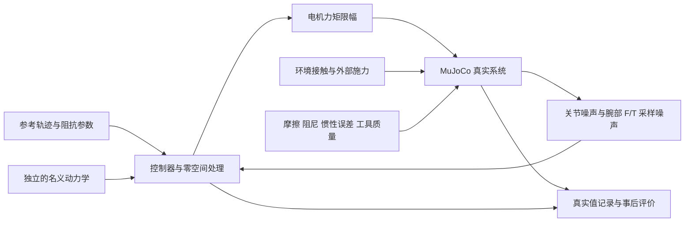

# 实现与论文的对应关系

状态：五种控制器和 A–F 场景已实现；137 次正式运行及 14 次物理步长减半运行均完成设定时长。13 项数学、闭环方程和反馈通道测试通过。工程运行通过不等于论文全部性能结论复现；C 组仍存在明显法向接触力振荡，详见 [结果](results/RESULTS.md) 与 [步长敏感性](results/SENSITIVITY.md)。

## 来源

1. Park, Park, Choi, *Nonlinear H-infinity Inverse-Optimal Impedance Control for Robotic Systems*, DOI: 10.1109/TRO.2026.3741518。本项目根目录的用户提供 PDF，特别是式 (39)、(50)–(62) 和第 VII 节。
2. Lee et al., *Bidirectional Energy Flow Modulation for Passive Admittance Control*, IEEE T-RO 40, 3917–3932, 2024, DOI: 10.1109/TRO.2024.3443690。用户提供的文件位于 `/home/suwenkang/下载/Bidirectional_Energy_Flow_Modulation_for_Passive_Admittance_Control.pdf`。采用式 (19)–(22)、(28)、(31)–(32)，补足主论文未展开的调制规则。

模型资源及其 Apache-2.0 许可证保留在 `franka_fr3/`。脚本在内存中生成场景和力矩执行器，不改写原模型。

## 控制律

- H∞：主论文式 (50)–(53)，保留参考速度科氏项；`gamma=0.1`，`K_gamma=diag(1000,1000,1000,50,50,50)`，`alpha=1`，F 组改为 0.25/0.5/1。
- 普通阻抗：式 (54)–(55)，使用计算力矩形式。
- NRIC 导纳：式 (56)–(57)，独立的虚拟七轴刚体模型，四阶 Runge–Kutta 积分，前馈名义力矩和关节 PID 反馈。
- 双向能量流导纳：式 (58)，惯量缩放 `lambda=1`，无名义重力项的 PD 虚拟模型；按来源 2 的分段规则调制 beta，并记录能量罐。`T_initial=T_max=1 J`、`T_min=0.05 J` 是本文档声明的参数选择，非主论文公布数值。直接积分 `T_dot=psi`，包含 beta 改变导致的储能跳变量，记录数值能量不足事件，不把负能量截为零来掩盖问题。
- 滑模阻抗：式 (59)–(62)，积分滑模面与 super-twisting；向量符号函数使用 `sigma/(norm(sigma)+0.001)`，不是逐分量 sign。B/D 的 K1 为 (50,50,40,40,40,40,40)，E 为 (30,30,25,25,25,25,25)，K2=0.1。

六轴对比控制器的关节增益扩展到七轴时，第七轴重复第六轴值。所有控制器共用该场景列出的参数、名义机器人、测量条件和物理力矩限制。但双向能量流按原文式 (58) 使用 `Mn=lambda*M_hat` 和 PD 虚拟控制器，Λ 不直接进入该控制律；其有效任务惯量随构型变化。因此，不能声称五种实现具有完全相同的有效任务惯量。没有为使曲线一致而另加未在原文给出的惯量整形。

## 冗余动力学与坐标

采用主论文的 `W=M_hat` 动态一致映射：

```
Pi = inverse(J inverse(M_hat) J.T)
Jplus = inverse(M_hat) J.T Pi
N = I - Jplus J
Gamma_p u = Jplus.T C(q,qdot) Jplus u - Pi Jdot Jplus u
```

W=M_hat 时，主论文式 (53) 中含零空间基导数的项在任务对角块的投影消失；科氏耦合仍存在，和论文讨论一致，不声称完全解耦所有动力学。零空间加入投影后的姿态弹簧与阻尼，姿态参考为 home，刚度 12、阻尼 4，并在需要时补偿零空间重力。

通过 RNE 的二次型极化计算标准 Christoffel 科氏矩阵与任意参考速度的乘积：

```
2 C(q,v) u = b(q,v+u) - b(q,v) - b(q,u) + g(q)
```

该计算不包含接触、摩擦或真实模型状态。测试使用独立的质量矩阵有限差分构造 Christoffel 符号进行验证，并检查 `Mdot=C+C.T`、任务空间对应恒等式、`J Jplus=I`、`J inverse(M) N.T=0`。

采用相对初始末端方向的 ZYX 欧拉坐标，避免 FR3 home 方向位于角度切口。物理角速度和欧拉角速度通过 E 转换，物理力矩通过 E.T 转为广义力，以保持功率一致性。坐标雅可比及其导数均被有限差分检查。遇到任务奇异性或欧拉图奇异性时记录终止，不静默切换为不同控制律。

## 真实系统与测量



控制器接收带噪的关节状态和经过校准、采样保持的 F/T 信号；真实状态只用于物理演化、外部环境和事后评价。

- 控制周期固定为 0.25 ms (4 kHz)，F/T 采样周期固定为 1 ms (1 kHz)，采样间保持；原文未滤波，默认不加力低通滤波。
- 原模型关节黏性阻尼 0.21，干摩擦分别为 (1.137,1.137,1.137,1.137,0.763,0.44,0.248)。仅物理模型有这些力，名义模型没有。
- 实际连杆质量和主惯量乘以 `1+0.10*sin(i)`，i=1…7；正比例缩放保留物理惯量约束。名义连杆参数保持原模型值。
- 物理工具质量 0.4 kg、长度 0.12 m、末端球半径 0.01 m。名义动力学不包含该质量。力传感器静态工具重力校准使用单独的校准质量 0.4 kg；工具惯性测量效应保留。
- 使用真实的腕部 force/torque 传感器，校验符号、重力校准与力矩参考点移动；不使用关节执行器力矩替代 F/T 信号。
- 关节位置、速度噪声标准差分别为 1e-5 rad、5e-4 rad/s；力/力矩噪声为 0.1 N、0.005 Nm。它们是声明的仿真假设，不是 FR3 实测标定值。随机数通道与种子固定。测量噪声进入控制器反馈，控制器不访问真实系统数据。
- 关节力矩限制为前四轴 ±87 Nm、后三轴 ±12 Nm。记录命令、施加力矩及饱和比例。

## A–F 场景

惯量、阻尼、刚度使用主论文的各组数值，保存在 `scenarios.py`。FR3 轨迹和几何尺寸是显式的跨平台适配，未冒称原论文未公开的精确轨迹。

- A：30 s ∞ 轨迹，平面范围 x=0…70 mm、y=±45 mm；五次时间标度保证起止速度、加速度为零。
- B/F：相同轨迹，固定墙面在 TCP 初始 x 的前方 60 mm（含工具半径后，TCP 在前移 50 mm 时接触）。接触落在轨迹中段；各控制器的实际开始/结束时间由响应决定。原文约 13–18 s 的时段只作为场景参考，不强行同步各控制器的真实接触。
- C：白板表面、凸起障碍和 `Fz_des=10+3 sin(t) N`，法向刚度为零。力命令通过反馈端口进入各比较控制器。
- D：35 s、两阶段旋转交互；在阶段间以虚拟人的弹簧阻尼手柄将滚转推进到约 90°。虚拟人的滚转刚度 300 Nm/rad、阻尼 8 Nm·s/rad，力矩限幅 18 Nm；yaw/pitch 脉冲标称幅度为 4/6 Nm。移动的手柄参考是外部能量输入，不能称为整个过程无源。10 组虚拟操作者参数 × 3 次随机重复，共 30 次/控制器、120 次仿真。不是 120 次真人试验。释放后实际姿态由控制器决定，记录第二阶段平均滚转角，不假设所有控制器都维持 90°。
- E：x 正弦运动及 z 下压，约 5 s 接触，目标位于表面以下 8 mm；附加 97/137/173 Hz 工具不平衡外力和 1.5 N 测量噪声。复现接触/振动条件，不模拟砂轮材料去除、磨粒断裂或热效应。

MuJoCo 采用软接触，默认 solref=(0.004,1)，solimp=(0.95,0.99,0.001)。需做物理子步长敏感性验证，不能把求解器数值振荡直接解释为控制器缺陷。

## 运行及证据

```
OPENBLAS_NUM_THREADS=1 python -m unittest discover -s tests -v
OPENBLAS_NUM_THREADS=1 python -m fr3imp --experiment B --controller hinf
OPENBLAS_NUM_THREADS=1 python -m fr3imp.suite --d-trials 30 --workers 4
```

完整矩阵为 137 个运行：A 3、B 5、C 3、D 120、E 3、F 3。每个运行输出参数、代码哈希、种子、时序、轨迹和指标。提前终止的比较必须保留，不删除不利结果；短时检查不能替代完整时长结果。

本次数据检查确认：17 个 30 s 运行各有 120000 个控制步和 30000 次 F/T 采样；120 个 35 s 运行各有 140000 个控制步和 35000 次 F/T 采样。没有数值终止、工作进程错误或能量罐负能量记录。统计按 1 kHz 保存样本计算，采样峰值和饱和比例不代表全部物理子步的精确极值/时长。

普通阻抗在 D 中约 16.94% 的日志样本触及至少一个关节的力矩限幅；其他三种 D 控制器没有记录到饱和。该差异影响比较的解释，不能把所有误差差异都归因于控制律本身。也不能从没有能量罐欠能量事件推导真实 FR3 的无源性。

场景预检查中，墙面原在 TCP 前移 62 mm 处，普通阻抗受摩擦和模型误差影响未触墙；公共墙面位置因此改为 50 mm。虚拟人原有 12 Nm 力矩限制也无法将普通阻抗控制下的 FR3 旋至 90°，因此统一采用上述 18 Nm 限制与更硬的握持。场景修正应用于所有控制器，不按控制器设置不同的接触几何或施力规则。各次真实施力仍随其运动响应而变化。

仿真期间不载入纯显示网格，以减少内存；碰撞几何和显式惯性参数保持一致。测试确认质量矩阵、偏置力与加速度在浮点误差范围内一致。回放时重新载入显示网格，保存的关节轨迹不变；半透明墙面只用于看清工具。

终止条件用于识别不再有效的仿真：非有限状态、奇异性、关节越界超过 0.05 rad、关节速度超过 15 rad/s、工具力超过 400 N。记录触发原因和时刻，不把终止计为稳定运行。
