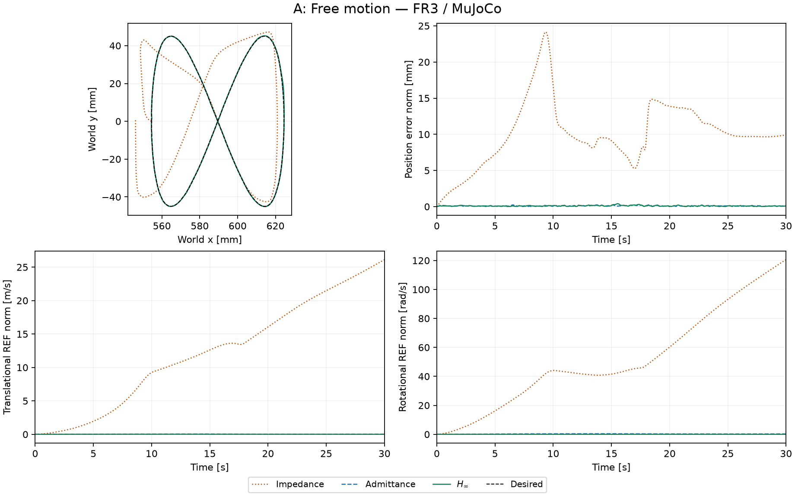
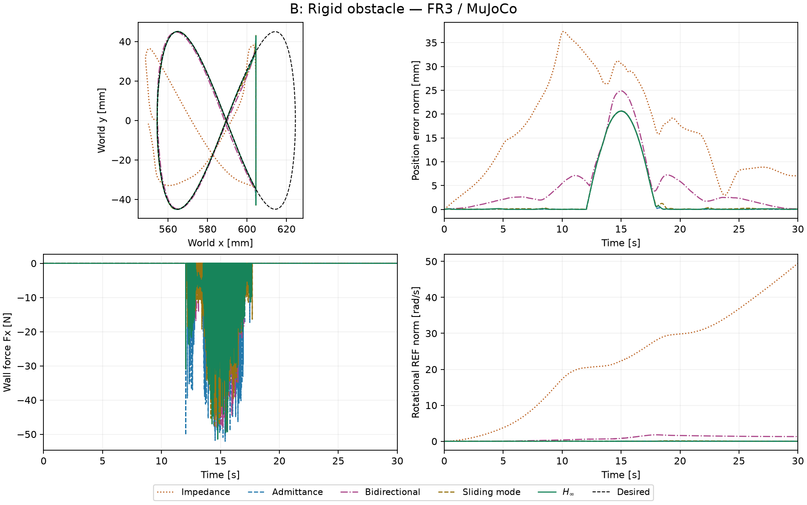
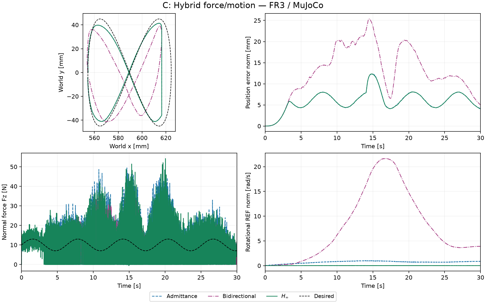
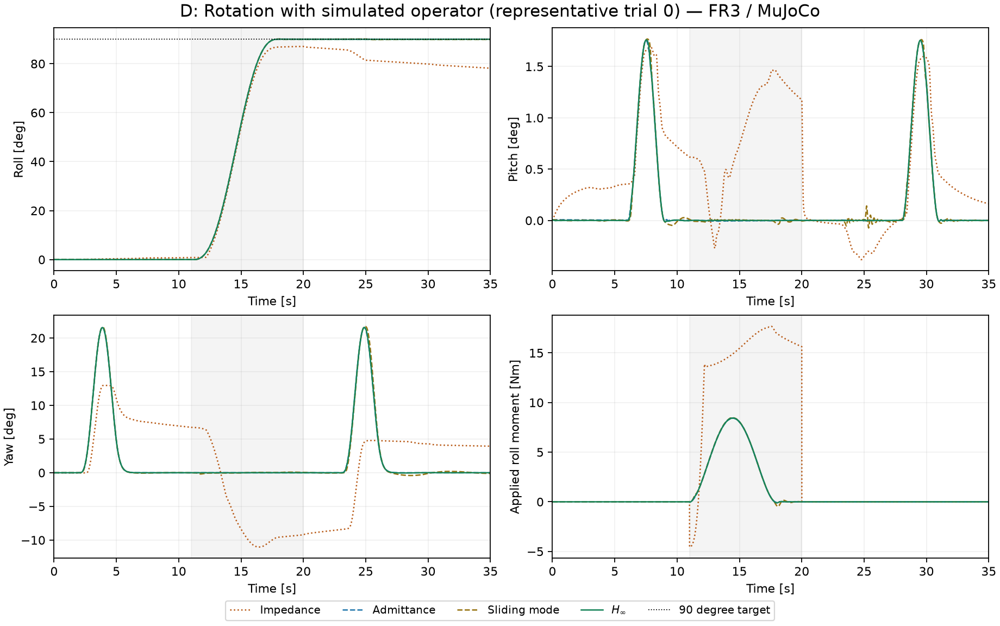
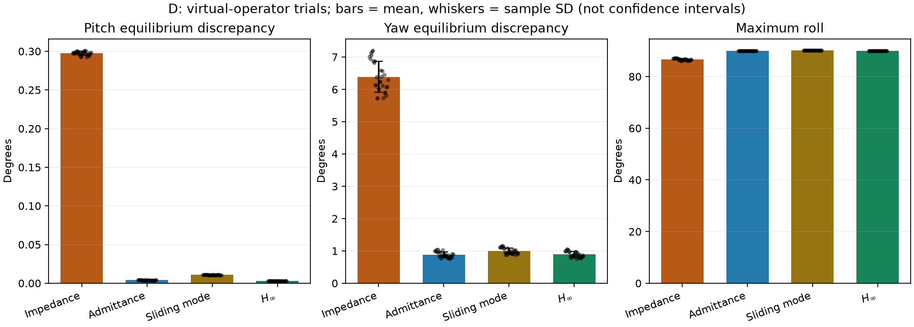
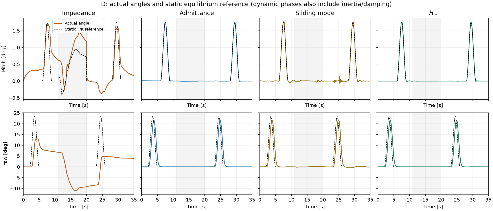
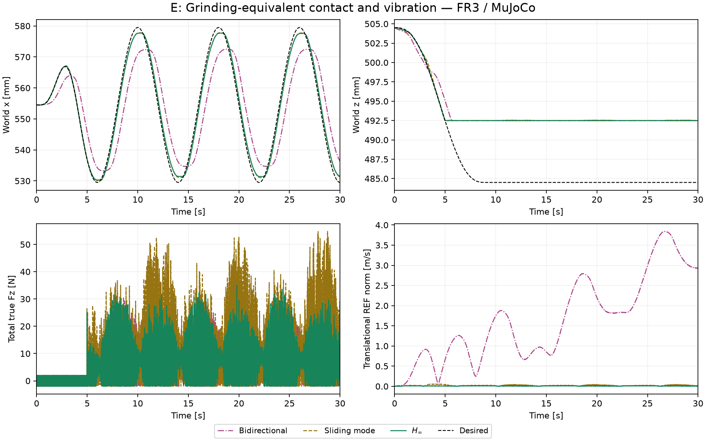
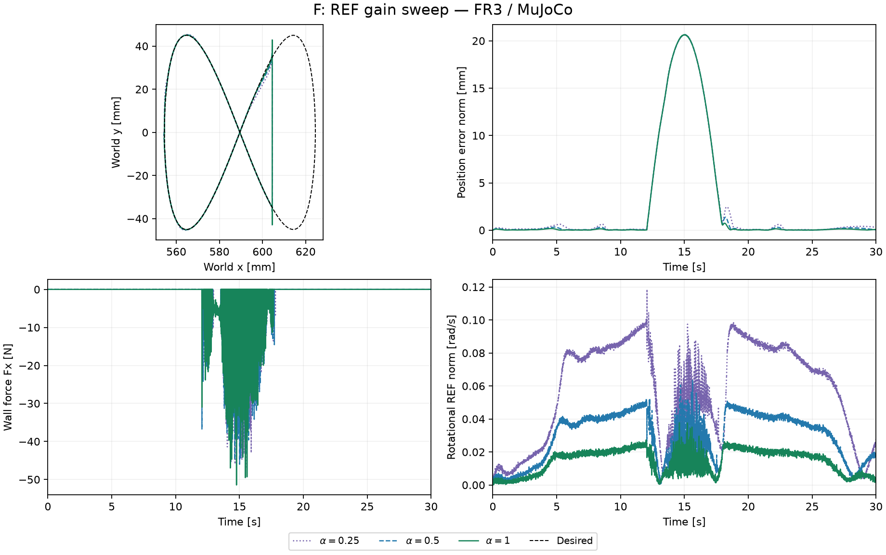

# FR3 仿真结果

> 历史 4 kHz 控制 / 1 kHz F/T 数据，保留原指标。当前 C 的 1 kHz 适配与验证见 [新报告](c-1khz/REPORT.md)。

运行数：137；状态：{'completed': 137}。
控制代码 SHA-256：`712eb339f605ef41bb259ef90f1199b77ea77062b6f3dae85d99b8ac46531fb3`。

来源为本项目生成的 FR3/MuJoCo 轨迹；不是论文 Indy7 实验数据。D 的重复是虚拟操作者参数与噪声种子变化，不是真人样本。

## 主要观察

- A 自由运动的位置 RMS：普通阻抗 11.030 mm，导纳 0.114 mm，H∞ 0.120 mm。
- **C 尚未复现原文的平滑法向力跟踪。** 导纳、双向能量流、H∞ 的力 RMS 误差分别为 9.622、8.805、9.551 N；当前模型和采样条件下接触力明显振荡。运行未终止并不代表这项性能验证通过。
- F 的 α=0.25/0.5/1 对应平移 REF RMS 为 0.03364 / 0.01708 / 0.00848 m/s；采样峰值力同时为 49.51 / 52.89 / 54.76 N，应同时考虑交互峰值与误差。这是同一种子的闭环观测，不是 H∞ 范数或理论无源性的证明。
- D 的普通阻抗平均有 16.94% 日志样本出现至少一轴力矩饱和，性能差异也受 FR3 执行器限制影响。其他控制器的饱和比例见总表。虚拟施力包含固定形状脉冲和滚转握持模型，不含真人复杂交互反馈。
- E 只验证下压接触和等效振动条件；未模拟磨粒、材料去除或热效应。

控制律、跨机器人适配和未公开参数的选择见 [实现说明](../IMPLEMENTATION.md)。步长对比见 [敏感性检查](SENSITIVITY.md)。

提前终止运行的指标仅涵盖终止前，不能与完整运行直接排名。完整参数和逐运行检查见 [metrics.json](metrics.json)。

|组|控制器|次数|完整完成|位置误差 RMS (mm)|参考误差 RMS (m/s)|采样峰值力 (N)|饱和样本比例|
|---|---|---:|---:|---:|---:|---:|---:|
|A|impedance|1|1|11.030|14.5610|0.00|0.00%|
|A|admittance|1|1|0.114|0.0326|0.00|0.00%|
|A|hinf|1|1|0.120|0.0096|0.00|0.00%|
|B|impedance|1|1|19.668|9.8781|50.32|0.01%|
|B|admittance|1|1|6.508|0.0133|54.94|0.97%|
|B|bidirectional|1|1|8.136|0.6085|53.35|0.18%|
|B|smc|1|1|6.506|0.0153|56.39|0.07%|
|B|hinf|1|1|6.507|0.0085|54.76|0.25%|
|C|admittance|1|1|6.371|0.0107|69.70|0.14%|
|C|bidirectional|1|1|14.238|5.5264|42.76|0.00%|
|C|hinf|1|1|6.361|0.0074|57.36|0.01%|
|D|impedance|30|30|2.138|15.2482|0.00|16.94%|
|D|admittance|30|30|0.026|0.1177|0.00|0.00%|
|D|smc|30|30|0.088|0.0258|0.00|0.00%|
|D|hinf|30|30|0.023|0.0046|0.00|0.00%|
|E|bidirectional|1|1|11.137|1.9634|36.98|0.00%|
|E|smc|1|1|7.233|0.0238|60.24|0.00%|
|E|hinf|1|1|7.232|0.0088|36.98|0.00%|
|F|hinf_0.25|1|1|6.520|0.0336|49.51|0.02%|
|F|hinf_0.5|1|1|6.510|0.0171|52.89|0.11%|
|F|hinf_1|1|1|6.507|0.0085|54.76|0.25%|

位置误差在接触任务中包含期望的柔顺位移，不宜单独作为阻抗好坏的排名。REF 使用控制器收到的带噪测量；静态平衡偏差也包含动态阶段的惯性和阻尼效应。

REF 是包含误差积分的参考速度差，不是实际末端速度。普通阻抗不使用该反馈，持续的小偏差会使这个积分指标积累到很大的数值。

图中轨迹来自 trial 0，每隔最多 5–6 ms 取点绘图；指标使用保存的全部 1 kHz 样本，未平滑。力峰值是已保存样本的最大值，不是所有 4 kHz 控制时刻或物理子步的全局最大值；饱和比例也是 1 kHz 样本估计。

## D 的旋转指标

表内为运行间均值 ± 样本标准差，单位为度。静态平衡偏差在完整动态时间段计算，不应解释为纯静态刚度误差。

|控制器|次数|Pitch 平衡偏差 MAE|Yaw 平衡偏差 MAE|最大滚转|第二阶段平均滚转|
|---|---:|---:|---:|---:|---:|
|impedance|30|0.2974 ± 0.0024|6.3875 ± 0.4762|86.6245 ± 0.3430|80.5471 ± 0.0498|
|admittance|30|0.0039 ± 0.0002|0.8850 ± 0.0878|90.0099 ± 0.0009|89.9997 ± 0.0015|
|smc|30|0.0107 ± 0.0002|0.9957 ± 0.0886|90.0945 ± 0.0048|89.9289 ± 0.0061|
|hinf|30|0.0029 ± 0.0002|0.8898 ± 0.0879|90.0242 ± 0.0011|89.9976 ± 0.0014|

## A

## B

## C

## D

D 统计图的误差棒是运行间标准差，不是置信区间。每三个运行共享同一虚拟操作者配置，不能视为 30 个独立真人。

## E

## F

## MuJoCo 回放

[B 组 H∞（两倍速）](B_hinf.mp4) · [D 组 H∞（两倍速）](D_hinf.mp4)

回放使用已保存的关节轨迹。B 的墙面仅在显示时设为半透明，便于看清工具。

