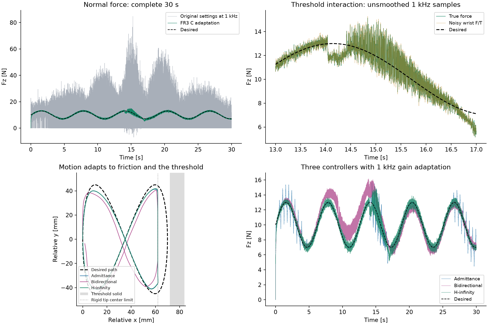

# C：FR3 1000 Hz 混合力/运动控制诊断

本轮已将 C 的大幅接触振荡压低，并在完整 30 s 白板/挡块任务中验证。**控制与传感器均为 1000 Hz**；物理积分默认 250 μs，每个控制周期保持同一力矩，只有一次反馈更新。保留论文的 Λ/D/K，以及本项目已有的关节摩擦、关节阻尼、模型误差、工具质量和噪声，未添加力滤波。

这属于 FR3 的采样率与接触模型适配，不是原论文参数原封不动的重跑。柔顺笔尖参数尚未实物标定，因此不能据此断言真实 FR3 已达到论文性能。



## 先看同一 1 kHz 条件下的消融

指标均来自 seed=100 的完整 30000 个样本，包含起始接触建立，无滤波、无删点。法向力采用物理接触真值；腕部测量误差另报在 JSON 中。限幅比例指至少一个关节命令超过电机力矩限制的控制周期比例。

|设置|法向力 RMSE (N)|限幅周期比例|
|---|---:|---:|
|原接触参数、原 H∞ α=1|10.9394|96.69%|
|只将 H∞ α 降至 0.25|9.7662|0%|
|只改柔顺接触，α 仍为 1|1.7391|96.88%|
|同时适配增益和接触|**0.4274**|**0%**|

旧的 4 kHz 控制 / 1 kHz F/T 配置重新运行得到 9.5512 N，与历史 C 结果一致。它与新的 1 kHz 旧参数基线 10.9394 N 是两个不同条件，不能混用。

## 问题在哪里

### 1. 论文连续时间增益不直接适合 FR3 的 1 ms 控制周期

名义 home 构型的 `Pi^-1 diag(1100,1100,1100,150,150,150)` 最大特征值约 2159 s⁻¹。冻结构型、忽略科氏项及误差的局部 REF 模型，其零阶保持反馈更新近似为 `s[k+1]=(I-dt Pi^-1 G)s[k]`。1 ms 下最快模态乘子约 -1.159，已在单位圆外；4 kHz 下该模态约 0.460。这里只是局部采样诊断，不能替代完整非线性闭环稳定性证明。

将 α 改为 0.25 后，同一局部最快模态乘子约 0.460，完整仿真不再触及限幅。期望阻抗矩阵 Λ/D/K 没有改，改变的是 REF 鲁棒反馈的收敛增益。

两种导纳的原关节 G 对 FR3 也过大：home 处 `M^-1 G` 最大特征值约 5398 s⁻¹。为避免让比较退化为不同程度的执行器限幅，二者共同将 G 乘 0.1，Kp/Ki 保持不变。该调整是有声明的 FR3 适配，不声称与论文原增益相同。

### 2. 原接触设置缺少论文实验的笔尖柔顺性

论文 VII-C 明确提到白板笔较软的笔尖。原场景用球形刚性工具配合很强的 MuJoCo 约束阻抗：`solref=(0.004,1)`、`solimp=(0.95,0.99,0.001)`。单纯缩小物理积分步长，或者只降低控制增益，都没有解决原接触振荡。

当前 C 共用 `solref=(0.04,1)`、`solimp=(0.5,0.5,0.001)`；白板、挡块与工具对所有控制器使用相同参数。摩擦系数保持 0.25。这是软笔尖/接触层的等效模型假设，**不是材料刚度和阻尼的实测值**，也不应把 solref 直接解释成 N/m。MuJoCo 的这些参数共同决定约束加速度与软接触响应，见 [官方求解器参数说明](https://mujoco.readthedocs.io/en/stable/modeling.html#solver-parameters)。

调整后的 H∞ 运行，板面等效压入量中位数约 1.05 mm、最大约 1.61 mm；应由实际笔尖的加载—位移数据验证此假设。30/40/50 ms 接触时间常数的邻域检查均保持低于 0.5 N 的全程力 RMSE，但这不是实物标定。

### 3. 摩擦和噪声会影响振荡，但不能用关闭它们代替修复

1 kHz 原设置下，单独关闭关节摩擦仍有 10.0475 N 力 RMSE；单独关闭全部测量噪声仍有 10.4284 N。关闭噪声的前 8 s 没有限幅，但完整 30 s 中限幅约 49.52%，说明噪声只是早期激励之一。

单独去掉接触滑动摩擦后，原配置误差降至 2.8439 N，但限幅仍约 97.56%。这支持“强接触约束与摩擦耦合”和“采样增益过强”是需要分开处理的两个因素；它不证明某个摩擦参数等于真实白板摩擦。

## 最终 30 s 结果与剩余误差

|控制器（同一柔顺接触及 1 kHz）|全程 Fz RMSE (N)|XY 路径 RMSE (mm)|限幅|
|---|---:|---:|---:|
|H∞，α=0.25|0.4274|6.2942|0%|
|导纳，G×0.1|0.6652|6.4912|0%|
|双向能量流导纳，G×0.1|0.9447|11.1008|0%|

XY 精确数值以 [metrics.json](metrics.json) 为准。路径误差包含横向摩擦造成的阻抗偏移及挡块阻挡后的主动让步，不能全归为跟踪失败。仅按准静态估算，10 N 正压力、μ=0.25、Kxy=400 N/m 就允许约 6.25 mm 的滑动摩擦位移量级；这个估算忽略动态项和摩擦方向变化。

H∞ 在 t≥1 s 的板面接触约束始终存在，没有用“力小于 1 N”代替几何脱离判断。真实挡块接触约为 14.036–16.482 s；原论文描述约 13–19 s，任务时序尚不完全一致。全程 Fz 采样峰值 15.154 N，去掉前 1 s 的力 RMSE 为 0.3868 N，挡块实际接触样本上的力 RMSE 为 0.9235 N。挡块阶段仍有波纹与转入/退出偏差，不能称为无误差复现。

本文没有论文原始数值数据，不能给出“与论文差多少 N”的可靠量化结论。目前复现了 H∞ 稳定跟踪、在挡块前让步、力误差小于两种导纳的趋势；普通导纳在当前 FR3 适配参数下也能稳定运行，没有复现论文中持续严重抖振的程度。

## 稳健性与数据校验

- 5 个噪声种子（100–104）：H∞ 全程力 RMSE 0.4261–0.4302 N，均无限幅。
- 物理积分 500/250/125 μs：全程力 RMSE 分别约 0.4290/0.4274/0.4297 N。控制和传感器始终是 1 kHz；单种子检查支持对这一区间步长不敏感，不等于严格收敛证明。
- 所有基础测量噪声标准差 ×2：0.6061 N；增加 1 个采样周期的 F/T 延迟：0.4296 N；二者均无限幅。
- 关节干摩擦与接触滑动摩擦同时 ×1.5：0.5079 N、无限幅；t≥1 s 中有 1 个日志样本没有板面约束，因此不声称所有扰动条件下都保持连续接触。
- 21 次正式运行全部完成 30 s；逐项检查了 630000 个保存样本的有限性、时序、力误差复算、限幅与实际施加力矩。完整配置、种子、代码哈希及逐项指标保存在 [metrics.json](metrics.json)。
- 15 项测试通过，包括动力学/控制方程测试、独立物理子步下的控制与传感器计数，以及包含挡块接触的 30 s C 回归。

[MuJoCo 轨迹回放（两倍速）](C_hinf.mp4) · [15 s 场景](scene_C.png)

## 重现

```bash
export OPENBLAS_NUM_THREADS=1
python -m fr3imp --experiment C --controller hinf --seed 100 --output outputs/c-single
PYTHONPATH=. python scripts/validate_c.py
PYTHONPATH=. python scripts/report_c.py
python -m unittest discover -s tests -v
```

`--c-profile legacy` 保留原增益与接触；`--control-period .00025 --physics-substeps 1 --c-profile legacy` 运行旧 4 kHz 条件。显式 `hinf_0.25`、`hinf_0.5`、`hinf_1` 覆盖配置中的 α。`--ideal` 关闭加入的模型误差、工具质量、关节摩擦/阻尼和噪声，但保留所选接触模型。

来源：用户提供主论文第 VII-C 节及图 8–9，[DOI 10.1109/TRO.2026.3741518](https://doi.org/10.1109/TRO.2026.3741518)；MuJoCo 官方求解器参数说明；本目录 JSON 中可检查的完整仿真配置与指标。笔尖、噪声与模型误差参数均是本项目声明的假设。

本轮运行代码 SHA-256：`ecc1b42b75defc15222176a46e406ef30665c4805e3054909e36b1730321137b`。
