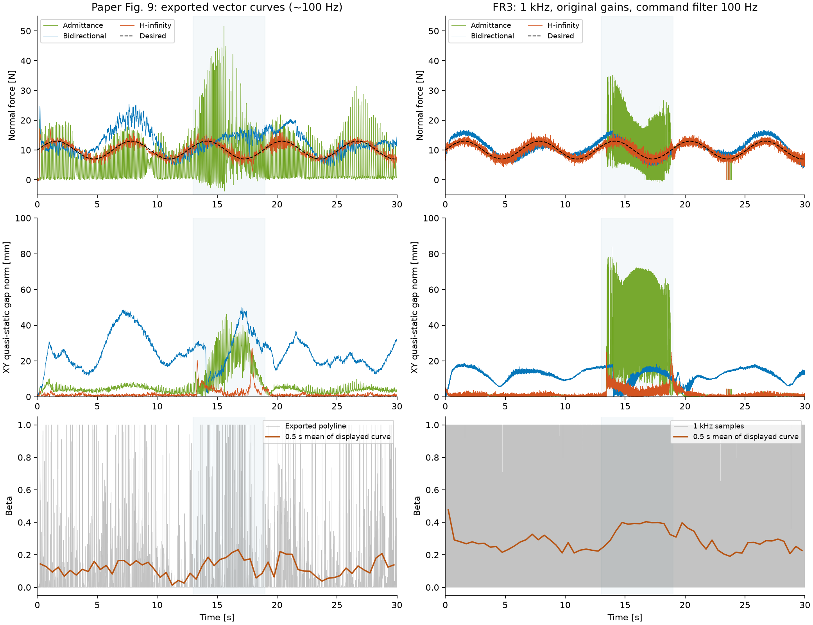
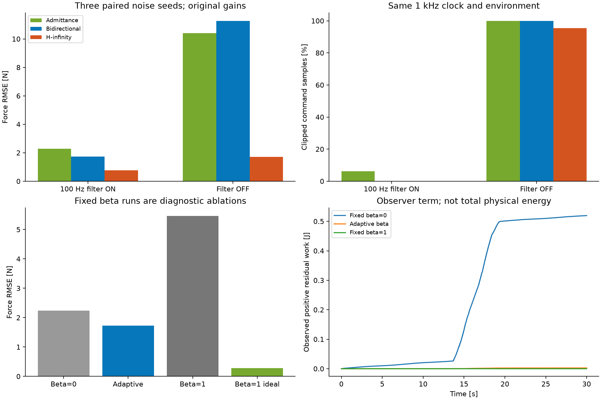

# C：论文性能差距与机制复现审计

**结论：部分优势和部分机制已复现，完整论文性能结论尚未复现。** 当前不能只凭 H∞ 的全程力 RMSE 最小宣称完成。恢复论文轨迹并使用论文原增益后，滤波开启分支呈现正确的全程误差排序；但普通导纳只在挡块阶段强烈振荡，4 kHz 诊断及低增益分支还会反转排序。这些反例直接限制了机制结论。

本轮正式矩阵共 **43 次完整 30 s 运行**，其中 40 次是用户指定的控制/传感器均 1000 Hz，3 次仅作为 4 kHz 控制、1 kHz F/T 的诊断。共校验 1,290,000 个 1 kHz 日志样本，20 项测试通过。另保存 80 次探索记录，包含两次虚拟积分提前终止；不同版本不合并计算优势。原默认紧凑场景与此前报告保留。

## 1. 论文对应程度

|项目|论文依据|本轮实现/结果|判断|
|---|---|---|---|
|期望运动|图 9 的原生矢量曲线|从中心出发，x/y 半幅 50/150 mm，30 s 走 1.25 周|绘图轨迹已恢复；绝对位置平移至 FR3|
|斜面与转角|图 8 的挡块、图 9 的适应轨迹|凸棱柱挡块；H∞ 接触约 13.45–19.27 s|时段接近；几何是图示估计|
|控制参数|C 的 α=1、γ=.1、Λ/D/K、原 NRIC 增益|正式主比较使用这些参数，第七轴重复最后一个腕部增益|跨机器人映射，未匹配原机内环带宽|
|普通导纳抖振|从开始到结束均有明显法向力抖振|主要集中于 13–19 s；1–5 s 的力 RMSE 仅 0.278 N，甚至小于 H∞ 的 0.647 N|**未匹配**|
|H∞ 的法向力跟踪|准确跟踪 10+3 sin(t) N|滤波开启时全程误差较低，无力矩限幅|该条件下成立；不是普遍优势|
|双向调制的阻抗偏差|稳定交互，但期望阻抗实现精度下降|XY 准静态关系偏差和力偏差均明显大于 H∞；固定 β 的消融支持补偿能力下降|部分机制得到支持，幅值和时序未匹配|
|β 在适应阶段接近 1|论文文字描述|源图为尖峰序列，绘图折线均值约 .15；仿真日志均值约 .36|不能用低分辨率图推断原始 β；未验证文字的时间统计含义|

源图通过 `pdftocairo` 转成 SVG 后提取，无人工描点。恢复的期望力与解析曲线 RMS 差约 0.003 N，轨迹相位的分块边界误差小于 0.0003 rad。恢复的是约 100 Hz 的**绘图折线**，并非作者原始 1/4 kHz 数据；未经公开的抽样/简化可能影响 RMS、频谱和 β 统计。

## 2. 原增益下：100 Hz 命令滤波开关

三种控制器共用接触、摩擦、阻尼、质量误差、噪声和力矩限制。实际控制/传感器均为 1000 Hz。以下是三个配对噪声种子 100/101/102 的均值，括号为最小–最大值；误差计算使用全程 1 kHz 真实法向力，无平滑。

|条件|H∞ 力 RMSE / N|普通导纳 / N|双向调制 / N|
|---|---:|---:|---:|
|命令滤波开启 100 Hz|**0.761** (0.750–0.770)|2.283 (2.270–2.305)|1.736 (1.726–1.751)|
|命令滤波关闭|1.718 (1.701–1.739)|10.399 (10.360–10.442)|11.272 (11.248–11.310)|
|论文图示折线，仅作参考|约 1.32|约 8.52|约 4.66|

**滤波关闭的原增益运行不可作为成功复现。** H∞、普通导纳、双向调制分别约有 95.38%、99.97%、99.98% 的日志周期发生至少一个关节力矩限幅。H∞ 的 Fz 误差看似较小，仍不能掩盖腕部力矩的高频限幅。滤波开启时三者限幅比例分别为 0%、6.19%、0%。

滤波开启时，H∞ 的平均全程 RMSE 相对普通导纳下降约 66.7%，相对双向调制下降约 56.1%。但是这一条件下的误差比约为 3.00:2.28:1，而源图约为 6.47:3.54:1；而且源图中的全程导纳抖振尚未出现。

seed 100 在 t≥1 s 的白板接触比例，H∞/普通导纳/双向分别为 99.976%/99.514%/100%。H∞ 仍有 7 个日志采样点短暂失去白板接触，不能表述为全程绝无脱离。

源图与仿真采样不同。为使这种差异可检查，另把 seed 100 仿真在源图折线时间戳处重采样，得到 H∞/普通导纳/双向调制 RMSE 约 **0.722/2.130/1.727 N**。这也不能恢复作者未公开的高频原始误差。所有指标同时保存在 `metrics.json`。

左列为恢复的论文绘图折线，右列为 seed 100 的 1 kHz 仿真；浅色区域是统一的 13–19 s 比较窗。β 的橙线是图中曲线的 0.5 s 分段平均，用于避免密集尖峰被视觉误读为持续处于 1；论文一侧仍不代表原始控制日志。

## 3. 哪些机制得到证据支持

**调制压低了观测到的内部正功率，同时削弱扰动补偿。** 同一双向控制器、同一环境，seed 100：

|调制方式|力 RMSE / N|挡块阶段 ≥20 Hz 力振荡 RMS / N|正残余观测功 / J|限幅比例|
|---|---:|---:|---:|---:|
|固定 β=0（消融）|2.235|4.654|0.519|5.72%|
|自适应 β|1.730|0.374|0.00249|0%|
|固定 β=1（消融）|5.461|0.223|0|0%|
|固定 β=1，理想模型/无噪声/无摩擦|0.277|0.0308|0|0%|

正残余功积分的是 `max((1-beta)*(Pe-beta*Pc),0)`。自适应分支的未消除部分由 μ/能量罐项记账，罐能量最低约 0.991 J（全部正式双向运行的最小值）。这里验证的是观测器的代数行为，**不是整个带滤波、采样和饱和系统的无源性证明**。H∞ 没有同样的虚拟模型功率观测器，日志的默认零值不能解释为它实际不注入能量。

β=1 时真实力矩严格退化为辅助 PD，补偿器系数为零；独立测试验证了这一点。去掉模型误差、工具惯量、摩擦、阻尼和噪声后，β=1 的力误差从 5.461 降至 0.277 N，说明原误差的大部分确实与无法补偿的非理想因素有关。该消融一次移除了多种因素，不能把全部改善都归因于关节摩擦。单独去除关节摩擦时，自适应双向分支从 1.730 降到 0.913 N。

XY 的准静态关系 `xi_xy + Fxy/400` 也显示这种差别。13–19 s 的向量均值模长，源图 H∞/普通导纳/双向约为 **0.35/15.48/18.35 mm**；仿真 seed 100 为 **0.30/0.22/6.65 mm**。H∞ 与双向的方向性差异出现了，但普通导纳的偏置和双向的幅度不匹配。准静态关系只是描述性诊断；动态惯性/阻尼项未被忽略为零，另独立积分完整 x/y 阻抗方程并保存残余指标。

## 4. 不能归入论文机制的差距

1. **采样、执行器相位与限幅是主要混杂因素。** 保持 FR3、接触、原增益和 1 kHz F/T 不变，仅使用 4 kHz 控制且关闭命令滤波，H∞/普通导纳/双向的 RMSE 为 **1.100/0.445/2.232 N**，三者均无日志限幅。普通导纳优于 H∞，没有复现论文原时序下的排序。
2. **关闭滤波并降低增益也会反转排序。** α=.25、NRIC G×.1 的 FR3 适配分支，三者为 **0.540/0.393/1.749 N**。这与旧紧凑轨迹的数字不同，原因是当前使用恢复的更大轨迹与转角障碍。
3. **普通导纳的振荡不是纯噪声。** 关闭所有测量噪声后，其全程 RMSE 仍为 2.247 N，挡块期 ≥20 Hz RMS 为 5.154 N，仍有力矩限幅；自由接触阶段则很平稳。理想模型、固定 β=0 也在挡块处振荡。这些现象不能直接证明连续控制结构就是唯一原因，因为采样和命令滤波仍在。
4. **摩擦同时提供耗散。** 单独关闭关节库仑摩擦，H∞ RMSE 反而从 .765 升至 4.920 N，并出现限幅；不能概括为“摩擦越少，所有控制器越好”。
5. **未知接触和延迟会改变结果。** 80 次探索包含更硬接触使三者一起振荡、额外摩擦抑制导纳振荡、1/2/4 ms F/T 延迟造成非单调结果等反例。没有为了得到论文排序而隐藏这些配置，也没有把探索中最有利的条件当作已标定实机参数。

由此，当前证据支持“1 kHz、特定共同接口下 H∞ 全程力跟踪更好”和“调制压制观测正功率但损失扰动补偿”两项较窄结论。它尚不支持“在 FR3 上完整复现了论文中持续导纳抖振及其全部形成机制”。

## 5. 修正与数值验证

- 从 PDF 恢复轨迹；挡块改为有转角的凸几何，H∞ 主接触窗由长挡板的约 13.45–20.10 s 缩短到 13.45–19.27 s。
- 修正用于审计的虚拟积分方法：RK4 阶段重新计算依赖虚拟 qn/vn 的补偿项，实际反馈、F/T、β 和实际力矩仍保持 1 ms。此前固定 β=1 在约 0.02 s 的虚拟发散是数值伪象；新实现完成完整 30 s。
- 物理步长从 250 μs 减至 125 μs，H∞/普通导纳/双向的力 RMSE 分别变化 **+0.19%/−3.44%/+0.16%**，主要排序和振荡时段未变。导纳非线性振荡的波形不宣称逐样本一致。
- 双向虚拟积分从每周期 4 步增至 8 步，RMSE 从 1.73033 变为 1.73016 N（约 −0.01%），时钟仍为 1000 Hz。
- 混合能量端口选择也影响结果：`net` 为 0.995 N，`physical` 为 1.730 N，`physical_exact` 为 1.728 N。作者没有公开 C 的这部分实现，不能擅自认定哪一个与作者代码完全相同。正式主比较使用源公式的物理外力约定，保留另两者作敏感性检查。
- 20 项测试包含名义控制方程、测量反馈隔离、功率对偶、时钟计数、混合能量恒等式、命令滤波解析解、β=1 退化性质及虚拟积分回归。验证输出见 `VALIDATION.txt`。

## 6. 可复核文件和下一步边界

- [来源、判据与具体假设](../../C_MECHANISM_AUDIT.md)
- [43 次正式配置和指标、原始轨迹 SHA256](metrics.json)
- [80 次探索记录索引](exploratory_index.json)：中间版本未全部提交，不能保证直接用当前代码逐个重跑；正式矩阵可重跑。
- [恢复的论文绘图折线](paper_curves.npz)
- [5 组代表运行的选定完整 1 kHz 曲线](selected_curves.npz)：保留时序、力、β、功率、罐能量、限幅、位置等；全部关节和其他原始量在本机 `outputs/c-mechanism`。
- [实际 MuJoCo 场景](scene_C.png)、[H∞ 30 s 回放（2 倍速）](C_hinf.mp4)。视频回放保存的关节轨迹，没有重跑控制器。

执行 `scripts/digitize_paper_c.py`、`scripts/validate_c_mechanism.py`、`scripts/report_c_mechanism.py` 可重建正式数据和图。重跑验证脚本会核对配置及运行时代码哈希后续用已完成结果。

接下来若要把“部分机制吻合”推进到完整的论文性能差距，需要约束原机与 FR3 的内环频率响应、命令处理、笔尖/接触柔顺性、摩擦及工具惯量；目前没有这些标定证据。100 Hz 单极点滤波只作用于 MuJoCo 总力矩，并非完整 libfranka/FCI 驱动补偿模型。继续任意搜索接触或扰动参数虽可改变排序，却不能据此证明形成机制与论文相同。此轮不把目标标为完成。
