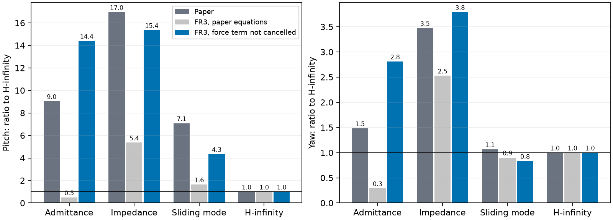
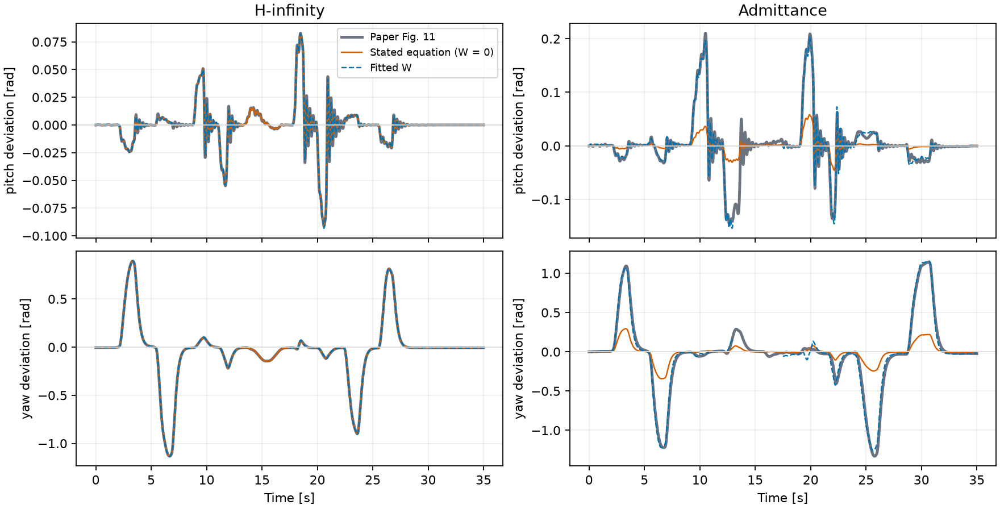
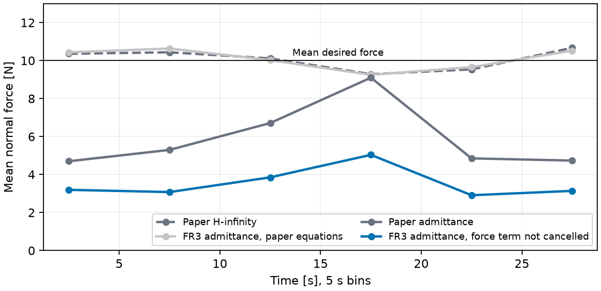

# D：论文导纳差距的原因

当前范围见 [AGENTS.md](../../../AGENTS.md)。这是诊断报告，`fr3v2`、默认操作者和控制器代码都没有改动。接在 [D 操作者报告](../d-operator/REPORT.md)之后。

共 36 次运行（trial 0，种子 100）。运行时代码 SHA256：`42eddc36272ee80e8e0f3511f699ac42530d3bd1ee8bcbeed2ab9114742522e7`。诊断版导纳关闭改动后，与 [D 操作者矩阵](../d-operator/REPORT.md)中同一次运行的姿态最大差为 0.0e+00。

**这是 FR3/MuJoCo 仿真加上从论文 PDF 恢复的曲线，不是作者的原始日志或代码。**

## 结论

**论文导纳的 D 响应不符合它写明的导纳方程，所以把仿真对象做得更逼真，不太可能弥合这个差距。** 用论文曲线辨识后发现，H∞ 符合 `Λẍ+Dẋ+Kx=m`，而导纳相当于多了一项力矩通路 `(I+W)m`。这一差距更可能来自导纳的实现，不太可能来自操作者或 FR3 与 Indy7 的差异。

在四种控制器上只改一处，即去掉方程 (54) 和名义输入里的 `-JᵀF`，就同时得到了以下结果：

- pitch 的相对排序和量级接近论文：普通阻抗 15.35 倍（论文 16.96）、导纳 14.39 倍（9.04）、SMC 4.34 倍（7.08）。
- H∞ 几乎不受影响（pitch .0014 rad，W≈0），也和论文一致。
- C 中导纳的平均力从 10.09 N 降到 3.54 N，H∞ 仍是 10.06 N。论文为 5.9 N 和 10.07 N，每 5 s 的起伏形状也相近。

与公开的 Indy7 模型核对后，这个解释通过了量级检验，但前提是名义模型不含转子惯量，而这一点未知；计入转子时，D 和 C 需要的系数互相矛盾（见[核对](#与-indy7-模型核对)）。结果还依赖所用的辨识参数组，所以这只是支持，不是确认。

**这不等于证明作者的代码缺了这一项。** 论文公式里有这一项，作者代码未公开。这里只能说，这个形式足以解释证据，而其他已测试的候选都不能。我也没有把它加入 `fr3v2`：它不是论文的控制器，加入后导纳虽然更差，却不再是对论文方法的公平验证。



每种控制器都用论文中自己那一列的力矩（×.6），这与论文的条件一致。

## 证据

- **直接从论文数据看：** Fig. 11 中 H∞ 的 |W|≤.15，按论文方程的 R² 已有 .98–1.00。导纳按论文方程的 R² 只有 −35–.47，加入 W 后升到 .88–.99。
- **yaw 的峰值：** yaw 是临界阻尼，线性响应不会超过 `m/K` 的峰值，而论文导纳约为 3.5 倍（误差 1.33 rad，`m/K` .385 rad）。论文把这种过冲归因于名义模型的惯性和阻尼，但仿真同样用 RK4 积分名义模型，W≈0，说明按写明的参数积分不足以产生这个量级。
- **W 跟着物理轴走：** Λ、D、K 在两个阶段都不变，但滚转 90° 后，论文的 W 从 pitch 4.44、yaw 2.61 变成 pitch 2.51、yaw 4.20，几乎互换。`W=ΛMx⁻¹` 预测了这种互换，恒定增益不能。
- **roll 只是旁证：** roll 的 Λ 是其他两轴的 5 倍，形式上 W 应当更大，第二阶段确实是 7.65，但第一阶段只有 1.59。两个阶段的 roll 力矩有效值都只有约 .55 Nm，不足以下定论。另一方面，转过约 90° 时（8–20 s），导纳的净冲量只有 1.83 Nm·s，H∞ 为 31.47 Nm·s，符合“所需力矩大幅减小”，但导纳这个净冲量的符号与运动相反，这一点没有解释。
- **C 的平均力不能来自抖振：** 论文方程在 z 向为 `Λz̈+Dż=F−Fd`，K=0，z 又贴着白板不会漂走，所以长时间平均力必须等于 Fd，与抖振无关。仿真按论文方程即使抖振（标准差 10 N），平均力仍是 10.09 N（Fd 10.08 N）。论文导纳只有 5.9 N，所以不是抖振造成的。这是我在运行前就写下的预测。



H∞ 与论文方程重合；导纳偏离方程，加入拟合的 W 后才吻合（13–17.5 s 的滚转过渡不参与拟合）。

|论文 Fig. 11|峰值力矩 / Nm（roll / pitch / yaw）|第一阶段 W（roll / pitch / yaw）|R²：方程 → 拟合|第二阶段 W|R²：方程 → 拟合|
|---|---:|---:|---:|---:|---:|
|导纳|3.5 / 11.7 / 3.9|1.59 / 4.44 / 2.61|-0.11 / 0.33 / 0.47 → 0.90 / 0.98 / 0.99|7.65 / 2.51 / 4.20|-35.05 / 0.46 / 0.34 → 0.88 / 0.96 / 0.99|
|普通阻抗|5.3 / 12.9 / 9.1|0.27 / 6.96 / 0.89|0.03 / 0.17 / 0.29 → 0.96 / 0.81 / 0.41|3.34 / 3.67 / 2.66|-39.59 / 0.29 / 0.12 → 0.98 / 0.81 / 0.39|
|SMC|11.4 / 14.9 / 9.6|1.25 / 2.62 / 0.32|0.51 / 0.51 / 0.93 → 0.83 / 0.81 / 0.96|-0.21 / 0.83 / 0.51|0.71 / 0.45 / 0.65 → 0.92 / 0.56 / 0.74|
|H∞|15.0 / 18.1 / 12.2|-0.15 / -0.01 / 0.00|0.98 / 0.99 / 1.00 → 0.99 / 0.99 / 1.00|0.10 / 0.01 / 0.00|0.99 / 1.00 / 1.00 → 1.00 / 1.00 / 1.00|

导纳 roll 的力矩很小（两个阶段有效值约 .55 Nm），这一项的 W 不可靠。普通阻抗 yaw 被摩擦卡住，线性拟合 R² 只有约 .4。

## 候选机理

输入均为 Fig. 11 的 H∞ 力矩 × .6，只看导纳。`W` 依次为 roll / pitch / yaw。

|候选|状态|第一阶段 W|第二阶段 W|pitch / rad|yaw / rad|
|---|---|---:|---:|---:|---:|
|基线（论文方程）|跑完|-0.00 / 0.00 / -0.00|-0.00 / -0.00 / -0.00|0.0013|0.074|
|软内环 G×.3|跑完|-0.01 / 0.01 / 0.00|-0.01 / -0.01 / -0.00|0.0014|0.074|
|软内环 G×.1|跑完|-0.03 / 0.05 / 0.00|-0.03 / -0.02 / -0.00|0.0021|0.074|
|软内环 G×.03|跑完|-0.12 / 0.17 / 0.00|-0.11 / -0.08 / -0.01|0.0050|0.076|
|F/T 延迟 20 ms|跑完|-0.00 / 0.00 / -0.00|-0.00 / -0.00 / -0.00|0.0013|0.074|
|代理力矩恒定 ×4|终止（22.8 s）|3.36 / 2.90 / 2.57|2.99 / 2.98 / 3.01|0.0291|0.271|
|未抵消力通路|终止（3.0 s）|53.45 / 5.12 / -22.16|—|0.0148|0.416|

未抵消力通路这一行只有 3 s 数据，W 不可用。

用导纳自己那一列的力矩时，未抵消力通路的 W 为第一阶段 23.92 / 4.12 / 5.80（该运行的 `ΛMx⁻¹` 为 19.90 / 3.94 / 5.56），第二阶段 18.81 / 5.75 / 5.31（16.41 / 5.69 / 4.39）。对角项基本恢复了已知真值，说明这个辨识方法可靠。

排除依据：

- **软内环和关节柔性：** 串联柔度会在 `m/K` 上叠加一个与 K 无关的偏差。要达到论文的响应，yaw 需要约 3 Nm/rad、pitch 需要约 65 Nm/rad 的串联刚度，两者差 20 倍，而论文腕部内环的等效刚度约为 12000 Nm/rad（`G·Kp`）。仿真把 G 降到 ×.03 时 W 也只有 .17。没有在仿真中单独建模关节柔性，这一项的排除依靠这个估算。
- **F/T 延迟和滤波：** 延迟 20 ms 后 W 仍为 0。论文也写明力信号未滤波。
- **恒定力矩增益：** W 在三个轴和两个阶段都约为 3，没有互换。
- **操作者：** 公式右侧本来就是测得的力矩，所以人的施力方式不影响从 m 到 x 的映射。
- **关节摩擦（针对普通阻抗）：** 仿真基线的 pitch W 为负（−.83、−.41），摩擦在这里只会减小偏差。论文普通阻抗 pitch 的 W 为 +6.96、+3.67，方向相反。

## 四种控制器

|控制器|论文倍数 pitch / yaw|FR3 论文方程|FR3 未抵消力通路|FR3 未抵消力通路：pitch / rad，yaw / rad，限幅|
|---|---:|---:|---:|---:|
|导纳|9.04 / 1.48|0.50 / 0.29|14.39 / 2.81|0.0202，0.211，3.45%|
|普通阻抗|16.96 / 3.47|5.36 / 2.53|15.35 / 3.79|0.0215，0.285，0.00%|
|SMC|7.08 / 1.07|1.64 / 0.90|4.34 / 0.83|0.0061，0.063，0.00%|
|H∞|1.00 / 1.00|1.00 / 1.00|1.00 / 1.00|0.0014，0.075，0.13%|

论文折算到 × 0.6 后，导纳 pitch .0130 rad、yaw .105 rad。H∞ 这一行用 H∞ 那一列的力矩。

## C 和 B



|C 平均力 / N|平均|标准差|每 5 s 平均|
|---|---:|---:|---:|
|论文导纳|5.90|7.06|4.7 / 5.3 / 6.7 / 9.1 / 4.8 / 4.7|
|论文 H∞|10.07|2.50|10.4 / 10.4 / 10.1 / 9.3 / 9.5 / 10.7|
|FR3 导纳，论文方程|10.09|10.03|10.4 / 10.6 / 10.0 / 9.3 / 9.7 / 10.5|
|FR3 导纳，未抵消力通路|3.54|7.81|3.2 / 3.1 / 3.9 / 5.0 / 2.9 / 3.1|
|FR3 H∞，论文方程|10.06|3.75|10.3 / 10.8 / 9.8 / 9.3 / 9.9 / 10.2|
|FR3 H∞，未抵消力通路|10.06|3.70|10.2 / 10.8 / 9.8 / 9.3 / 9.9 / 10.2|

期望力平均 10.08 N。FR3 的 z 向 Mz=4.2 kg，预测比例 0.30，实际 0.35。论文曲线来自约 10 ms 一点的矢量线。

|B 或 A|论文方程：峰值力 / N，平衡偏差 / mm|未抵消力通路：峰值力 / N，平衡偏差 / mm|
|---|---:|---:|
|B 导纳|101.6，10.7|106.8，9.4|
|B 普通阻抗|32.6，72.4|12.9，73.0|
|B SMC|74.9，4.1|37.3，3.3|
|B H∞|72.0，3.0|43.8，2.7|

A 是自由运动，不受影响：导纳位置 RMS 0.39 → 0.45 mm，普通阻抗 48.64 → 48.65 mm。

## 与 Indy7 模型核对

用 [Tadese 等 2022](https://pmc.ncbi.nlm.nih.gov/articles/PMC9783800/) 的 DH 表和基参数计算 `J M⁻¹ Jᵀ`，不需要 URDF。A2 的数值已对照原文。A1 的线性组合用随机全参数验证，与 DH 表一致（M 的最大差约 5e-4，来自表中常数的舍入）。D 的姿态按 Fig. 10 取工具朝下、再绕 x 滚转 −90°，并扫描 TCP 位置、工具长度和 ±15° 倾角，共 346 个。

|`Mx⁻¹` 对角项|第一阶段 pitch|第一阶段 yaw|第二阶段 pitch|第二阶段 yaw|第二阶段 roll|四项 ±20% 的姿态数|C 的 Mz / kg|
|---|---:|---:|---:|---:|---:|---:|---:|
|**论文导纳隐含值**|**11.09**|**6.52**|**6.26**|**10.50**|**3.83**|—|**9–14**|
|conventional_cold，不计转子|11.28|6.50|6.58|6.25|7.74|43|6.2|
|conventional_cold，计入转子|2.65|1.79|1.97|1.58|2.10|0|8.2|
|conventional_hot，不计转子|12.60|9.54|9.68|6.00|9.52|0|6.4|
|conventional_hot，计入转子|2.67|1.94|2.20|1.74|2.17|0|8.9|
|proposed_cold，不计转子|11.25|14.40|14.98|4.84|10.07|0|6.6|
|proposed_cold，计入转子|2.46|1.76|2.09|1.68|1.99|0|8.7|
|proposed_hot，不计转子|11.40|15.63|16.11|5.35|10.22|0|6.3|
|proposed_hot，计入转子|2.59|1.80|2.17|1.81|2.08|0|8.3|

模型列为姿态扫描的中位数。Mz 沿 C 的轨迹计算，高度未公开，取 .1–.2 m；关节 1、2 的转子惯量在基参数中分不开，所以“不计转子”只去掉关节 3–6 的项。

|参数组|D 需要的 c（四项，不含 roll）|C 需要的 c|
|---|---:|---:|
|conventional_cold，不计转子|0.98 / 1.00 / 0.95 / 1.68|0.56–0.84|
|conventional_cold，计入转子|4.19 / 3.65 / 3.18 / 6.65|0.75–1.12|
|conventional_hot，不计转子|0.88 / 0.68 / 0.65 / 1.75|0.58–0.87|
|conventional_hot，计入转子|4.16 / 3.35 / 2.84 / 6.04|0.81–1.21|
|proposed_cold，不计转子|0.99 / 0.45 / 0.42 / 2.17|0.61–0.90|
|proposed_cold，计入转子|4.51 / 3.71 / 2.99 / 6.25|0.79–1.18|
|proposed_hot，不计转子|0.97 / 0.42 / 0.39 / 1.96|0.58–0.86|
|proposed_hot，计入转子|4.29 / 3.61 / 2.88 / 5.80|0.76–1.14|

C 的 c 由力比例 0.49–0.58 算出（高值是全程，低值去掉接触门槛所在的 15–20 s），并按仿真标定：FR3 已知 c=1 时，同样的算法得到 0.78。

- **量级通过。** 不计转子时，隐含的 `Mx⁻¹` 与模型同一量级，`conventional_cold` 在第一阶段 pitch、yaw 和第二阶段 pitch 上相差不到 5%。
- **计入转子时 D 和 C 对不上。** 四组参数在 D 都需要 c≈2.8–6.7，在 C 却只需要 c≈.75–1.21，范围完全不重叠。不计转子时两者有重叠：D 为 .39–2.17（`conventional_cold` 为 .95–1.68），C 为 .56–.90。所以这个形式只有在名义模型不含转子惯量时才说得通。
- **不利之处：结果依赖参数组。** 四组辨识值的 Izz6 从 .065 到 .157，差 2.4 倍。只有 `conventional_cold` 有姿态同时满足四项 ±20%（346 个中的 43 个），其余七个模型都没有。从八个模型里挑最好的一个有选择偏差。
- **不利之处：有两项对不上。** 即使用 `conventional_cold`，第二阶段 yaw 也需要 c=1.68，第二阶段 roll 需要 c=.49。roll 的力矩太小，但 yaw 没有这个理由。Fig. 10 的姿态只知道大致形状，这也可能是原因。
- **关键假设没有验证。** 论文没有说明名义模型 `M̂` 是否包含转子惯量。如果包含，`c=1` 的形式就不成立。参数也来自另一个实验室的另一台 Indy7。论文写明 F/T 传感器和工具未建模，所以这里也没有加入它们。

## 不确定之处

- **系数和 Mx 分不开。** 数据只能给出 `W=c·Λ·Mx⁻¹`。取 c=1 时，论文 pitch、yaw 对应的 Mx 约为 .09–.16 kg·m²。与 Indy7 模型的核对见上一节，能否确定仍取决于作者的代码或日志。
- **绝对值不一致。** FR3 的 Mx 与 Indy7 不同：z 向只有 4.2 kg，因此导纳的绝对偏差和力偏差不会与论文相同。导纳 pitch .0202 rad、yaw .211 rad，高于论文折算值 .0130 和 .105；力比例 .35，也低于论文 .59。
- **yaw 倍数偏差较大。** 导纳 2.81 倍（论文 1.48），SMC .83 倍（1.07），排序中 SMC 与 H∞ 互换。
- **交叉项不能作证据。** 理论上 `Mx⁻¹` 应当对称，但论文 W 的交叉项并不对称。仿真里已知真值时，这个方法同样恢复不了交叉项，所以这一项既不支持也不否定假设。
- **B 的急停和紧握失稳仍未解释。** B 中未抵消力通路没有引发急停（导纳峰值 106.8 N，基线 101.6 N），H∞ 的接触峰值反而从 72.0 N 降到 43.8 N。A 不受影响，这与论文一致。F 没有测。
- **用 H∞ 的力矩时会提前终止。** 导纳 3.0 s 终止，普通阻抗 22.8 s 终止，所以倍数只按各用自己那一列的力矩计算。s=.3 的导纳也在 23.0 s 终止。这与论文中导纳的力矩明显更小（yaw 3.9 Nm，H∞ 12.2 Nm）一致。
- **证据范围。** D 只有每种控制器的一次代表性试验（数字化结果与 Fig. 12 的 30 次均值接近），C 的矢量曲线约 10 ms 一点，可能丢失短促尖峰。候选列表在运行前写定，但是在看过论文辨识结果之后写的。

## 对复现的含义

- **对这次复现：** D 中导纳的 ×9 不应当作复现目标，也不宜在仿真里调出来。按论文公式实现时，导纳在 FR3 上接近理想响应，这就是当前的如实结果。
- **对论文方法的优越性：** H∞ 的两项优势保持成立：在实测力矩下响应符合设定的阻抗；D 和 C 的结果在这个力项和摩擦变化下都基本不变。但“H∞ 明显优于按论文公式实现的导纳”这一点，D 的这组数据不能支持，也没有否定，因为差距可能来自实现而不是因果结构。仿真中按论文公式实现的导纳略优于 H∞，但这个对象没有关节柔性等非理想因素。

## 重跑

```bash
.venv/bin/python scripts/digitize_paper_c.py
OPENBLAS_NUM_THREADS=1 PYTHONPATH=scripts .venv/bin/python scripts/validate_d_admittance.py --workers 8 --resume
OPENBLAS_NUM_THREADS=1 PYTHONPATH=scripts .venv/bin/python scripts/check_indy7_inertia.py
OPENBLAS_NUM_THREADS=1 PYTHONPATH=scripts .venv/bin/python scripts/report_d_admittance.py
```

[机器可读结果](metrics.json) · [测试记录](VALIDATION.txt)
