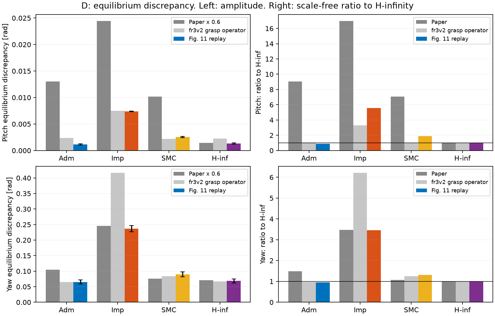
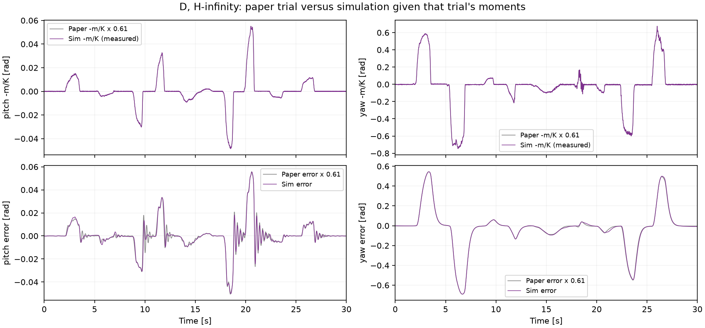
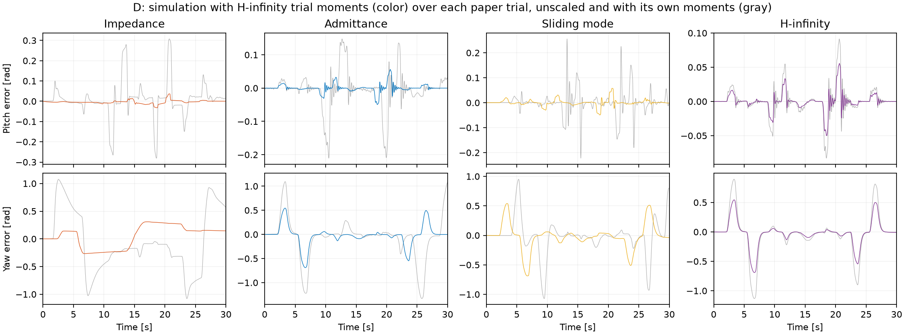

# D：用论文 Fig. 11 的实测力矩作为操作者输入

当前范围见 [AGENTS.md](../../../AGENTS.md)。这里只改 D 的操作者，其余沿用 `fr3v2`。[`fr3v2` 原有的 D 结果](../reproduction-fr3v2/REPORT.md)和默认操作者都没有改动。

共 171 次运行（4 种控制器各 30 次 + 固定敏感性检查），其中 169 次跑完，其余提前终止并保留。运行时代码 SHA256：`42eddc36272ee80e8e0f3511f699ac42530d3bd1ee8bcbeed2ab9114742522e7`。

**这是 FR3/MuJoCo 仿真，输入取自论文图中的一次试验，不是真人交互，也不是作者的原始日志。**

## 结论

换成论文实测输入后，D 的趋势比原操作者更接近论文：yaw 上普通阻抗与 H∞ 的倍数几乎相同，pitch 上 SMC 也开始明显差于 H∞。但论文最强的 pitch 优势仍只复现了一部分，**导纳的恶化完全没有出现**。这个差距已经不能归咎于操作者。

- **yaw：** 普通阻抗是 H∞ 的 3.45 倍，论文 3.47 倍（原操作者 6.21 倍）。SMC 1.31 倍，论文 1.07 倍。H∞ 与普通阻抗的幅值也与按比例缩放的论文值接近。不过普通阻抗的倍数不是定值：trial 0 上摩擦 ×1 时 2.41 倍、×3 时 3.25 倍，加入握持后超过 4 倍，所以与 3.47 几乎相同有一定巧合。
- **pitch：** SMC 是 H∞ 的 1.90 倍（原操作者 .98 倍），普通阻抗 5.56 倍（原操作者 3.32 倍）。方向对了，但比论文的 7.08 倍和 16.96 倍小得多。
- **导纳：** pitch 为 H∞ 的 .87 倍（论文 9.04 倍），yaw 为 .95 倍（论文 1.48 倍）。它在两个轴上都略优于 H∞，这与论文相反。
- **为什么操作者解释不了导纳：** 同样的力矩下，仿真导纳的 pitch 阻抗偏差只有 .0002 rad，几乎就是理想阻抗响应。用论文导纳那一列自己的力矩时，yaw 偏差只有 .0225 rad，而论文 Fig. 12 按 .6 折算后约 .105 rad。论文中该次试验的 yaw 误差峰值（1.33 rad）约为 `m/K` 峰值（.385 rad）的 3.5 倍，而线性的临界阻尼响应不会超过 `m/K` 的峰值。这个差距的后续诊断见[导纳差距报告](../d-admittance/REPORT.md)：论文导纳不符合它写明的方程，差距更可能来自实现，不太可能来自仿真对象。
- **稳健性有新证据：** 关节摩擦从 ×1 增加到 ×3.5（trial 0），H∞ 的 pitch 偏差只从 .0013 变到 .0015 rad，SMC 从 .0014 变到 .0031，普通阻抗从 .0043 变到 .0084。SMC 与 H∞ 的差距随摩擦拉开，而摩擦 ×1 时两者几乎相同，所以这一差距依赖 ×3 这个未标定的假设。

矩阵运行前写定的 11 条判据通过 7 条。未通过：

- 导纳的 pitch 偏差至少是 H∞ 的 2 倍（论文约 9 倍）
- SMC 的 pitch 偏差至少是 H∞ 的 4 倍（论文约 7 倍）
- 普通阻抗的 pitch 偏差至少是 H∞ 的 10 倍（论文约 17 倍）
- H∞ 的 yaw 偏差最小

## 操作者模型

- **力矩：** 使用从 Fig. 11(d) 数字化的 H∞ 这次试验的 `m_x`、`m_y`、`m_z`，以开环方式加到四种控制器上，因此每次试验的输入对所有控制器完全相同。没有人为添加事件，交叉轴力矩和不规则时序都来自原图。
- **幅值：** 乘以 .6。论文 pitch 力矩峰值 18 Nm，超过 FR3 腕部 12 Nm 的限幅。这个比例只根据 H∞ 的运行确定：在系数 1.02 的 trial 0 上，.7 能跑完，.8 就提前终止（第 5 关节超限）。操作者系数理论上限 1.26，.6 × 1.26 = .76 仍低于失败的 .8，所以取 .6；实际 30 次的最高系数是 1.07。这样 trial 0 的 pitch 峰值约 11 Nm，比论文小，这是 FR3 力矩能力决定的，不是论文条件。选择时没有看控制器之间的差距。
- **滚转：** K=0，开环力矩到不了 90°，所以 13–17.5 s 改用闭环引导。之后没有被动支撑，第二阶段滚转均值约 83°，论文四次试验均值约 72°–82°。
- **方向：** 关于 x-z 平面镜像，滚转仍为 +90°，与原操作者一致；论文的滚转方向相反。这一点没有单独做敏感性检查。
- **重复：** 沿用 10 组操作者系数 × 3 次的方案，但只有幅值和噪声变化。这不等于十名真人的差异，论文中真人还会根据手感调整施力。

## 平衡偏差

全部为测量 F/T 口径，时间平均后取 30 次均值。“论文 × 0.6”只用于比较量级：各次试验还乘以操作者系数（0.78–1.07，均值 0.90），实际平均输入约为论文的 0.54 倍。与量级相比，相对 H∞ 的倍数不受这个比例影响，更适合比较。

|指标（导纳 / 普通阻抗 / SMC / H∞）|论文|论文 × .6|`fr3v2` 原操作者|Fig. 11 回放|
|---|---:|---:|---:|---:|
|pitch / rad|0.0217 / 0.0407 / 0.0170 / 0.0024|0.0130 / 0.0244 / 0.0102 / 0.0014|0.0024 / 0.0075 / 0.0022 / 0.0023|0.0012 / 0.0074 / 0.0025 / 0.0013|
|pitch 相对 H∞ 的倍数|9.04 / 16.96 / 7.08 / 1.00|—|1.06 / 3.32 / 0.98 / 1.00|0.87 / 5.56 / 1.90 / 1.00|
|yaw / rad|0.175 / 0.410 / 0.126 / 0.118|0.105 / 0.246 / 0.076 / 0.071|0.065 / 0.417 / 0.083 / 0.067|0.065 / 0.237 / 0.090 / 0.069|
|yaw 相对 H∞ 的倍数|1.48 / 3.47 / 1.07 / 1.00|—|0.97 / 6.21 / 1.24 / 1.00|0.95 / 3.45 / 1.31 / 1.00|



|控制器|完整/总数|pitch / rad|yaw / rad|pitch 阻抗偏差 / rad|yaw 阻抗偏差 / rad|第二阶段 roll / °|限幅|
|---|---:|---:|---:|---:|---:|---:|---:|
|导纳|30/30|0.0012 ± 0.0001|0.0653 ± 0.0065|0.0002|0.0006|82.9（81.6–83.8）|0.20%|
|普通阻抗|30/30|0.0074 ± 0.0001|0.2370 ± 0.0102|0.0076|0.2201|84.9（83.8–85.7）|12.70%|
|SMC|30/30|0.0025 ± 0.0001|0.0898 ± 0.0082|0.0025|0.0273|82.3（81.3–83.2）|0.12%|
|H∞|30/30|0.0013 ± 0.0001|0.0686 ± 0.0066|0.0009|0.0044|82.8（81.6–83.7）|0.14%|

± 是 30 次之间的样本标准差。这 30 次共用同一条力矩曲线，只是幅值和噪声不同，所以离散程度明显小于真人试验，不能当作置信区间。

普通阻抗的 12.70% 限幅不是偏差的原因。在 trial 0 上，它全部落在 13.67–17.5 s 的滚转引导段，是第 5 关节达到 12 Nm 限幅；这段的 yaw 偏差（.216 rad）并不高于其余时段（.255 rad）。



灰线是论文 H∞ 这一次试验按比例缩放并镜像后的结果，彩线是仿真。



灰线是论文四次试验，未缩放，且各用各的力矩；彩线是仿真，四种控制器用同一条 H∞ 力矩，因此两者只能看形态。

## 判据

判据写在这个矩阵跑完之前，但写在单次探索之后，阈值并非独立于已看到的结果。

|判据|结果|
|---|---:|
|四种控制器 120 次全部跑完|✓|
|pitch 和 yaw 的平衡偏差都是普通阻抗最大|✓|
|SMC 的 pitch 偏差至少是 H∞ 的 1.5 倍|✓|
|H∞ 的 pitch 偏差在论文值 × 输入比例的 ±30% 内|✓|
|H∞ 的 yaw 偏差在论文值 × 输入比例的 ±30% 内|✓|
|普通阻抗的 yaw 偏差在论文值 × 输入比例的 ±30% 内|✓|
|无滚转支撑时，H∞ 第二阶段滚转都在 70°–110°|✓|
|导纳的 pitch 偏差至少是 H∞ 的 2 倍（论文约 9 倍）|✗|
|SMC 的 pitch 偏差至少是 H∞ 的 4 倍（论文约 7 倍）|✗|
|普通阻抗的 pitch 偏差至少是 H∞ 的 10 倍（论文约 17 倍）|✗|
|H∞ 的 yaw 偏差最小|✗|

## 敏感性

每行除标注外都是 trial 0、种子 100。`scale*` 只跑 H∞，用来确定幅值上限。`grip*` 是握持刚度（yaw，pitch 为 3 倍）。`own_column` 让每种控制器用论文中自己那一列的力矩。

|配置|H∞ 状态|pitch：导纳 / 普通阻抗 / SMC / H∞|yaw：同上|限幅 % ：同上|
|---|---|---:|---:|---:|
|trial 0（基准）|completed|0.0013 / 0.0073 / 0.0027 / 0.0015|0.074 / 0.250 / 0.100 / 0.077|0.30 / 12.77 / 0.20 / 0.19|
|scale0.3|completed|— / — / — / 0.0009|— / — / — / 0.0399|— / — / — / 0.03|
|scale0.4|completed|— / — / — / 0.0011|— / — / — / 0.0523|— / — / — / 0.08|
|scale0.5|completed|— / — / — / 0.0013|— / — / — / 0.0647|— / — / — / 0.14|
|scale0.7|completed|— / — / — / 0.0016|— / — / — / 0.0894|— / — / — / 0.87|
|scale0.8|terminated (20.8 s)|— / — / — / 0.0059|— / — / — / 0.0876|— / — / — / 3.87|
|scale1|terminated (18.7 s)|— / — / — / 0.0087|— / — / — / 0.1278|— / — / — / 3.51|
|grip10|completed|0.0013 / 0.0076 / 0.0027 / 0.0014|0.0732 / 0.3202 / 0.1033 / 0.0768|0.29 / 12.83 / 0.19 / 0.18|
|grip30|completed|0.0012 / 0.0091 / 0.0027 / 0.0014|0.0733 / 0.3464 / 0.1051 / 0.0768|0.28 / 12.85 / 0.19 / 0.18|
|grip60|completed|0.0012 / 0.0093 / 0.0027 / 0.0014|0.0733 / 0.3489 / 0.1059 / 0.0768|0.28 / 13.69 / 0.18 / 0.17|
|grip120|completed|0.0011 / 0.0093 / 0.0026 / 0.0013|0.0732 / 0.3488 / 0.1065 / 0.0769|0.25 / 14.47 / 0.17 / 0.23|
|grip300|completed|0.0010 / 0.0090 / 0.0025 / 0.0013|0.0732 / 0.3644 / 0.1079 / 0.0774|0.11 / 15.09 / 0.13 / 0.12|
|own_column|completed|0.0007 / 0.0078 / 0.0024 / 0.0015|0.0225 / 0.1948 / 0.0695 / 0.0771|0.00 / 12.86 / 0.00 / 0.19|
|delay0|completed|0.0013 / 0.0075 / 0.0028 / 0.0015|0.0736 / 0.2504 / 0.1005 / 0.0771|0.29 / 12.77 / 0.20 / 0.20|
|matched_G|—|0.0017 / — / — / —|0.0742 / — / — / —|0.30 / — / — / —|
|friction1|completed|0.0013 / 0.0043 / 0.0014 / 0.0013|0.0736 / 0.1799 / 0.0782 / 0.0747|0.35 / 11.39 / 0.21 / 0.19|
|friction2|completed|0.0013 / 0.0069 / 0.0020 / 0.0014|0.0736 / 0.2456 / 0.0887 / 0.0759|0.32 / 12.82 / 0.20 / 0.19|
|friction3.5|completed|0.0013 / 0.0084 / 0.0031 / 0.0015|0.0736 / 0.2541 / 0.1053 / 0.0777|0.29 / 12.78 / 0.20 / 0.18|
|physics8|completed|0.0013 / 0.0073 / 0.0027 / 0.0015|0.0736 / 0.2497 / 0.1003 / 0.0771|0.30 / 12.77 / 0.20 / 0.19|

- **紧握没有引发导纳失稳。** 握持刚度从 10 加到 300 Nm/rad，导纳的 pitch 偏差反而从 .0013 降到 .0010 rad，限幅也没有上升。论文提到的紧握失稳没有出现。这个握持模型只在操作者施力时生效，且跟随的是论文的运动轨迹，因此不能排除其他握持方式。
- **F/T 延迟和 G 对 D 影响很小。** 把延迟设为 0，或把 NRIC G 换成带宽匹配值（导纳 pitch .0017 rad），都没有改变结论。这与 B/C 不同，在 B/C 中这两项决定导纳是否抖振。可能是因为 D 中没有硬接触，但这里没有单独验证。
- **各控制器用自己那一列的力矩时**，导纳和 SMC 的输入变小，偏差也更小。这说明论文中导纳和 SMC 的大偏差并非因为人对它们施力更大。
- **物理步长减半**（子步 4 → 8）没有改变结果。

## 数字化核对

Fig. 11 是每种控制器的一次代表性试验，从 PDF 矢量线恢复。下表用它算出的偏差与 Fig. 12 的 30 次均值对比，两者接近，说明坐标标定可信。矢量线可能被导出工具简化，短促尖峰可能被削低。

|控制器|pitch：数字化 / Fig. 12|yaw：数字化 / Fig. 12|
|---|---:|---:|
|导纳|0.0211 / 0.0217|0.197 / 0.175|
|普通阻抗|0.0400 / 0.0407|0.433 / 0.410|
|SMC|0.0164 / 0.0170|0.125 / 0.126|
|H∞|0.0024 / 0.0024|0.119 / 0.118|

## 重跑

重新数字化需要 Poppler 的 `pdftocairo`。

```bash
.venv/bin/python scripts/digitize_paper_d.py
OPENBLAS_NUM_THREADS=1 .venv/bin/python scripts/validate_d_operator.py --workers 8 --resume
OPENBLAS_NUM_THREADS=1 .venv/bin/python scripts/report_d_operator.py
```

[机器可读结果](metrics.json) · [测试记录](VALIDATION.txt) · [数字化曲线](../../../fr3imp/data/paper_d_curves.npz)

加入这个模型改变了运行时代码哈希，因此早先的 `fr3`、`fr3v2` 记录要回放时，请使用各自输出目录里的 `source/` 快照。
