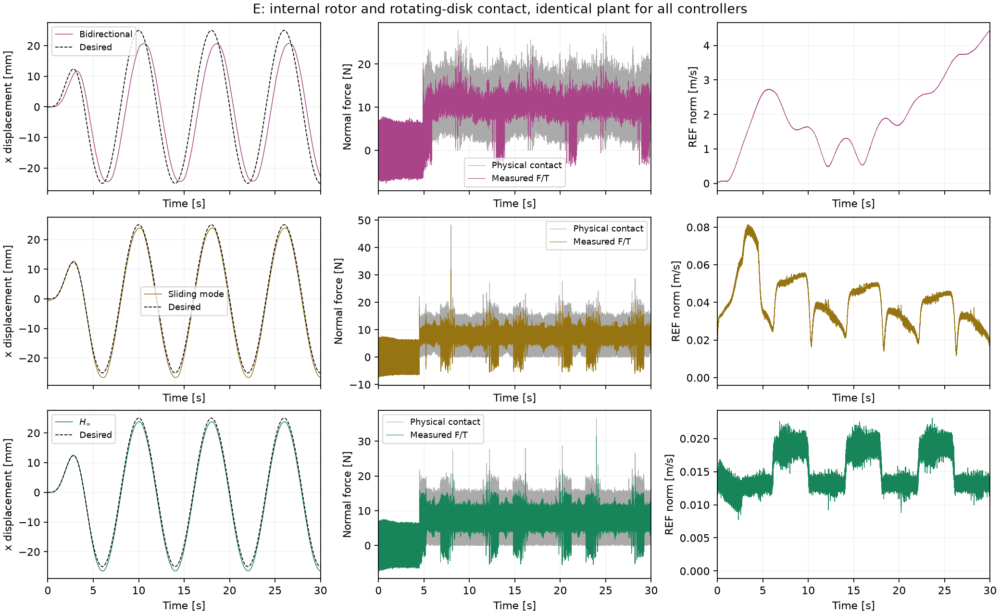
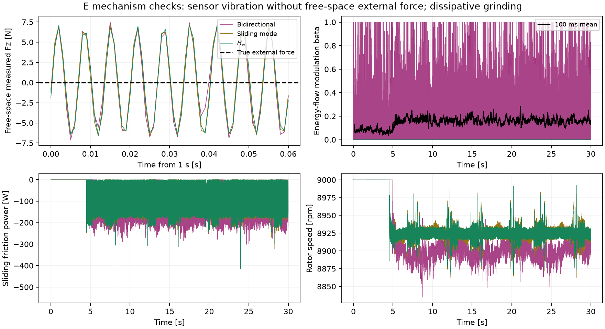

# E：内部转子与旋转圆盘接触

固定 36 次运行：{'completed': 33, 'terminated': 3}。运行时代码 SHA256：`45fe9e1558458a622ad78af08f0ae8567c0ac0c9787cfbbad876a9a765d864c5`。

此轮补齐工具振动的物理来源，保留所有未完成的敏感性运行。尚未复现论文中双向导纳 100–150 N、β 接近 1，以及 SMC 明显反弹的完整组合。

## 模型与来源

- [Bosch 原厂资料](https://www.bosch-pt.com.my/my/en/products/gws-7-100-et-06013885L0)给出 GWS 7-100 ET 的 1.8 kg、100 mm 圆盘和 2,800–9,300 rpm。仿真采用总质量 1.8 kg、9,000 rpm；转子质量 0.1 kg、偏心 0.1 mm、工具 COM 60 mm、摩擦系数 .25 均是未经标定的假设。
- 真实系统新增第八个转子自由度，名义控制器仍只接收 FR3 的七轴测量。转速伺服连续运行，限矩 .5 Nm；七轴控制与 F/T 仍为 1 kHz。静态工具重力单独校准，动态惯性保留在测量中。
- 自由空间真实外力严格为零，腕部 F/T 的振动由转子反作用产生。固定工具测试验证 `m e ω²` 和 TCP 力矩变换。旧的外加正弦力/额外 1.5 N 白噪声通过 `--grinder-model external` 保留。
- 圆盘使用 MuJoCo 法向接触，加显式耗散滑动摩擦 `F_t = −μ F_n v_t / sqrt(v_t²+.01²)`，每个物理子步更新，施加在转子实际接触点。逐记录核对摩擦功率非正及 `|F_t| ≤ μ F_n`，并测试接触功率与广义力功率一致。
- 约 47 m/s 轮缘速度下，直接使用软摩擦锥曾在第一次接触产生约 1.5 kN 法向力；这属于被诊断的数值异常，未当作算法效果。新模型仍是光滑工件接触，不包含材料去除、磨粒或热过程。

## 全部结果

|案例|状态 / 时长|x RMS / mm|REF 均值 / m/s|真实峰值 / N|接触丢失 / %|最长丢失 / ms|
|---|---|---:|---:|---:|---:|---:|
|6000rpm_bidirectional|completed / 30.000 s|7.914|2.75059|24.01|0.0000|0|
|6000rpm_hinf|completed / 30.000 s|1.362|0.01515|34.91|0.0000|0|
|6000rpm_smc|completed / 30.000 s|1.397|0.05101|31.63|0.0000|0|
|balanced_bidirectional|completed / 30.000 s|8.157|3.03537|28.66|0.0000|0|
|balanced_hinf|completed / 30.000 s|1.364|0.01512|45.20|0.0167|3|
|balanced_smc|completed / 30.000 s|1.398|0.05707|47.35|0.0083|2|
|double_imbalance_bidirectional|completed / 30.000 s|6.527|1.42498|33.58|0.1333|9|
|double_imbalance_hinf|completed / 30.000 s|1.434|0.01645|46.02|0.5792|13|
|double_imbalance_smc|completed / 30.000 s|1.418|0.03597|54.00|0.3083|18|
|fixed_point_bidirectional|completed / 30.000 s|8.589|1.65753|20.40|0.0000|0|
|fixed_point_hinf|completed / 30.000 s|1.612|0.01523|19.74|0.2458|2|
|fixed_point_smc|completed / 30.000 s|1.674|0.04068|22.03|0.2542|2|
|frictionless_bidirectional|completed / 30.000 s|6.886|1.73883|46.95|0.8542|25|
|frictionless_hinf|terminated / 17.789 s|0.088|0.01542|1829.03|1.8830|60|
|frictionless_smc|terminated / 26.010 s|0.228|0.04251|1824.43|2.7585|72|
|half_imbalance_bidirectional|completed / 30.000 s|7.729|2.46054|28.70|0.0000|0|
|half_imbalance_hinf|completed / 30.000 s|1.362|0.01515|44.41|0.0083|1|
|half_imbalance_smc|completed / 30.000 s|1.393|0.04902|48.20|0.0000|0|
|main_bidirectional|completed / 30.000 s|7.325|1.96238|28.60|0.0000|0|
|main_hinf|completed / 30.000 s|1.363|0.01523|37.73|0.0125|3|
|main_smc|completed / 30.000 s|1.386|0.04029|49.74|0.0000|0|
|physics16_bidirectional|completed / 30.000 s|7.133|1.76347|26.57|0.0000|0|
|physics16_hinf|completed / 30.000 s|1.364|0.01525|37.46|0.0167|4|
|physics16_smc|completed / 30.000 s|1.386|0.03998|50.15|0.0000|0|
|physics8_bidirectional|completed / 30.000 s|7.192|1.81380|27.60|0.0000|0|
|physics8_hinf|completed / 30.000 s|1.363|0.01524|50.78|0.0167|4|
|physics8_smc|completed / 30.000 s|1.386|0.04009|29.45|0.0000|0|
|rigid_contact_bidirectional|completed / 30.000 s|7.287|1.96610|262.60|1.5042|27|
|rigid_contact_hinf|completed / 30.000 s|1.365|0.01529|132.94|1.3042|19|
|rigid_contact_smc|terminated / 10.766 s|1.412|0.04901|662.36|2.1187|35|
|seed101_bidirectional|completed / 30.000 s|7.303|1.92716|32.60|0.0083|1|
|seed101_hinf|completed / 30.000 s|1.362|0.01523|53.10|0.0000|0|
|seed101_smc|completed / 30.000 s|1.387|0.04028|53.68|0.0000|0|
|seed102_bidirectional|completed / 30.000 s|7.283|1.90850|29.09|0.0000|0|
|seed102_hinf|completed / 30.000 s|1.362|0.01523|46.97|0.0125|3|
|seed102_smc|completed / 30.000 s|1.386|0.04029|28.63|0.0000|0|

中止案例的指标仅覆盖中止前，不能与完整 30 s 的统计直接等同。接触丢失按几何接触活动标志统计，1 ms 缺口不能直接称为可见反弹。峰值只覆盖 1 kHz 样本。

## 积分细化

|控制器|子步|REF 均值 / m/s|接触期物理 Fz 标准差 / N|平均滑动功率 / W|
|---|---:|---:|---:|---:|
|bidirectional|4|1.962382|5.3520|-118.352|
|bidirectional|8|1.813801|5.3186|-116.316|
|bidirectional|16|1.763470|5.3130|-115.666|
|smc|4|0.040289|5.3796|-88.472|
|smc|8|0.040085|5.3810|-88.498|
|smc|16|0.039978|5.3897|-88.482|
|hinf|4|0.015233|5.6600|-88.356|
|hinf|8|0.015244|5.6717|-88.376|
|hinf|16|0.015248|5.6520|-88.369|

RMS/均值与逐采样峰值分开报告；接触峰值对种子和碰撞切换敏感，不能称为逐样本收敛。

[完整配置、轨迹哈希与指标](metrics.json)

重跑：`OPENBLAS_NUM_THREADS=1 .venv/bin/python scripts/validate_grinding.py --workers 8`，随后运行 `scripts/report_grinding.py`。历史记录的可运行源码在对应输出目录 `source/`；以该目录为工作目录调用项目 Python，即可回放同版本记录。