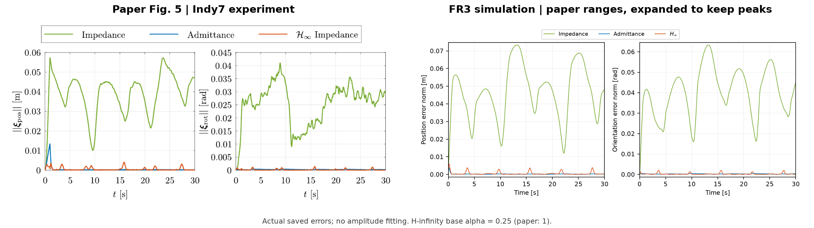
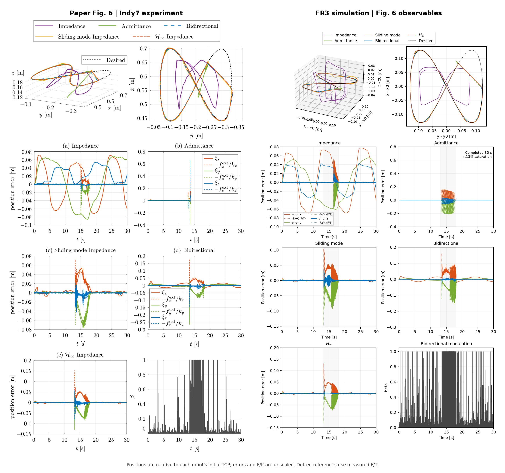
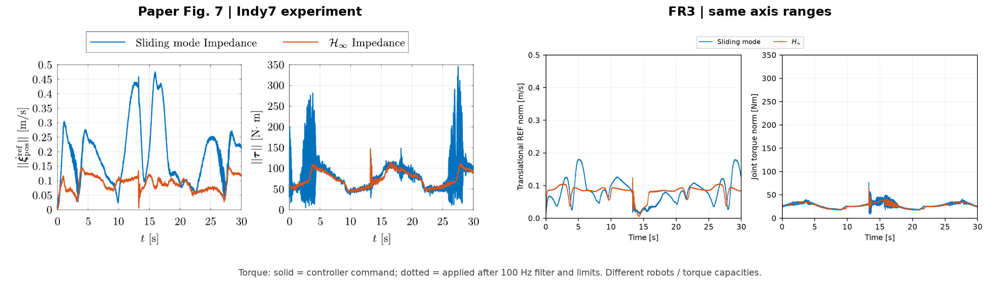
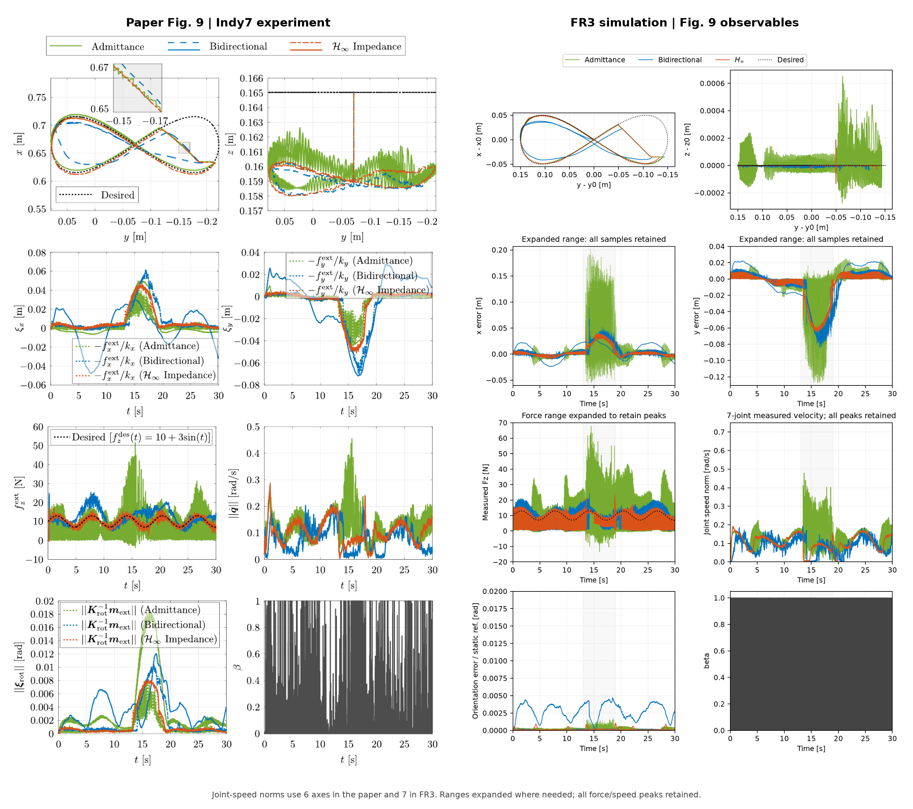
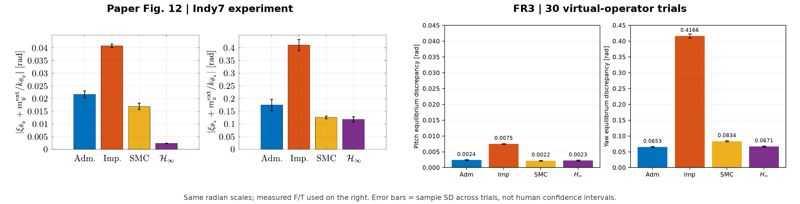
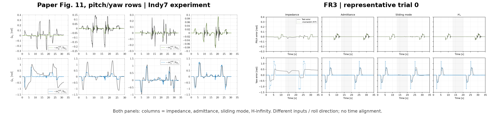
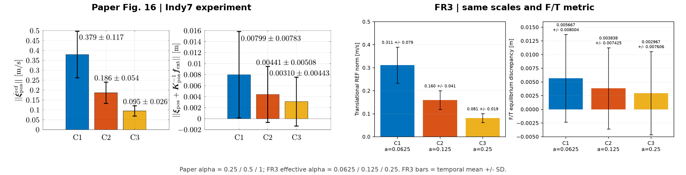

# A、B、C、D、F：论文原图与 `fr3v2` 逐图对照

左侧是论文原图裁剪，右侧是 `fr3v2` 的 FR3/MuJoCo 仿真数据。结论和全部不利证据见 [fr3v2 报告](../reproduction-fr3v2/REPORT.md)；`fr3` 的同类对照见 [此处](../paper-comparison/REPORT.md)。

**当前判断：A、F 的 REF 和均值、D 的 yaw 整体形态与原图接近；B 的接触响应形态相近，但导纳没有急停；C 的导纳接近，H∞ 差距明显；D 的 pitch 优势没有复现。**

本次只从已有记录重绘，没有重跑控制器。E 依 [AGENTS.md](../../../AGENTS.md) 暂缓。

[下载全部高清对照图](paper_vs_fr3.zip) · [计算结果和统计口径](comparison_metrics.json) · [来源、裁剪坐标及轨迹哈希](sources.json) · [生成脚本](../../../scripts/compare_paper_figures.py)

## 比较条件

论文是六轴 Indy7 真机，这里是七轴 FR3 仿真。曲线保留实际幅值，没有缩放或对齐时间。FR3 轨迹图用相对初始 TCP 的位置。数据超出论文量程时扩展坐标轴，所以比较幅值时请以坐标轴为准。

`fr3v2` 的 Λ/D/K、NRIC G、D 虚拟操作者与论文相同。H∞ 有效 α 是论文的四分之一；摩擦 ×3、F/T 延迟 3 ms、接触参数都是未标定的仿真假设。

## A：低刚度自由运动



形态接近。普通阻抗位置误差峰值 73 mm（原图约 58 mm），姿态误差峰值约 .063 rad（原图约 .041 rad），都偏大。H∞ 的小幅误差凸起与原图位置相近，导纳在 1 s 处没有原图的 13 mm 峰。位置 RMS 为 48.6 / .39 / 1.05 mm（普通阻抗 / 导纳 / H∞）。

## B：刚性环境交互



相近之处：普通阻抗轨迹形态（含偏离期望路径的方形环）与原图相似，也在约 15–18 s 接触墙面。SMC、双向、H∞ 在接触段的误差形态和幅值（x 约 .05 m，y 约 −.07 m）与原图接近。

差距：

- 普通导纳在接触后持续抖振直到离开墙面，限幅 4.13%，跑完 30 s。原图是接触瞬间失稳后急停。这是最明显的不一致。
- 接触段各控制器的 F/K 曲线都有较厚的波动带，比原图的 SMC、H∞ 更明显。
- β 在接触窗口 13–18 s 的均值约 .357，β>.9 的样本约占 30.7%。没有作者原始 β 日志，不能据此认定调制机制一致。



**这张图没有复现。** 原图 SMC 的 REF 峰值约 .47 m/s，H∞ 约 .1 m/s。当前两者均值都是 .081 m/s，SMC 峰值约 .18 m/s。原图 SMC 力矩有明显抖振，峰值约 340 Nm；当前 SMC 命令力矩范数峰值 77 Nm，且没有这种抖振。FR3 与 Indy7 的力矩量程不同，但抖振是否出现不受量程影响。

## C：混合力/运动控制



按 F/T 测量通道，导纳、双向、H∞ 的法向力 RMS 为 **9.80、4.20、3.14 N**，原图数字化结果为 8.51、4.67、1.32 N。

- 导纳：较接近。抖振在挡块段 13–19 s 最强，主频约 11 Hz，与原图数字化的约 10 Hz 接近。测量力峰值 68 N（原图约 52 N），x 向 F/K 波动明显大于原图。
- 双向：RMS 接近原图，轨迹偏离和姿态误差的形态也相似，但当前的力信号有更多 100 Hz 以上成分。
- H∞：**差距明显。** 测量力在 0–15 N 间高频波动，板面接触比例 .90；原图 H∞ 贴近目标曲线。接触时间常数翻倍可把 RMS 降到 1.65 N，但这也减弱导纳的抖振（见主报告），未作为默认值。
- 右上图的 z 位移范围约 1 mm，原图约 5 mm。接触模型和笔尖柔性尚未对齐。
- 第三行右图是关节速度范数 `||qdot||`，不是 REF；原图 6 轴，FR3 7 轴。

## D：旋转阻抗与重复试验



|平衡偏差 / rad|导纳|普通阻抗|SMC|H∞|
|---|---:|---:|---:|---:|
|pitch，论文（读图）|.0217|.0407|.017|.0024|
|pitch，`fr3v2`|.0024|.0075|.0022|.0023|
|yaw，论文（读图）|.175|.41|.126|.118|
|yaw，`fr3v2`|.0653|.417|.0834|.0671|

**论文最强的 pitch 结论没有复现。** H∞ 与原图相当，但导纳和 SMC 也在同一水平，而不是原图的 7–9 倍。可能原因之一是虚拟操作者比真人规则，也没有在这个方向激发出足够的动态误差，这一点尚未验证。yaw 的普通阻抗与原图几乎相同，但导纳略小于 H∞，排序也不同。

30 次是虚拟操作者参数和噪声的变化，不是十名真人各三次试验，误差棒不能当作置信区间。



普通阻抗释放后 yaw 长时间不回零，这与原图相近，而且没有使用附加滚转支撑。其余控制器的 pitch 响应比原图小得多，也更规则，原图的超调和恢复过程没有逐项重现。[完整 Fig. 11 裁剪](source/paper_D_full.png)另保留了 roll 和第六关节曲线。

## F：增益与性能变化



|指标，C1 → C2 → C3|论文|`fr3v2`|`fr3`|
|---|---|---|---|
|有效 α|.25 → .5 → 1|.0625 → .125 → .25|.0625 → .125 → .25|
|REF 均值，m/s|.379 → .186 → .095|.311 → .160 → .081|.115 → .059 → .030|
|REF 标准差，m/s|.117 → .054 → .026|.079 → .041 → .019|—|
|平衡偏差均值，mm|7.99 → 4.41 → 3.10|5.67 → 3.84 → 2.97|.92 → .88 → .88|
|平衡偏差标准差，mm|7.83 → 5.08 → 4.43|8.00 → 7.42 → 7.61|1.91 → 1.91 → 1.99|

REF 和平衡偏差均值的量级和趋势都接近原图，平衡偏差 C1→C3 下降约 48%（论文 61%）。但这是在有效 α 为论文四分之一的条件下得到的，等效扰动（增益 × REF）约 22 N，论文约 104 N。平衡偏差的时间标准差不随增益下降，这一点没有复现。

## 重绘

需要 `outputs/reproduction-fr3v2/main`、根目录的 PDF 和 Poppler 的 `pdftoppm`：

```bash
OPENBLAS_NUM_THREADS=1 .venv/bin/python scripts/compare_paper_figures.py --runs outputs/reproduction-fr3v2/main --output docs/results/paper-comparison-fr3v2
```

脚本只读取记录，不调用控制器。本目录下的 `sources.json` 保存了 PDF、轨迹和运行时代码的哈希。
