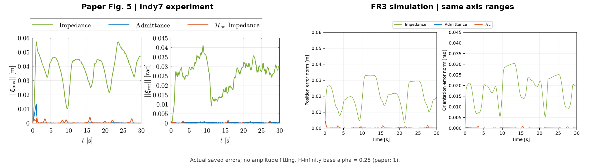
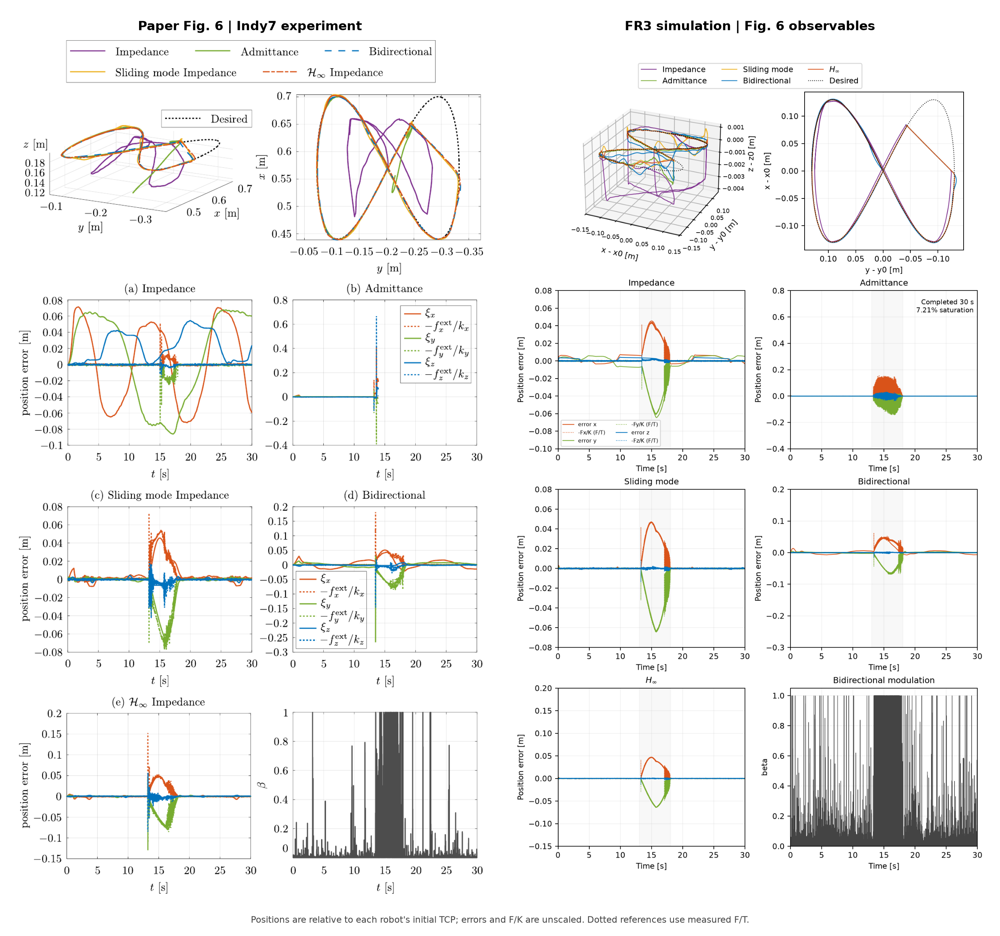
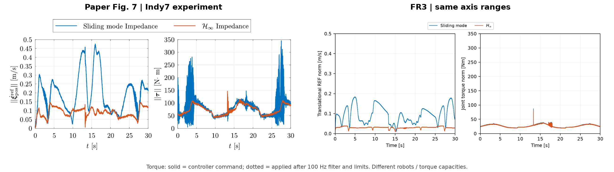
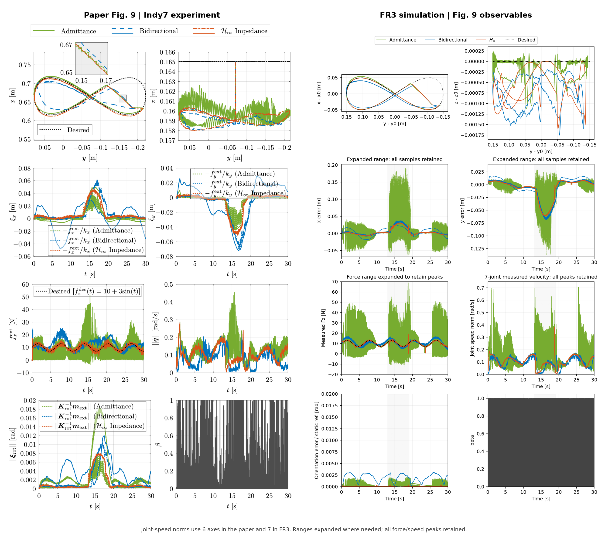
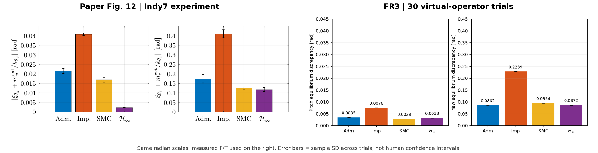
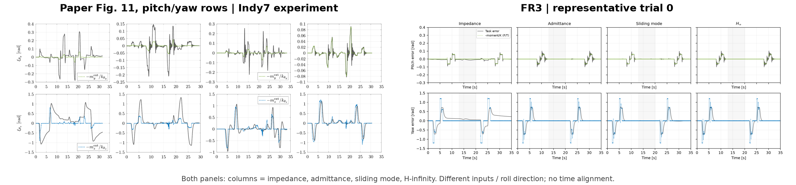
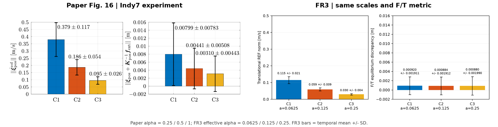

# A、B、C、D、F：论文原图与 FR3 结果逐图对照

左侧为用户提供论文的原图裁剪，右侧为已保存的 `fr3` 仿真数据。当前判断是：**A 的定性趋势较接近；B/C 仍有接触行为和幅值差距；D 的 pitch 统计优势、F 的明显静态误差改善尚未复现。** [134 次主实验及 51 次敏感性检查](../reproduction-fr3/REPORT.md)验证了所列运行和部分定性趋势，不代表论文全部性能结论已经成立。

本次仅从已有记录重绘和复核，没有重新调参或运行控制器。E 依 [AGENTS.md](../../../AGENTS.md) 暂缓，不包含在本次对照中。

[下载全部高清对照图](paper_vs_fr3.zip) · [计算结果和统计口径](comparison_metrics.json) · [来源、裁剪坐标及原始轨迹哈希](sources.json) · [生成脚本](../../../scripts/compare_paper_figures.py)

## 来源与比较条件

论文为 [Nonlinear H∞ Inverse-Optimal Impedance Control for Robotic Systems](../../../Nonlinear_mathcal_H_infty__Inverse-Optimal_Impedance_Control_for_Robotic_Systems.pdf)，DOI `10.1109/TRO.2026.3741518`。原图版权归原权利人所有；原图保持原始坐标、图例和曲线，未重画或按 FR3 数据修改。

|实验|论文图号|PDF 页码|本次 FR3 数据|
|---|---|---:|---|
|A|Fig. 5|13|seed 100，30 s|
|B|Fig. 6、7|14|seed 100，30 s|
|C|Fig. 9|15|seed 100，30 s|
|D|Fig. 11、12|17|代表 trial 0；统计含每控制器全部 30 次|
|F|Fig. 16|19|seed 100，30 s，三个相对增益|

论文使用六轴 Indy7 真机，当前是七轴 FR3/MuJoCo 仿真。任务阻抗、反馈增益、采样和未标定物理参数已有明确适配，见 [实现说明](../../IMPLEMENTATION.md)。当前误差更小不等于相同条件下性能更好。

- 曲线保留实际幅值，没有按原图缩放误差或对齐峰值时间。FR3 轨迹图使用相对初始 TCP 的位置，并在轴标签中注明；论文的绝对坐标保持原样。
- A、B 控制量、D 统计、F 尽量采用原图量程。C 对超过原量程的力、误差和关节速度扩展坐标轴，保留所有峰值并明确标注。
- 静态平衡参考使用测量 F/T，非零刚度轴采用 `(F_des - F_measured) / K`；角轴使用功率对偶的广义力矩。旧报告的对应指标使用物理真值 `force_true`，两套结果分别保留。
- 原图没有作者控制频率下的原始日志。图中峰值近似读数不能视为精确原始统计；β 曲线黑色区域的密度也不能直接当作时间占比。

## A：低刚度自由运动



主要趋势一致：普通阻抗误差明显，导纳和 H∞ 均有较好的跟踪。当前普通阻抗、导纳、H∞ 的位置 RMS 分别为 **21.670、0.351、0.541 mm**。

剩余差距是误差幅值、波形与过渡过程。普通阻抗的位置误差峰值原图约 58 mm，当前约 33 mm。H∞ 的当前有效 α 为 .25，论文基准为 1；本图支持定性跟踪改善，不构成同增益、同扰动强度下的定量复现。

## B：刚性环境交互



H∞ 和滑模控制在接触段顺应墙面、跟踪平衡响应的趋势已出现。普通导纳也有接触抖振，约 **7.21%** 的记录样本触发力矩限幅。

论文普通导纳在接触后失稳并急停；当前仍完成 30 s。因此现有证据是抖振和限幅，尚未复现原机的急停行为。普通阻抗在自由运动阶段的误差也比原图小得多，基线误差的幅值和形态不一致。



H∞ 的 REF 小于 SMC，与论文趋势相符。但论文 SMC 的明显力矩抖振，在当前配置中不明显。右图同时给出滤波前命令力矩和滤波/限幅后施加力矩，避免只看滤波后曲线掩盖问题。机器人惯量、驱动和力矩能力不同，绝对力矩不能直接作性能排名。

B 接触窗口 13–18 s 的 β 均值约 .354，β>.9 的样本约占 28.8%。这保留了当前调制过程的量化记录；缺少作者原始 β 日志时，不能凭两张压缩曲线图认定能量调制机制已完全匹配。

## C：混合力/运动控制



普通导纳存在持续抖振，H∞ 保持较好的法向力跟踪，控制器之间的主要差异已出现。按 **F/T 测量通道**计算，导纳、双向控制、H∞ 的法向力跟踪 RMS 分别为 **9.073、1.749、0.631 N**。

仍存在以下差距：

- 普通导纳测量力峰值当前约 69 N，原图约 52 N；抖振强度与时间分布不同。
- z 方向位移、挡块碰撞的峰值及 x/y 平衡参考与原图不同，笔尖和接触条件尚未定量对齐。
- 双向控制的轨迹及法向力偏差形态不同；13–19 s 的 β 均值约 .363，β>.9 的样本约占 30.2%，其调制过程仍需与论文描述核验。
- 原图第三行右侧是 **关节速度范数 `||qdot||`，不是 REF**。本次使用 `v_measured` 重绘相同物理量；原图包含六轴，FR3 包含七轴，量值还受运动学差异影响。不能把内部 REF 值与该图的 rad/s 量程比较。

## D：旋转阻抗与重复试验



原图中 H∞ 的 pitch 平衡误差明显最小；当前按测量 F/T 计算，SMC 约 **0.002866 rad**，H∞ 约 **0.003283 rad**，排序不同。普通阻抗仍较差，但“所提方法在高刚度、欠阻尼 pitch 方向有显著优势”的关键统计结论尚未复现。

当前每次运行先计算时间平均绝对平衡偏差，再统计 30 次的均值和样本标准差。30 次是虚拟操作者参数及噪声变化，不能替代论文的十名真人各三次试验；当前重复间离散程度明显更小，也不能据此宣称更稳健。



本图对齐的是 pitch/yaw 任务误差及其 F/T 静态参考。两侧施力时序、滚转方向和输入不同，没有逐峰对齐。当前响应更规则，原图中的真人交互超调和恢复过程没有逐项重现。[完整 Fig. 11 原图裁剪](source/paper_D_full.png)另保留了 roll 与 Indy7 第六关节曲线；后者没有简单的一对一 FR3 关节对应。

当前还依赖额外虚拟手支撑保持约 90° 滚转，因此不能仅凭第二阶段姿态保持来验证论文强调的零刚度自由顺应。这一支撑是已声明的仿真假设。

## F：增益与性能变化



|指标，按 C1 → C2 → C3|论文原图/正文|当前 FR3|
|---|---|---|
|有效 α|.25 → .5 → 1|.0625 → .125 → .25|
|REF 均值，m/s|.379 → .186 → .095|.11503 → .05911 → .02991|
|测量 F/T 平衡偏差均值，mm|7.99 → 4.41 → 3.10|.920 → .884 → .880|
|当前物理真值平衡偏差均值，mm|无作者真值日志|.712 → .644 → .623|

REF 的“增益翻倍、误差约减半”趋势已出现。静态平衡偏差从 C1 到 C3，论文下降约 **61.2%**，当前按相同测量通道仅下降约 **4.3%**。当前该偏差的时间标准差为 1.911、1.912、1.990 mm，也没有随增益缩小。

这里明确区分了旧报告基于物理真值的结果与本次基于测量 F/T 的结果。当前误差绝对值较小，但增益、任务阻抗和扰动条件不同；它不能替代论文的完整增益敏感性结论。

## 复核与重绘

本次输入沿用运行时代码 SHA256 `1ca942baf2501965b1063402f7e64d252280516417cf6bc5f900b0bdfd9322a7` 的记录。测量口径变更、各次轨迹哈希、PDF 哈希、图号和裁剪坐标见本目录 JSON 文件。

仓库已包含可直接查看的图和结果。重新绘制需要原始 `outputs/reproduction-fr3/main` 记录、根目录的用户提供 PDF，以及系统 Poppler 的 `pdftoppm`：

```bash
OPENBLAS_NUM_THREADS=1 .venv/bin/python scripts/compare_paper_figures.py
```

输出默认位于 `docs/results/paper-comparison`。可用 `--runs`、`--pdf`、`--output` 显式指定路径。脚本只读取记录，不调用实验控制器。若本地没有原始记录，先按主项目说明生成当前 FR3 主矩阵（D 每控制器 30 次）；单次 D 的快速矩阵不能替代统计输入。
