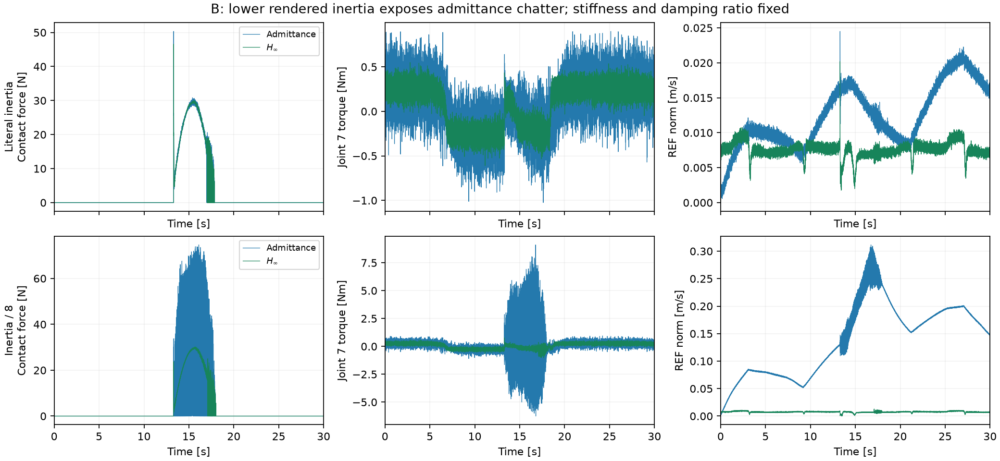

# 跨机器人惯量与握持对照

固定 48 次运行：{'completed': 42, 'terminated': 6}；代码 SHA256：`b71d9601c33cf08de5f9de070f1706812bda542e77fb033570d89134b2b54e57`。

**B 的低惯量对照出现了论文相似的导纳抖振 / H∞ 稳定差异，但统一缩放不能解决全部实验。C、D 的负面结果保留，未替换默认论文参数。**

## 为什么检查惯量比例

当前 FR3 名义模型 home 处第七轴质量矩阵对角元约 0.07412 kg·m²。另一项 [Indy7 参数辨识研究](https://pmc.ncbi.nlm.nih.gov/articles/PMC9783800/)附录表 A1/A2 给出末轴转子/齿轮惯量约 0.5405、连杆轴惯量约 0.0705 kg·m²（作者提出方法、低温列），合计约 0.611。该研究不是本篇 TRO 的同一台实物标定，关节惯量也不能直接替代整个 Cartesian 惯量矩阵。此数量级差异仅用于提出可检验假设。

矩阵固定包含：B/C/D 的原参数、Λ×1/4、Λ×1/8；缩放时 D×sqrt(scale)、K 不变，保持每轴阻尼比。D 另含虚拟握持刚度 ×4/×8，以及 Λ×1/8 配合握持 ×4。所有比较控制器使用完全相同的任务/握持变化，控制器反馈增益保持原值。它们是机制对照，不是原论文参数或已标定的动力学等价变换。

## 全部结果

|案例|状态 / 时长|位置阻抗动态偏差 / mm|旋转阻抗动态偏差 / deg|限幅 / %|物理峰值力 / N|
|---|---|---:|---:|---:|---:|
|grasp4_D_admittance|completed / 35.000 s|2.872|0.780|10.306|0.00|
|grasp4_D_hinf|terminated / 9.299 s|4.895|1.157|13.097|0.00|
|grasp4_D_impedance|completed / 35.000 s|2.888|141.664|15.066|0.00|
|grasp4_D_smc|completed / 35.000 s|3.364|0.982|8.606|0.00|
|grasp8_D_admittance|terminated / 22.508 s|3.368|0.795|5.771|0.00|
|grasp8_D_hinf|terminated / 9.281 s|5.991|2.266|13.004|0.00|
|grasp8_D_impedance|completed / 35.000 s|3.167|142.454|15.163|0.00|
|grasp8_D_smc|completed / 35.000 s|4.292|1.238|9.611|0.00|
|inertia_eighth_B_admittance|completed / 30.000 s|0.133|0.017|7.213|74.64|
|inertia_eighth_B_bidirectional|completed / 30.000 s|6.456|0.344|0.000|33.55|
|inertia_eighth_B_hinf|completed / 30.000 s|0.100|0.005|0.000|30.17|
|inertia_eighth_B_impedance|completed / 30.000 s|6.809|1.160|0.000|28.47|
|inertia_eighth_B_smc|completed / 30.000 s|0.447|0.081|0.000|29.99|
|inertia_eighth_C_admittance|completed / 30.000 s|17.413|0.054|88.300|114.48|
|inertia_eighth_C_bidirectional|completed / 30.000 s|182.724|0.126|0.000|32.36|
|inertia_eighth_C_hinf|completed / 30.000 s|14.567|0.009|68.530|95.69|
|inertia_eighth_D_admittance|completed / 35.000 s|0.749|0.089|18.111|0.00|
|inertia_eighth_D_hinf|completed / 35.000 s|0.508|0.304|1.866|0.00|
|inertia_eighth_D_impedance|completed / 35.000 s|0.520|110.953|1.234|0.00|
|inertia_eighth_D_smc|completed / 35.000 s|0.420|0.659|1.280|0.00|
|inertia_eighth_grasp4_D_admittance|completed / 35.000 s|4.332|0.925|29.966|0.00|
|inertia_eighth_grasp4_D_hinf|terminated / 8.684 s|25.947|6.916|9.234|0.00|
|inertia_eighth_grasp4_D_impedance|terminated / 22.240 s|2.794|66.102|7.621|0.00|
|inertia_eighth_grasp4_D_smc|terminated / 22.294 s|5.196|2.123|9.195|0.00|
|inertia_quarter_B_admittance|completed / 30.000 s|0.092|0.006|0.000|44.72|
|inertia_quarter_B_bidirectional|completed / 30.000 s|7.752|0.329|0.000|32.79|
|inertia_quarter_B_hinf|completed / 30.000 s|0.112|0.007|0.000|30.13|
|inertia_quarter_B_impedance|completed / 30.000 s|13.345|2.294|0.000|26.12|
|inertia_quarter_B_smc|completed / 30.000 s|0.479|0.089|0.000|30.20|
|inertia_quarter_C_admittance|completed / 30.000 s|7.646|0.029|53.013|83.98|
|inertia_quarter_C_bidirectional|completed / 30.000 s|127.891|0.125|0.000|32.21|
|inertia_quarter_C_hinf|completed / 30.000 s|2.807|0.005|16.837|68.62|
|inertia_quarter_D_admittance|completed / 35.000 s|0.070|0.023|0.526|0.00|
|inertia_quarter_D_hinf|completed / 35.000 s|0.067|0.043|0.469|0.00|
|inertia_quarter_D_impedance|completed / 35.000 s|0.711|164.013|0.217|0.00|
|inertia_quarter_D_smc|completed / 35.000 s|0.129|0.468|0.300|0.00|
|literal_B_admittance|completed / 30.000 s|0.081|0.006|0.017|50.34|
|literal_B_bidirectional|completed / 30.000 s|12.680|0.303|0.000|32.68|
|literal_B_hinf|completed / 30.000 s|0.246|0.019|0.023|46.58|
|literal_B_impedance|completed / 30.000 s|39.884|6.459|0.000|20.79|
|literal_B_smc|completed / 30.000 s|0.440|0.086|0.000|39.81|
|literal_C_admittance|completed / 30.000 s|0.117|0.007|6.250|50.02|
|literal_C_bidirectional|completed / 30.000 s|61.248|0.124|0.000|31.77|
|literal_C_hinf|completed / 30.000 s|0.310|0.002|0.000|29.92|
|literal_D_admittance|completed / 35.000 s|0.035|0.009|0.091|0.00|
|literal_D_hinf|completed / 35.000 s|0.075|0.065|0.086|0.00|
|literal_D_impedance|completed / 35.000 s|2.189|137.277|11.994|0.00|
|literal_D_smc|completed / 35.000 s|0.203|0.444|0.000|0.00|

中止前指标不能当作完整时长统计。运行完成也不表示稳定：例如持续限幅必须单独检查。动态偏差来自完整 Λ/D/K 方程，不把期望柔顺位移本身判为跟踪失败。

## 可支持的结论

- B：Λ×1/8 时，普通导纳限幅约 7.2%，H∞ 无限幅；接触峰值约 74.6 N 对 30.2 N。原参数下普通导纳主要保持稳定。说明 FR3 上可通过降低共同的期望惯量检验论文强调的低惯量交互机制；没有将有限抖振写成论文同等急停。
- C：统一降低包括法向与旋转轴的惯量，会同时损害 H∞，不能作为有效的全局移植规则。后续应独立处理运动轴、力控轴与采样接口。
- D：较硬握持暴露了 1 kHz / 100 Hz 命令接口下的限制，部分 H∞ 设置提前终止；原参数的导纳动态误差仍很小。此结果不支持“降低惯量即可复现论文中的全部优劣关系”。



[完整配置、原始轨迹哈希与指标](metrics.json)

```bash
OPENBLAS_NUM_THREADS=1 .venv/bin/python scripts/validate_portability.py --workers 8
OPENBLAS_NUM_THREADS=1 .venv/bin/python scripts/report_portability.py
# 单独复核 B 的低惯量对照；显式参数不会更改默认值
.venv/bin/python -m fr3imp --experiment B --controller hinf --inertia-scale .125 --output outputs/B-low-inertia
```