# FR3 适配复现：A、B、C、D、F

当前范围见 [AGENTS.md](../../../AGENTS.md)。E 砂轮机按用户要求暂缓，既有代码和历史记录保留。

`fr3` 正式矩阵 134 次（D 每控制器 30 次），固定敏感性矩阵 51 次；状态：{'completed': 185}。
运行时代码 SHA256：`1ca942baf2501965b1063402f7e64d252280516417cf6bc5f900b0bdfd9322a7`。

**本报告是参数已明确调整的 FR3/MuJoCo 仿真，不能称为论文原参数或真实机械臂复现。** `paper` 保留论文 Λ/D/K 和反馈增益，[此前的原参数对照](../reproduction-active/REPORT.md)表明，直接移植时 B/C/D 的若干现象不会出现。
用户已确认未知工具质量、材料与滤波采用仿真假设。所有对比使用相同工具、物理环境、采样率、任务和虚拟操作者规律。没有改写记录中的实际轨迹、注入专属扰动或删去失败配置。

## 与论文相似的主要效果

|组|当前证据|仍需区分的边界|
|---|---|---|
|A|普通阻抗 / 导纳 / H∞ 位置 RMS：21.670 / 0.351 / 0.541 mm；两种鲁棒反馈显著改善低任务刚度下的跟踪|绝对误差属于 FR3 仿真|
|B|普通导纳接触时抖振并有 7.21% 采样限幅；H∞ 无限幅，动态阻抗位置偏差 0.175 mm；双向调制偏差 6.456 mm|导纳仍完成 30 s，没有伪称复现原机急停|
|C|导纳 / 双向 / H∞ 真实法向力 RMS：8.894 / 1.743 / 0.625 N；导纳在平板绘制阶段也出现抖振，H∞ 保持力跟踪|非原工具材料；振幅与源图不能逐点等同|
|D|先后在约 0° 与 90° 滚转姿态下执行 yaw/pitch 交互；H∞ 动态响应接近期望阻抗，导纳有短时限幅，滑模瞬态偏差更大；下表含全部重复|虚拟手在第二阶段继续提供滚转支撑；这是显式附加假设，未复现真人握持感受或每一项统计排名|
|F|相对增益 .25 / .5 / 1 的 REF 均值：0.11503 / 0.05911 / 0.02991 m/s；增益翻倍时接近减半；静态偏差均值 0.712 / 0.644 / 0.623 mm|有效 α 为 .0625 / .125 / .25；不是论文的绝对增益。静态偏差降幅较小，其时间标准差未随增益下降|

[机器可读效果检查](effect_checks.json)同时覆盖种子 100/101/102、物理步长细化和主矩阵；这些检查不是稳定性或无源性证明。

## 适配参数与选择依据

|范围|相对 `paper` 的变化|
|---|---|
|全部活动实验|H∞ 基准反馈 ×.25；F 再乘 .25/.5/1。100 Hz 公共命令低通、1 kHz 控制/F/T、250 μs 物理步长；无力信号低通|
|A|Λ/D/K 不变；NRIC G 不变|
|B、F|全部任务轴 Λ×.125、D×sqrt(.125)、K 不变；B 的 NRIC G 不变|
|C|仅 x/y 的 Λ×.25、D×.5；力轴 z 与三个角轴的 Λ/D/K 不变；NRIC G 不变|
|D|三个角轴的 Λ/D/K 同乘 .25；NRIC G×.25；平移阻抗不变。yaw/pitch 虚拟手弹簧×4，输出广义力矩×.25（上限 3 Nm）；滚转引导保持原量级并延长至试验结束|
|SMC 与普通阻抗|原控制律增益保持；使用与该实验所有控制器相同的任务阻抗和外部环境|

D 的 NRIC 比例与旋转任务比例一起调整；其余导纳保留论文 G。比较的是各完整配置，不能据此断言算法在任意等增益优化下的排名。所有实际 Λ/D/K、控制增益、交互参数均保存在每次 `config.json` 和本报告 `metrics.json`。
选择过程保留了不利证据：[48 次统一惯量/握持对照](../portability/REPORT.md)显示，统一降低惯量会损害 C/D；轴向对照才定位到 C 的平面运动与接触耦合。另一个统一将 NRIC G 降为 .25 的候选使 B/C 导纳恢复稳定，因此不能把“导纳必然不稳定”作为结论。完整候选记录和源码快照见 [适配审计](../fr3-adaptation/REPORT.md)。

## D：30 次虚拟操作者重复

每控制器使用同样 10 组握持参数 × 3 个噪声种子。下表只统计完整时长运行，并显示完整/总数；均值 ± 样本标准差不是真人置信区间。动态偏差独立积分该运行实际 Λ/D/K，避免把过渡过程只与静态 F/K 比较。

|控制器|完整/总数|pitch 动态 RMS / °|yaw 动态 RMS / °|第二阶段平均 roll / °|限幅比例|
|---|---:|---:|---:|---:|---:|
|impedance|30/30|0.554 ± 0.001|10.404 ± 0.004|89.562 ± 0.041|0.000%|
|admittance|30/30|0.030 ± 0.006|0.415 ± 0.040|90.000 ± 0.000|1.035%|
|smc|30/30|0.283 ± 0.000|1.251 ± 0.006|90.000 ± 0.000|0.000%|
|hinf|30/30|0.091 ± 0.000|0.119 ± 0.001|90.000 ± 0.000|0.000%|

D 的静态误差排名并非所有指标均由 H∞ 最小；导纳的 pitch 动态偏差也可能更小。H∞ 的优势证据是两个姿态下较小的整体动态偏差、无力矩限幅及稳定的恢复过程，不把静态 F/K 或某一张图当成全局优越性证明。

## 正式结果

下表 D 为完整运行均值，其余为主种子 100。失败/提前终止和完成数量仍保存在上表与机器可读清单中。

|组|控制器|位置 RMS / mm|动态阻抗位置偏差 / mm|REF 均值 / m·s⁻¹|采样峰值力 / N|限幅比例|
|---|---|---:|---:|---:|---:|---:|
|A|impedance|21.670|21.657|13.27984|0.00|0.000%|
|A|admittance|0.351|0.185|0.03180|0.00|0.000%|
|A|hinf|0.541|0.421|0.03073|0.00|0.000%|
|B|impedance|22.317|6.809|14.35075|28.47|0.000%|
|B|admittance|21.039|0.133|0.13818|74.64|7.213%|
|B|bidirectional|22.546|6.456|5.88034|33.55|0.000%|
|B|smc|21.191|0.447|0.09429|29.99|0.000%|
|B|hinf|21.185|0.175|0.02991|29.97|0.000%|
|C|admittance|21.424|1.880|0.15724|82.37|28.743%|
|C|bidirectional|28.051|62.607|10.01600|32.22|0.000%|
|C|hinf|23.302|1.154|0.04013|28.96|0.000%|
|D|impedance|3.503|3.503|20.35033|0.00|0.000%|
|D|admittance|1.786|1.786|1.05589|0.00|1.035%|
|D|smc|0.142|0.142|0.02307|0.00|0.000%|
|D|hinf|0.145|0.145|0.01475|0.00|0.000%|
|F|hinf_0.25|21.190|0.396|0.11503|29.97|0.000%|
|F|hinf_0.5|21.186|0.259|0.05911|29.97|0.000%|
|F|hinf_1|21.185|0.175|0.02991|29.97|0.000%|

动态偏差由 1 kHz 记录的真实外力零阶保持驱动 `Λ ë + D ė + K e = Fdes − Fext` 独立积分得到，包含惯性/阻尼，而静态 F/K 关系仅用于描述。角度力矩采用功率对偶变换。峰值只涵盖保存的 1 kHz 样本。REF 包含误差积分，不是末端实际速度；普通阻抗不使用此反馈，不能把其积分积累当作机器人高速运动。
C 表格评价真实接触力；论文对照图则使用 F/T 测量通道，避免把测量值与物理真值混为一谈。测量包含噪声和工具惯性，相关 RMS 单独保存在 metrics.json 的 diagnostics。

## 固定敏感性检查

|案例|状态|位置 RMS / mm|REF 均值 / m·s⁻¹|限幅比例|最长连续限幅 / ms|
|---|---|---:|---:|---:|---:|
|filter_off_A_admittance|completed|0.512|0.09378|99.987%|29974.0|
|filter_off_B_hinf|completed|21.147|0.02908|0.000%|0.0|
|filter_off_C_hinf|completed|23.025|0.03411|0.000%|0.0|
|filter_off_D_hinf|completed|0.153|0.01474|0.000%|0.0|
|physics8_B_admittance|completed|21.036|0.13805|7.277%|12.0|
|physics8_B_bidirectional|completed|22.558|6.00689|0.000%|0.0|
|physics8_B_hinf|completed|21.184|0.02991|0.000%|0.0|
|physics8_B_impedance|completed|22.315|14.34076|0.000%|0.0|
|physics8_B_smc|completed|21.191|0.09430|0.000%|0.0|
|physics8_C_admittance|completed|21.399|0.15661|28.307%|31.0|
|physics8_C_bidirectional|completed|28.060|10.04172|0.000%|0.0|
|physics8_C_hinf|completed|23.301|0.04012|0.000%|0.0|
|physics8_F_hinf_0.25|completed|21.190|0.11500|0.000%|0.0|
|physics8_F_hinf_0.5|completed|21.185|0.05911|0.000%|0.0|
|physics8_F_hinf_1|completed|21.184|0.02991|0.000%|0.0|
|rigid_contact_B_admittance|completed|21.209|0.17306|9.227%|99.0|
|rigid_contact_B_bidirectional|completed|22.380|5.39508|0.127%|2.0|
|rigid_contact_B_hinf|completed|21.378|0.02853|0.000%|0.0|
|rigid_contact_B_impedance|completed|22.348|14.45256|0.000%|0.0|
|rigid_contact_B_smc|completed|21.382|0.09037|0.000%|0.0|
|seed101_A_admittance|completed|0.353|0.03230|0.000%|0.0|
|seed101_A_hinf|completed|0.540|0.03075|0.000%|0.0|
|seed101_A_impedance|completed|21.655|13.25930|0.000%|0.0|
|seed101_B_admittance|completed|21.040|0.13804|7.173%|8.0|
|seed101_B_bidirectional|completed|22.538|5.75747|0.000%|0.0|
|seed101_B_hinf|completed|21.184|0.02992|0.000%|0.0|
|seed101_B_impedance|completed|22.316|14.36421|0.000%|0.0|
|seed101_B_smc|completed|21.191|0.09440|0.000%|0.0|
|seed101_C_admittance|completed|21.399|0.15793|28.753%|40.0|
|seed101_C_bidirectional|completed|28.017|10.01838|0.000%|0.0|
|seed101_C_hinf|completed|23.302|0.04015|0.000%|0.0|
|seed101_F_hinf_0.25|completed|21.190|0.11504|0.000%|0.0|
|seed101_F_hinf_0.5|completed|21.186|0.05912|0.000%|0.0|
|seed101_F_hinf_1|completed|21.184|0.02992|0.000%|0.0|
|seed102_A_admittance|completed|0.346|0.03183|0.000%|0.0|
|seed102_A_hinf|completed|0.538|0.03073|0.000%|0.0|
|seed102_A_impedance|completed|21.653|13.25894|0.000%|0.0|
|seed102_B_admittance|completed|21.040|0.13855|7.403%|12.0|
|seed102_B_bidirectional|completed|22.561|5.87182|0.000%|0.0|
|seed102_B_hinf|completed|21.184|0.02990|0.000%|0.0|
|seed102_B_impedance|completed|22.316|14.35592|0.000%|0.0|
|seed102_B_smc|completed|21.190|0.09436|0.000%|0.0|
|seed102_C_admittance|completed|21.411|0.15719|28.943%|26.0|
|seed102_C_bidirectional|completed|28.063|10.08056|0.000%|0.0|
|seed102_C_hinf|completed|23.299|0.04014|0.000%|0.0|
|seed102_F_hinf_0.25|completed|21.190|0.11504|0.000%|0.0|
|seed102_F_hinf_0.5|completed|21.185|0.05914|0.000%|0.0|
|seed102_F_hinf_1|completed|21.184|0.02990|0.000%|0.0|
|virtual8_B_bidirectional|completed|22.556|5.94169|0.000%|0.0|
|virtual8_C_admittance|completed|21.379|0.15708|28.787%|32.0|
|virtual8_C_bidirectional|completed|28.041|10.00348|0.000%|0.0|

固定种子 100/101/102，物理子步 4→8、虚拟积分 4→8、旧硬接触、命令滤波关闭均保留。关闭滤波可能产生持续力矩限幅；运行完成不能作为该配置可用的证明。没有按排名选择种子或删去负面配置。
物理步长减半时，以 C 的力 RMS、B/F 的 REF 均值比较，最大相对变化为 physics8_B_bidirectional 的 +2.15%。这只是所列指标的变化量，不代表非线性振荡逐样本一致或严格的无源性证明。

## 图与复核

[完整配置、指标、原始轨迹哈希](metrics.json) · [A/B/F 图示几何恢复证据](../reproduction/paper_ab_geometry.json) · [实现与假设](../../IMPLEMENTATION.md) · [此前 C 机制审计](../../C_MECHANISM_AUDIT.md)

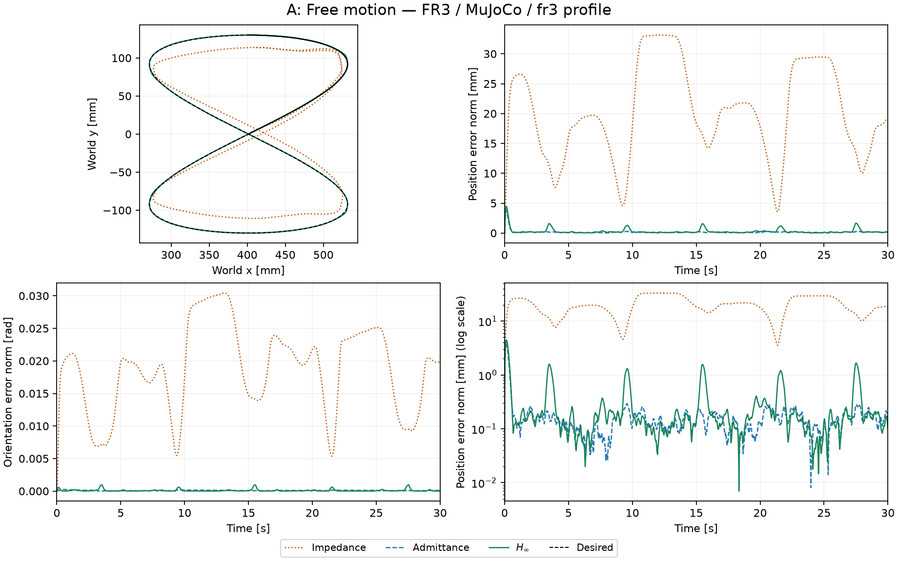

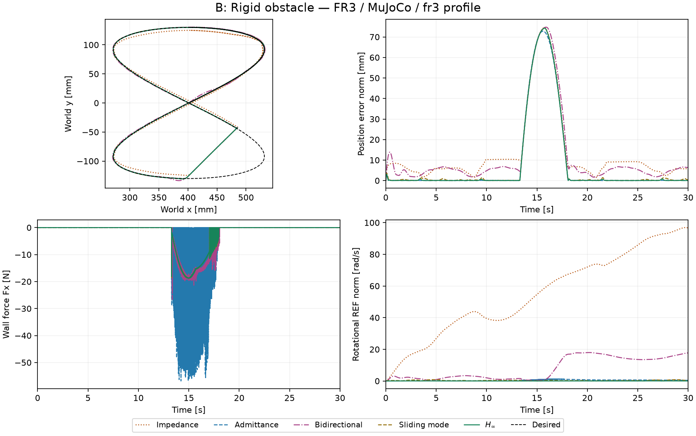

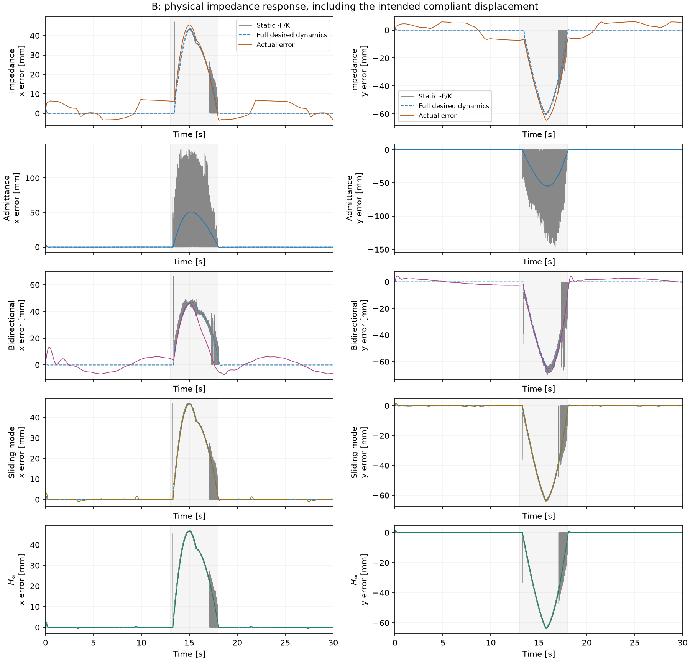

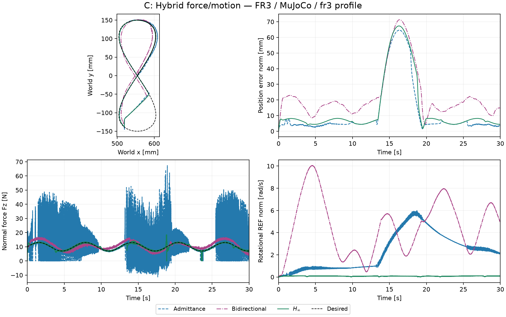

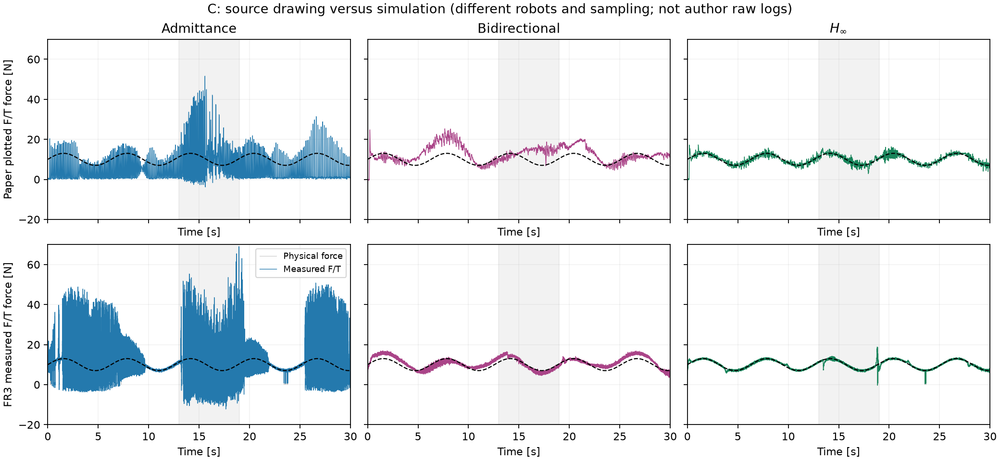

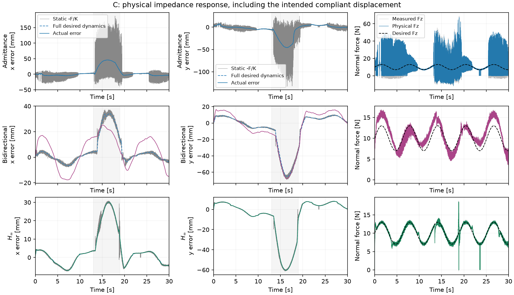

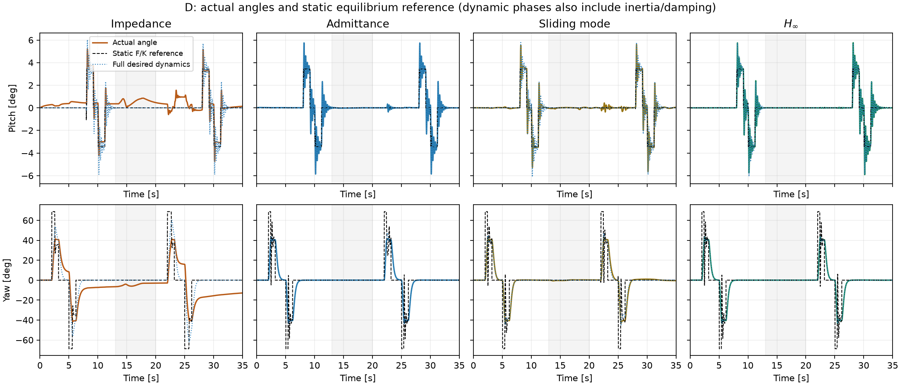

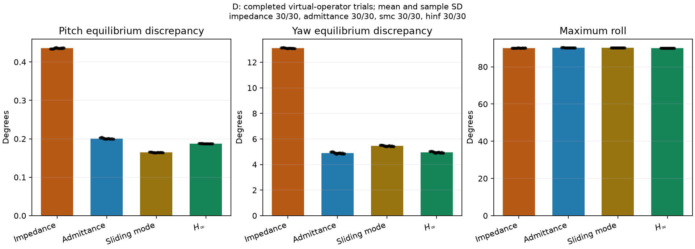

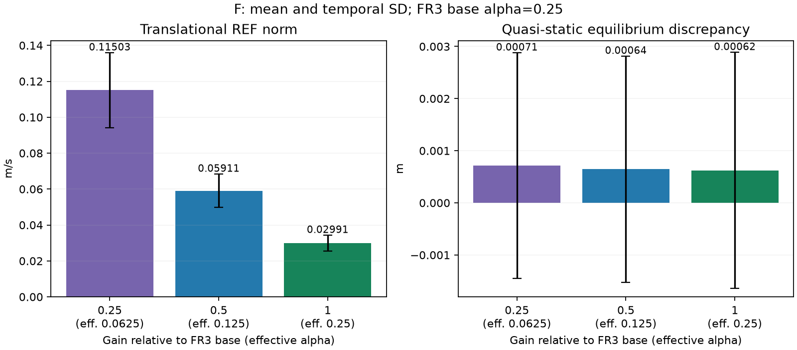

## MuJoCo 回放

[A 自由轨迹](A_hinf.mp4) · [B 斜墙接触](B_hinf.mp4) · [C 白板与挡块](C_hinf.mp4) · [D 旋转交互](D_hinf.mp4) · [F 基准增益](F_hinf.mp4)（均为 H∞，2 倍速；控制器对比见上方图表）。

回放使用保存的真实关节轨迹；绿色为期望路径，橙色为实际路径。显示用半透明墙不改变实验碰撞几何。

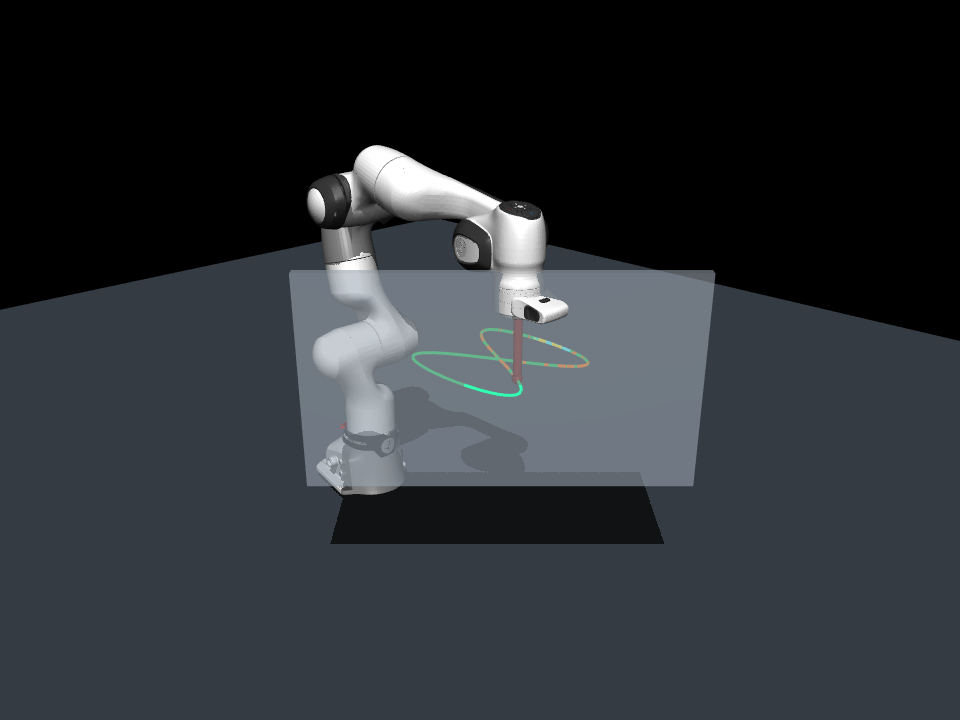

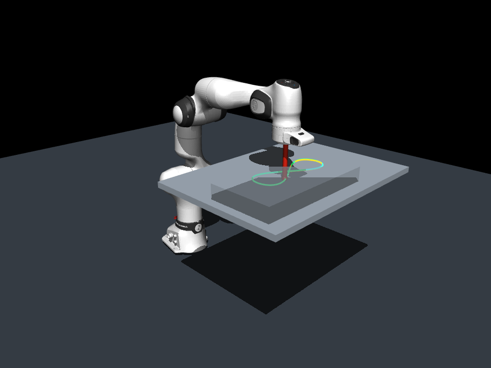


## 重跑

```bash
OPENBLAS_NUM_THREADS=1 .venv/bin/python scripts/validate_reproduction.py --resume
OPENBLAS_NUM_THREADS=1 .venv/bin/python scripts/report_reproduction.py
```

时序、有限值、矩阵完整性、位置 RMS、峰值力和实际限幅已逐运行核对。单元/集成测试见 `VALIDATION.txt`；E 测试依当前范围默认跳过。D 的误差棒是虚拟操作者重复间样本标准差，不是真人统计置信区间。敏感性运行的提前终止保留，不能把部分时长指标与完整 30 s 直接等同。