# `fr3v2`：恢复论文阻抗参数后的 A、B、C、D、F

当前范围见 [AGENTS.md](../../../AGENTS.md)。E 砂轮机按用户要求暂缓，既有代码和历史记录保留。

`fr3v2` 正式矩阵 134 次（D 每控制器 30 次），固定敏感性矩阵 148 次；状态：{'completed': 282}。
运行时代码 SHA256：`9f48b793ce7b73a3afea9c8ca5db4b88be1b07bc43ef49efe5d8461a0cd3bba3`。[`fr3` 的结果](../reproduction-fr3/REPORT.md)保留作对照。

**这是 FR3/MuJoCo 仿真，不是真实机械臂或论文原机复现。** 摩擦、F/T 延迟和接触参数都未经实物标定；选择方式见“这些假设如何选出来”。

## 结论

`fr3v2` 用论文的任务参数复现了 A、F 的主要趋势和 D 的 yaw 趋势。B/C 中导纳差于 H∞ 的现象也出现了，但这个差异依赖高增益内环和 F/T 延迟同时存在。论文最强的 D pitch 优势仍未复现。它也不是全面好于 `fr3`：C 的 H∞ 力跟踪和 B 的 H∞/SMC REF 差异都变差了。

**比 `fr3` 更接近论文：**

- 任务条件：Λ/D/K、NRIC G、D 虚拟操作者全部回到论文值，D 不再需要滚转支撑。H∞ 和导纳在第二阶段仍保持约 90°，普通阻抗掉到约 82.6°。
- A：普通阻抗峰值误差 73 mm（论文约 58 mm，`fr3` 33 mm），H∞ 的小幅误差凸起也出现在相近位置。
- F：REF 为 .311 / .160 / .081 m/s（论文 .379 / .186 / .095）。平衡偏差 C1→C3 下降 48%（论文 61%，`fr3` 4.3%）。
- D：普通阻抗 yaw 平衡偏差 .417 rad（论文 .41，`fr3` .229）。
- B/C：导纳振荡从 `fr3` 的 134/151 Hz 降到 18/11 Hz。C 平板段 2–100 Hz 力波动为 6.1 / 1.9 / 1.0 N，从论文图数字化的 2–50 Hz 结果约为 4.7 / 1.2 / .8 N，主频约 10 Hz。数字化约 100 Hz，只能看到 50 Hz 以下。

**比 `fr3` 更差：**

- C：H∞ 法向力 RMS 为 3.14 N（`fr3` .63，论文约 1.32）。板面接触比例从 1.00 降到 .90，测量力在 0–15 N 间高频波动，而论文 H∞ 曲线贴近目标。
- B：H∞ 和 SMC 的 REF 都是 .081 m/s，不再有差异。`fr3` 是 .030 / .094，论文也是 SMC 明显更大。
- B：H∞ 不再是零限幅（.09%），接触峰值力从 30 N 升到 72 N，13–18 s 力波动从 2.0 N 升到 5.6 N。

**两版都没有复现：**

- D pitch：H∞ .0023 rad 与论文 .0024 相当，但导纳 .0024 和 SMC .0022 也在同一水平（论文 .0217 和 .017），H∞ 没有优势。
- D yaw：导纳 .0653 rad 略小于 H∞ .0671，论文是 H∞ 最小。
- B：导纳跑完 30 s，没有原机的失稳急停；论文 Fig. 7 中 SMC 的明显力矩抖振也没有出现（SMC 命令力矩范数峰值 77 Nm，论文约 340 Nm）。
- F：平衡偏差的时间标准差不随增益下降（8.00 / 7.42 / 7.61 mm，论文 7.83 / 5.08 / 4.43）。
- 量级：增益 × REF 约 22 N，只有论文约 104 N 的五分之一。

预先声明的 21 条判据中，主矩阵通过 15 条，未通过 6 条：

- B（Fig. 7）：H∞ 的 REF 比 SMC 至少低 10%
- B：导纳在接触后失稳终止（原机急停）
- C：平板段导纳力波动至少是 H∞ 的 2 倍
- F：平衡偏差时间标准差随增益单调下降，C1→C3 至少降 20%
- D（Fig. 12）：H∞ 的 pitch 偏差比其他控制器都至少低 50%
- D（Fig. 12）：H∞ 的 yaw 偏差最小

## 配置

|项目|`paper`|`fr3`|`fr3v2`|
|---|---|---|---|
|Λ/D/K|论文值|B/F 全轴 Λ×.125、D×√.125；C 的 x/y 缩放；D 角轴 ×.25|**论文值**|
|NRIC G|论文值|D ×.25，其余论文值|**论文值**|
|H∞ 有效 α|1；F 为 .25/.5/1|.25；F 为 .0625/.125/.25|.25；F 为 .0625/.125/.25|
|D 虚拟操作者|原尺度|弹簧×4、力矩×.25、第二阶段滚转支撑|**原尺度，无滚转支撑**|
|关节摩擦|模型值×1|×1|**×3**|
|F/T 延迟|0|0|**3 ms（3 个采样）**|
|B/F 接触 solref；solimp|(.02,1)；(.5,.5,.001)|同左|**(.02,.4)；(.95,.99,.001)**|
|C 接触 solref；solimp|(.04,1)；(.5,.5,.001)|同左|**(.04,.3)；(.9,.95,.001)**|

两版都用 1 kHz 控制/F/T、250 μs 物理步长、100 Hz 公共命令低通、A/B/F 相同起始姿态。同一实验内所有控制器共享以上全部设置，已从每次记录逐项核对。

## 论文、`fr3`、`fr3v2` 对照

三列由同一段代码从保存的轨迹重算，`fr3` 没有重跑。平衡偏差和 C 的法向力用测量 F/T，与论文口径一致。D 为 30 次均值，其余为种子 100。

|指标|论文|`fr3`|`fr3v2`|
|---|---:|---:|---:|
|A 普通阻抗峰值误差 / mm|≈58|33.1|73.3|
|A 位置 RMS / mm（阻抗/导纳/H∞）|—|21.67 / 0.35 / 0.54|48.64 / 0.39 / 1.05|
|B 限幅 / %（导纳/双向/SMC/H∞）|原机急停|7.21 / 0.00 / 0.00 / 0.00|4.13 / 0.53 / 0.11 / 0.09|
|B 13–18 s 力波动 / N（同上）|—|18.02 / 2.47 / 1.90 / 2.02|17.66 / 11.12 / 6.69 / 5.60|
|B 13–18 s 力 2–100 Hz 波动 / N（同上）|—|2.6 / 0.5 / 0.1 / 0.1|34.2 / 4.4 / 4.8 / 2.8|
|B 导纳力谱峰 / Hz|—|134|18|
|B 峰值力 / N（同上）|—|75 / 34 / 30 / 30|102 / 85 / 75 / 72|
|B 平衡偏差 / mm（同上）|—|7.07 / 5.55 / 0.96 / 0.88|10.68 / 13.57 / 4.11 / 2.97|
|B 阻抗偏差 / mm（同上）|—|0.10 / 5.41 / 0.31 / 0.10|0.18 / 12.73 / 1.80 / 1.18|
|B REF / m·s⁻¹（SMC/H∞）|SMC 更大|0.094 / 0.030|0.081 / 0.081|
|C 测量法向力 RMS / N（导纳/双向/H∞）|8.51 / 4.67 / 1.32（数字化）|9.07 / 1.75 / 0.63|9.80 / 4.20 / 3.14|
|C 阻抗偏差 / mm（同上）|—|0.13 / 9.82 / 0.07|0.10 / 15.81 / 0.58|
|C 平板段 2–100 Hz 力波动 / N（同上）|4.7 / 1.2 / 0.8（数字化，2–50 Hz）|5.3 / 0.3 / 0.2|6.1 / 1.9 / 1.0|
|C 平板段 >100 Hz 力波动 / N（同上）|—|7.7 / 0.4 / 0.1|1.9 / 2.6 / 2.6|
|C 导纳力谱峰 / Hz|10（数字化）|151|11|
|C 板面接触比例（同上）|—|0.84 / 1.00 / 1.00|0.62 / 0.91 / 0.90|
|D pitch 平衡偏差 / rad（导纳/阻抗/SMC/H∞）|0.0217 / 0.0407 / 0.0170 / 0.0024|0.0035 / 0.0076 / 0.0029 / 0.0033|0.0024 / 0.0075 / 0.0022 / 0.0023|
|D yaw 平衡偏差 / rad（同上）|0.175 / 0.410 / 0.126 / 0.118|0.086 / 0.229 / 0.095 / 0.087|0.065 / 0.417 / 0.083 / 0.067|
|D 第二阶段 roll / °（同上）|自由顺应|90.0 / 89.6 / 90.0 / 90.0|90.0 / 82.6 / 89.7 / 90.0|
|F 有效 α（C1/C2/C3）|0.2500 / 0.5000 / 1.0000|0.0625 / 0.1250 / 0.2500|0.0625 / 0.1250 / 0.2500|
|F REF / m·s⁻¹|0.379 / 0.186 / 0.095|0.115 / 0.059 / 0.030|0.311 / 0.160 / 0.081|
|F 增益 × REF / N|104 / 102 / 104|7.9 / 8.1 / 8.2|21.4 / 22.0 / 22.4|
|F 平衡偏差均值 / mm|7.99 / 4.41 / 3.10|0.92 / 0.88 / 0.88|5.67 / 3.84 / 2.97|
|F 平衡偏差标准差 / mm|7.83 / 5.08 / 4.43|1.91 / 1.91 / 1.99|8.00 / 7.42 / 7.61|

论文 A、D 的数值从原图读取，C 从矢量图数字化，只有 F 的数值是原图印出的。
增益 × REF 是 H∞ 反馈实际要抵消的等效任务空间扰动。论文三档约 104 N，`fr3` 约 8 N，`fr3v2` 约 22 N，仍只有论文的约五分之一。

## 判据与稳健性

判据在矩阵跑完前写定。✓/✗ 是该组运行上的结果，空白表示该组没有所需运行。D 的判据要用全部重复，只在主矩阵评估。[机器可读结果](effect_checks.json)。

|判据|main|seed101|seed102|physics8|delay0|delay1|delay2|delay5|matched_G|friction2|friction3.5|contact_zeta1|contact_soft|contact_stiff|
|---|---:|---:|---:|---:|---:|---:|---:|---:|---:|---:|---:|---:|---:|---:|
|A：导纳与 H∞ 的位置 RMS 都低于普通阻抗的 20%|✓|✓|✓||||||✓|✓|✓||||
|A：普通阻抗峰值误差落在论文约 58 mm 的 0.5–2 倍内|✓|✓|✓||||||✓|✓|✓||||
|B：普通阻抗也接触到墙（不是靠大偏差错过）|✓|✓|✓|✓|||||✓|✓|✗|✓|✓|✓|
|B：导纳接触力高频波动至少是 H∞ 的 3 倍|✓|✓|✓|✓|✗|✗|✓|✓|✗|✓|✓|✗|✓|✗|
|B：导纳限幅超过 1%，H∞ 低于 0.5%|✓|✓|✓|✓|✗|✗|✓|✓|✗|✓|✓|✓|✗|✓|
|B：平衡偏差普通阻抗最大、H∞ 最小|✓|✓|✓|✓|||||✓|✓|✓|✓|✓|✓|
|B：双向调制的阻抗偏差至少是 H∞ 的 3 倍|✓|✓|✓|✓|✓|✓|✓|✓|✓|✓|✓|✓|✓|✓|
|B（Fig. 7）：H∞ 的 REF 比 SMC 至少低 10%|✗|✗|✗|✗|✗|✗|✗|✗|✗|✗|✓|✗|✗|✗|
|B：导纳在接触后失稳终止（原机急停）|✗|✗|✗|✗|✗|✗|✗|✗|✗|✗|✗|✗|✗|✗|
|C：法向力 RMS 为 H∞ < 双向 < 导纳|✓|✓|✓|✓|✗|✓|✓|✓|✗|✓|✓|✓|✓|✓|
|C：H∞ 法向力 RMS 不超过导纳的一半|✓|✓|✓|✓|✗|✗|✓|✓|✗|✓|✓|✓|✓|✓|
|C：平板段导纳力波动至少是 H∞ 的 2 倍|✗|✗|✗|✗|✗|✗|✗|✗|✗|✗|✗|✗|✗|✗|
|F：增益翻倍时 REF 接近减半（相邻比 1.7–2.2）|✓|✓|✓|✓|||||✓|✓|✓||||
|F：增益 × REF 在三档增益下基本不变（最大/最小 < 1.3）|✓|✓|✓|✓|||||✓|✓|✓||||
|F：平衡偏差均值随增益单调下降，C1→C3 至少降 30%|✓|✓|✓|✓|||||✓|✓|✓||||
|F：平衡偏差时间标准差随增益单调下降，C1→C3 至少降 20%|✗|✗|✗|✗|||||✗|✗|✗||||
|D：四种控制器 120 次全部跑完|✓||||||||||||||
|D：pitch 与 yaw 平衡偏差都是普通阻抗最大|✓||||||||||||||
|D（Fig. 12）：H∞ 的 pitch 偏差比其他控制器都至少低 50%|✗||||||||||||||
|D（Fig. 12）：H∞ 的 yaw 偏差最小|✗||||||||||||||
|D：无被动支撑时 H∞ 第二阶段滚转仍在 90°±2°|✓||||||||||||||

## 平台假设的影响

|配置|B 导纳限幅|B 力波动 导纳 / H∞ / N|C 测量法向力 RMS 导纳 / 双向 / H∞ / N|F REF C1 / C3|F 平衡偏差 C1 / C3 / mm|
|---|---:|---:|---:|---:|---:|
|main|4.13%|17.7 / 5.6|9.80 / 4.20 / 3.14|0.311 / 0.081|5.67 / 2.97|
|delay0|0.10%|6.6 / 5.8|3.25 / 3.86 / 3.11|—|—|
|delay1|0.23%|8.9 / 5.7|5.09 / 3.85 / 3.10|—|—|
|delay2|4.02%|17.3 / 5.6|6.53 / 3.96 / 3.11|—|—|
|delay5|4.13%|18.3 / 5.6|16.61 / 4.71 / 3.18|—|—|
|matched_G|0.24%|6.2 / 5.6|3.14 / 3.90 / 3.14|0.311 / 0.081|5.67 / 2.97|
|friction2|4.20%|17.2 / 5.2|8.51 / 3.85 / 3.05|0.212 / 0.055|4.29 / 2.55|
|friction3.5|4.08%|17.9 / 5.8|10.14 / 4.27 / 3.20|0.361 / 0.094|6.36 / 3.18|
|contact_zeta1|1.52%|13.7 / 5.2|6.47 / 4.04 / 3.05|—|—|
|contact_soft|0.53%|11.5 / 3.4|5.55 / 3.10 / 1.65|—|—|
|contact_stiff|3.72%|22.5 / 8.8|15.73 / 6.32 / 5.13|—|—|
|c_solimp8|—|—|4.98 / 3.09 / 1.91|—|—|
|rigid_contact|3.89%|23.7 / 13.1|—|—|—|

- **H∞ 对 F/T 延迟几乎不敏感，这一点不依赖延迟的具体取值。** 延迟从 0 到 5 ms，H∞ 在 B 的力波动为 5.8→5.6 N，在 C 的法向力 RMS 为 3.11→3.18 N。同样条件下，导纳在 C 从 3.25 N 升到 16.61 N，在 B 的限幅从 .10% 升到 4.13%。B 的限幅在 1 ms 和 2 ms 之间跳变（.23%→4.02%）。
- **导纳的劣势依赖论文原 G。** `matched_G` 把 NRIC G 换成在 FR3 上给出论文内环 −3 dB 带宽的估计值后，导纳在 B 的限幅只有 .24%，力波动 6.2 N（H∞ 5.6 N），在 C 的 RMS 为 3.14 N，与 H∞ 相同；代价是 A 的位置 RMS 从 .39 mm 升到 .82 mm。论文 G 是为 Indy7 设的，同样的数值放到 FR3 上，估算内环带宽为 75–234 Hz（J1–3）和 600 Hz 以上（腕部），而论文约为 13–23 Hz 和 63–69 Hz。所以能说的只是“高增益内环加 F/T 延迟时，导纳比 H∞ 敏感”，不能说导纳本身不稳定，也不能当成原机失稳的机理。
- **C 的 H∞ 退化主要来自接触变硬，不是欠阻尼。** 接触时间常数翻倍后 H∞ 为 1.65 N，放宽 solimp 后为 1.91 N，而把 ζ 改回 1 仍有 3.05 N。这两个更软的接触也会减弱导纳的抖振（5.55 N、4.98 N），未改作默认值。
- **摩擦有窄窗口。** ×2 时 F 的 REF 只有 .212 / .055 m/s。×3.5 时普通阻抗在 B 中碰不到墙，H∞ 的 REF 则低于 SMC，判据结果只有这两项变化。
- **B 的抖振对比对接触参数敏感。** 力波动判据在 ζ=1 和更硬的接触下不成立，限幅判据在更软的接触下不成立。种子 101/102 和物理步长减半时，所有判据结果都与主矩阵相同。
- 关闭命令滤波时 A 的导纳有 96.7% 的样本限幅，因此 100 Hz 接口仍是必要假设，不是无害的细节。

## 这些假设如何选出来

- 摩擦 ×3 是看 F 的 REF 量级和“普通阻抗能碰到墙”选的。平衡偏差没有用来拟合，但它也随摩擦变化。
- **F/T 延迟和接触参数是在观察控制器差异是否拉开时选的，存在选择偏差。** 它们没有实物依据，延迟也可能偏大或偏小。
- 判据在正式矩阵跑完前写定，但写在探索之后。它只能防止事后改标准，不能防止参数对结果的拟合。
- `C：平板段导纳力波动` 沿用了 `fr3` 判据的 20 Hz 高通，错过了 11 Hz 的主频，所以在所有组都是 ✗。判据不改，结果保留。对照表里的 2–100 Hz 频带和力谱峰是看过结果后才加的，属于事后口径。
- 探索共 9 轮 1152 次运行，脚本和结果存放在 [probes](probes)。它们通过替换 `build_model` 和 `Admittance.__init__` 运行在改动前的代码上，只作过程记录，不能直接用当前代码重跑。
- 探索中否定的方向：只加腕部摩擦（D 的 H∞ 限幅 3–8%，普通阻抗滚转掉到 15–17°）；接近 Indy7 的转子惯量（A 的普通阻抗峰值 63.7 mm 更接近论文，但 C 的导纳触发 400 N 截止，H∞ 的 C/F 变差，D 有 34 次提前终止）；×3.5 及以上的摩擦（普通阻抗碰不到墙）；4 kHz 或更细步长。
- 所有比较中，物理环境和测量条件对同一实验的控制器相同。这只保证比较条件一致，不能证明这些条件接近原机。

## D：30 次虚拟操作者重复

每控制器使用同样 10 组握持参数 × 3 个噪声种子，均值 ± 样本标准差不是真人置信区间。

|控制器|完整/总数|pitch 平衡偏差 / rad|yaw 平衡偏差 / rad|pitch 阻抗偏差 / rad|第二阶段 roll / °|限幅|
|---|---:|---:|---:|---:|---:|---:|
|admittance|30/30|0.0024 ± 0.0002|0.0653 ± 0.0017|0.0003 ± 0.0001|90.00 ± 0.00|0.65%|
|impedance|30/30|0.0075 ± 0.0001|0.4166 ± 0.0064|0.0083 ± 0.0001|82.55 ± 0.10|15.97%|
|smc|30/30|0.0022 ± 0.0001|0.0834 ± 0.0019|0.0029 ± 0.0001|89.74 ± 0.04|0.05%|
|hinf|30/30|0.0023 ± 0.0001|0.0671 ± 0.0017|0.0013 ± 0.0000|89.98 ± 0.02|0.22%|

## 正式结果

下表 D 为完整运行均值，其余为主种子 100。表中动态阻抗位置偏差沿用旧口径，包含 C 的 z 轴（K=0，积分参考会漂移），所以 C 的这一列不能直接比较；K>0 轴的结果见前面的“B/C 阻抗偏差”和 `metrics.json` 的 `dynamic_impedance_position_rmse_stiff_axes_m`。

|组|控制器|位置 RMS / mm|动态阻抗位置偏差 / mm|REF 均值 / m·s⁻¹|采样峰值力 / N|限幅比例|
|---|---|---:|---:|---:|---:|---:|
|A|impedance|48.645|48.638|17.52980|0.00|0.000%|
|A|admittance|0.392|0.249|0.04528|0.00|0.000%|
|A|hinf|1.047|0.962|0.08746|0.00|0.000%|
|B|impedance|75.732|75.189|9.52139|32.57|0.000%|
|B|admittance|21.394|0.195|0.02150|101.64|4.127%|
|B|bidirectional|26.069|15.007|1.73432|84.88|0.533%|
|B|smc|21.554|2.378|0.08130|74.94|0.107%|
|B|hinf|21.520|1.977|0.08129|72.00|0.093%|
|C|admittance|22.262|0.235|0.03532|105.04|5.300%|
|C|bidirectional|32.916|85.101|4.69769|45.72|0.000%|
|C|hinf|24.342|3.385|0.11366|30.44|0.000%|
|D|impedance|3.559|3.559|12.36826|0.00|15.967%|
|D|admittance|0.105|0.105|0.11913|0.00|0.651%|
|D|smc|0.715|0.715|0.13046|0.00|0.050%|
|D|hinf|0.329|0.329|0.03723|0.00|0.223%|
|F|hinf_0.25|22.466|6.201|0.31142|70.64|0.067%|
|F|hinf_0.5|21.763|3.533|0.15975|72.73|0.070%|
|F|hinf_1|21.520|1.977|0.08129|72.00|0.093%|

动态偏差由 1 kHz 记录的真实外力零阶保持驱动 `Λ ë + D ė + K e = Fdes − Fext` 独立积分得到，包含惯性/阻尼，而静态 F/K 关系仅用于描述。角度力矩采用功率对偶变换。峰值只涵盖保存的 1 kHz 样本。REF 包含误差积分，不是末端实际速度；普通阻抗不使用此反馈，不能把其积分积累当作机器人高速运动。
C 表格评价真实接触力；论文对照图则使用 F/T 测量通道，避免把测量值与物理真值混为一谈。测量包含噪声和工具惯性，相关 RMS 单独保存在 metrics.json 的 diagnostics。

## 固定敏感性检查

|案例|状态|位置 RMS / mm|REF 均值 / m·s⁻¹|限幅比例|最长连续限幅 / ms|
|---|---|---:|---:|---:|---:|
|c_solimp8_C_admittance|completed|22.258|0.03368|5.227%|11.0|
|c_solimp8_C_bidirectional|completed|32.864|4.67234|0.000%|0.0|
|c_solimp8_C_hinf|completed|24.325|0.11476|0.000%|0.0|
|contact_soft_B_admittance|completed|21.319|0.01693|0.530%|18.0|
|contact_soft_B_bidirectional|completed|26.149|1.70811|0.590%|4.0|
|contact_soft_B_hinf|completed|21.515|0.08198|0.113%|21.0|
|contact_soft_B_impedance|completed|75.735|9.82247|0.000%|0.0|
|contact_soft_B_smc|completed|21.513|0.08176|0.117%|21.0|
|contact_soft_C_admittance|completed|22.052|0.03759|6.350%|12.0|
|contact_soft_C_bidirectional|completed|32.724|4.88235|0.000%|0.0|
|contact_soft_C_hinf|completed|24.301|0.11464|0.000%|0.0|
|contact_stiff_B_admittance|completed|21.361|0.02074|3.723%|18.0|
|contact_stiff_B_bidirectional|completed|26.225|1.99950|1.250%|7.0|
|contact_stiff_B_hinf|completed|21.522|0.08116|0.083%|22.0|
|contact_stiff_B_impedance|completed|75.658|9.35701|0.000%|0.0|
|contact_stiff_B_smc|completed|21.543|0.08128|0.060%|10.0|
|contact_stiff_C_admittance|completed|22.860|0.04170|5.000%|18.0|
|contact_stiff_C_bidirectional|completed|33.738|5.19913|0.000%|0.0|
|contact_stiff_C_hinf|completed|24.324|0.11154|0.000%|0.0|
|contact_zeta1_B_admittance|completed|21.372|0.01727|1.517%|18.0|
|contact_zeta1_B_bidirectional|completed|26.071|1.73625|0.417%|6.0|
|contact_zeta1_B_hinf|completed|21.505|0.08119|0.060%|18.0|
|contact_zeta1_B_impedance|completed|75.729|9.48323|0.000%|0.0|
|contact_zeta1_B_smc|completed|21.527|0.08082|0.060%|18.0|
|contact_zeta1_C_admittance|completed|22.219|0.03572|5.900%|11.0|
|contact_zeta1_C_bidirectional|completed|32.779|4.63066|0.000%|0.0|
|contact_zeta1_C_hinf|completed|24.291|0.11371|0.000%|0.0|
|delay0_B_admittance|completed|21.397|0.01678|0.097%|19.0|
|delay0_B_bidirectional|completed|25.926|1.39829|0.033%|2.0|
|delay0_B_hinf|completed|21.520|0.08133|0.093%|20.0|
|delay0_B_smc|completed|21.547|0.08089|0.087%|18.0|
|delay0_C_admittance|completed|24.212|0.02802|0.050%|3.0|
|delay0_C_bidirectional|completed|32.278|4.52856|0.000%|0.0|
|delay0_C_hinf|completed|24.343|0.11359|0.000%|0.0|
|delay1_B_admittance|completed|21.403|0.01681|0.233%|19.0|
|delay1_B_bidirectional|completed|25.847|1.41521|0.097%|3.0|
|delay1_B_hinf|completed|21.520|0.08135|0.093%|21.0|
|delay1_B_smc|completed|21.542|0.08069|0.087%|18.0|
|delay1_C_admittance|completed|22.398|0.03251|4.723%|8.0|
|delay1_C_bidirectional|completed|32.303|4.38593|0.000%|0.0|
|delay1_C_hinf|completed|24.347|0.11356|0.000%|0.0|
|delay2_B_admittance|completed|21.330|0.01938|4.017%|21.0|
|delay2_B_bidirectional|completed|25.965|1.60717|0.337%|4.0|
|delay2_B_hinf|completed|21.519|0.08132|0.093%|22.0|
|delay2_B_smc|completed|21.546|0.08092|0.093%|19.0|
|delay2_C_admittance|completed|22.272|0.03339|5.133%|8.0|
|delay2_C_bidirectional|completed|32.511|4.50911|0.000%|0.0|
|delay2_C_hinf|completed|24.343|0.11363|0.000%|0.0|
|delay5_B_admittance|completed|21.454|0.02477|4.127%|27.0|
|delay5_B_bidirectional|completed|26.090|1.94155|0.827%|8.0|
|delay5_B_hinf|completed|21.520|0.08131|0.100%|22.0|
|delay5_B_smc|completed|21.556|0.08186|0.110%|16.0|
|delay5_C_admittance|completed|22.100|0.04067|4.960%|24.0|
|delay5_C_bidirectional|completed|34.249|5.44112|0.000%|0.0|
|delay5_C_hinf|completed|24.346|0.11369|0.000%|0.0|
|filter_off_A_admittance|completed|0.421|0.04710|96.740%|1152.0|
|filter_off_B_hinf|completed|21.518|0.08154|0.097%|21.0|
|filter_off_C_hinf|completed|24.338|0.11309|0.000%|0.0|
|filter_off_D_hinf|completed|0.331|0.03662|0.697%|157.0|
|friction2_A_admittance|completed|0.368|0.03750|0.000%|0.0|
|friction2_A_hinf|completed|0.795|0.05932|0.000%|0.0|
|friction2_A_impedance|completed|37.801|15.40273|0.000%|0.0|
|friction2_B_admittance|completed|21.390|0.01920|4.197%|24.0|
|friction2_B_bidirectional|completed|25.920|1.72196|0.533%|5.0|
|friction2_B_hinf|completed|21.461|0.05511|0.070%|21.0|
|friction2_B_impedance|completed|59.270|9.46319|0.000%|0.0|
|friction2_B_smc|completed|21.420|0.03938|0.087%|17.0|
|friction2_C_admittance|completed|22.271|0.02699|4.880%|11.0|
|friction2_C_bidirectional|completed|32.128|4.41356|0.000%|0.0|
|friction2_C_hinf|completed|24.322|0.07727|0.000%|0.0|
|friction2_D_admittance|completed|0.055|0.11152|0.943%|68.0|
|friction2_D_hinf|completed|0.241|0.02617|0.163%|57.0|
|friction2_D_impedance|completed|3.041|11.89041|15.057%|5184.0|
|friction2_D_smc|completed|0.441|0.06263|0.066%|21.0|
|friction2_F_hinf_0.25|completed|21.970|0.21188|0.057%|17.0|
|friction2_F_hinf_0.5|completed|21.587|0.10821|0.063%|19.0|
|friction2_F_hinf_1|completed|21.461|0.05511|0.070%|21.0|
|friction3.5_A_admittance|completed|0.406|0.04958|0.000%|0.0|
|friction3.5_A_hinf|completed|1.170|0.10131|0.000%|0.0|
|friction3.5_A_impedance|completed|53.766|18.62136|0.000%|0.0|
|friction3.5_B_admittance|completed|21.396|0.02262|4.083%|24.0|
|friction3.5_B_bidirectional|completed|26.189|1.81831|0.867%|6.0|
|friction3.5_B_hinf|completed|21.553|0.09431|0.110%|23.0|
|friction3.5_B_impedance|completed|84.049|11.26871|0.000%|0.0|
|friction3.5_B_smc|completed|21.639|0.10557|0.103%|19.0|
|friction3.5_C_admittance|completed|22.244|0.03955|5.313%|11.0|
|friction3.5_C_bidirectional|completed|33.178|4.84568|0.000%|0.0|
|friction3.5_C_hinf|completed|24.359|0.13136|0.000%|0.0|
|friction3.5_D_admittance|completed|0.303|0.24252|2.166%|248.0|
|friction3.5_D_hinf|completed|0.386|0.04376|0.769%|153.0|
|friction3.5_D_impedance|completed|3.788|12.38789|15.789%|5455.0|
|friction3.5_D_smc|completed|0.873|0.17124|0.240%|79.0|
|friction3.5_F_hinf_0.25|completed|22.752|0.36052|0.070%|21.0|
|friction3.5_F_hinf_0.5|completed|21.864|0.18528|0.073%|22.0|
|friction3.5_F_hinf_1|completed|21.553|0.09431|0.110%|23.0|
|matched_G_A_admittance|completed|0.824|0.23758|0.000%|0.0|
|matched_G_B_admittance|completed|21.423|0.09396|0.237%|18.0|
|matched_G_B_bidirectional|completed|25.518|1.21235|0.000%|0.0|
|matched_G_C_admittance|completed|24.419|0.18338|0.000%|0.0|
|matched_G_C_bidirectional|completed|31.441|4.28419|0.000%|0.0|
|matched_G_D_admittance|completed|0.333|0.51469|1.540%|165.0|
|physics8_B_admittance|completed|21.392|0.02148|4.143%|24.0|
|physics8_B_bidirectional|completed|26.111|1.77621|0.703%|5.0|
|physics8_B_hinf|completed|21.521|0.08129|0.097%|22.0|
|physics8_B_impedance|completed|75.732|9.50380|0.000%|0.0|
|physics8_B_smc|completed|21.558|0.08165|0.113%|19.0|
|physics8_C_admittance|completed|22.223|0.03581|5.223%|11.0|
|physics8_C_bidirectional|completed|32.981|4.74915|0.000%|0.0|
|physics8_C_hinf|completed|24.347|0.11371|0.000%|0.0|
|physics8_F_hinf_0.25|completed|22.466|0.31140|0.067%|20.0|
|physics8_F_hinf_0.5|completed|21.762|0.15981|0.070%|21.0|
|physics8_F_hinf_1|completed|21.521|0.08129|0.097%|22.0|
|rigid_contact_B_admittance|completed|21.430|0.02075|3.893%|19.0|
|rigid_contact_B_bidirectional|completed|25.991|1.99026|2.063%|7.0|
|rigid_contact_B_hinf|completed|21.524|0.08119|0.067%|20.0|
|rigid_contact_B_impedance|completed|75.498|10.36737|0.000%|0.0|
|rigid_contact_B_smc|completed|21.551|0.08177|0.050%|13.0|
|seed101_A_admittance|completed|0.394|0.04565|0.000%|0.0|
|seed101_A_hinf|completed|1.043|0.08750|0.000%|0.0|
|seed101_A_impedance|completed|48.625|17.50680|0.000%|0.0|
|seed101_B_admittance|completed|21.393|0.02163|4.143%|24.0|
|seed101_B_bidirectional|completed|26.106|1.75351|0.717%|6.0|
|seed101_B_hinf|completed|21.519|0.08131|0.097%|22.0|
|seed101_B_impedance|completed|75.727|9.55031|0.000%|0.0|
|seed101_B_smc|completed|21.550|0.08124|0.097%|18.0|
|seed101_C_admittance|completed|22.235|0.03557|5.157%|12.0|
|seed101_C_bidirectional|completed|32.922|4.73284|0.000%|0.0|
|seed101_C_hinf|completed|24.342|0.11367|0.000%|0.0|
|seed101_F_hinf_0.25|completed|22.464|0.31133|0.067%|20.0|
|seed101_F_hinf_0.5|completed|21.766|0.15988|0.070%|21.0|
|seed101_F_hinf_1|completed|21.519|0.08131|0.097%|22.0|
|seed102_A_admittance|completed|0.388|0.04521|0.000%|0.0|
|seed102_A_hinf|completed|1.044|0.08747|0.000%|0.0|
|seed102_A_impedance|completed|48.622|17.51327|0.000%|0.0|
|seed102_B_admittance|completed|21.395|0.02136|4.130%|24.0|
|seed102_B_bidirectional|completed|26.095|1.76161|0.630%|6.0|
|seed102_B_hinf|completed|21.520|0.08127|0.100%|23.0|
|seed102_B_impedance|completed|75.734|9.41872|0.000%|0.0|
|seed102_B_smc|completed|21.553|0.08153|0.093%|18.0|
|seed102_C_admittance|completed|22.245|0.03556|5.277%|11.0|
|seed102_C_bidirectional|completed|32.869|4.66602|0.000%|0.0|
|seed102_C_hinf|completed|24.345|0.11365|0.000%|0.0|
|seed102_F_hinf_0.25|completed|22.464|0.31152|0.067%|20.0|
|seed102_F_hinf_0.5|completed|21.762|0.15978|0.073%|22.0|
|seed102_F_hinf_1|completed|21.520|0.08127|0.100%|23.0|
|virtual8_B_bidirectional|completed|26.107|1.77107|0.570%|6.0|
|virtual8_C_admittance|completed|22.240|0.03551|5.183%|11.0|
|virtual8_C_bidirectional|completed|32.776|4.70825|0.000%|0.0|

固定种子 100/101/102，物理子步 4→8、虚拟积分 4→8、旧硬接触、命令滤波关闭均保留。关闭滤波可能产生持续力矩限幅；运行完成不能作为该配置可用的证明。没有按排名选择种子或删去负面配置。
物理步长减半时，以 C 的力 RMS、B/F 的 REF 均值比较，最大相对变化为 physics8_B_bidirectional 的 +2.42%。这只是所列指标的变化量，不代表非线性振荡逐样本一致或严格的无源性证明。

## 图与复核

[完整配置、指标、原始轨迹哈希](metrics.json) · [A/B/F 图示几何恢复证据](../reproduction/paper_ab_geometry.json) · [实现与假设](../../IMPLEMENTATION.md) · [此前 C 机制审计](../../C_MECHANISM_AUDIT.md)

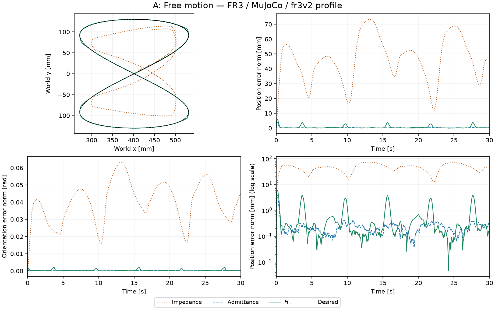

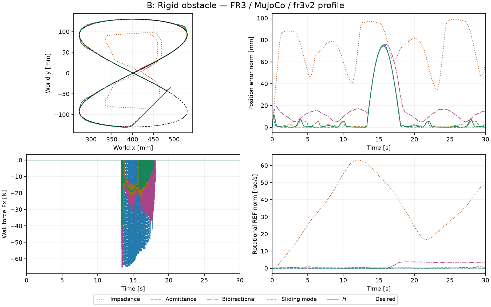

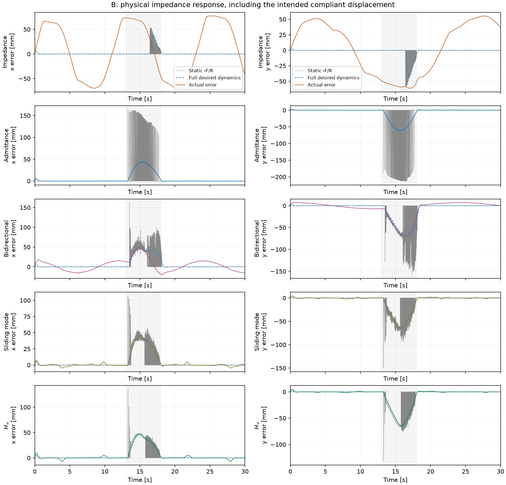

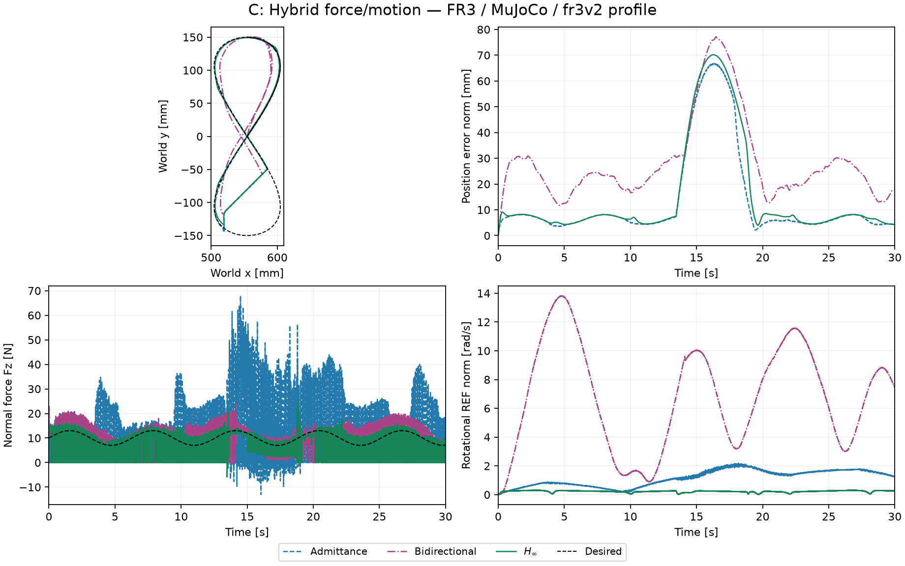

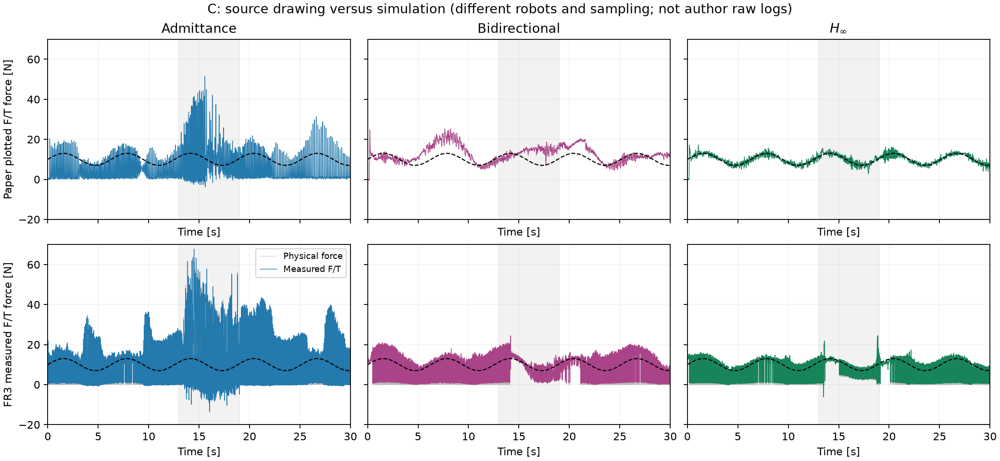

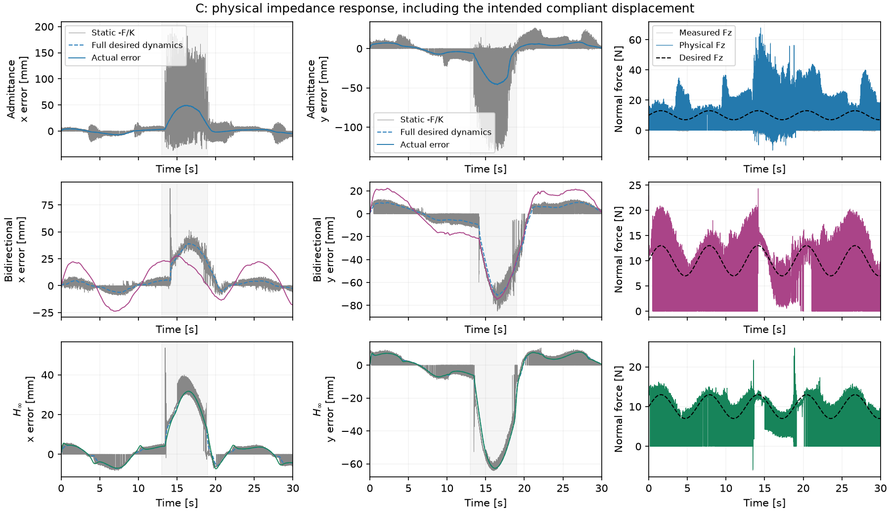

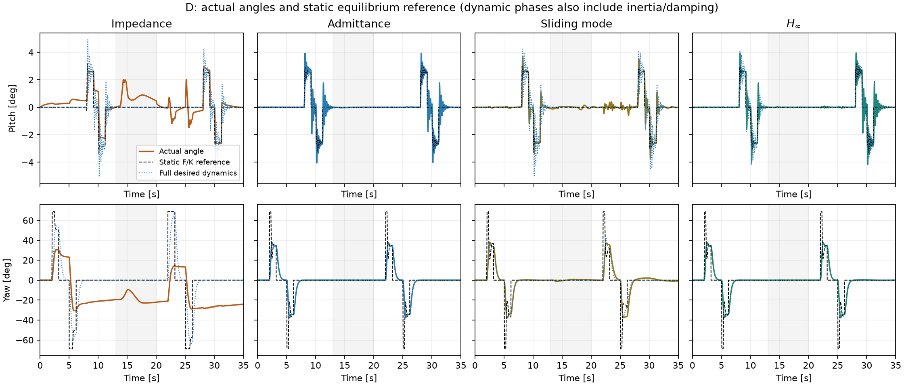

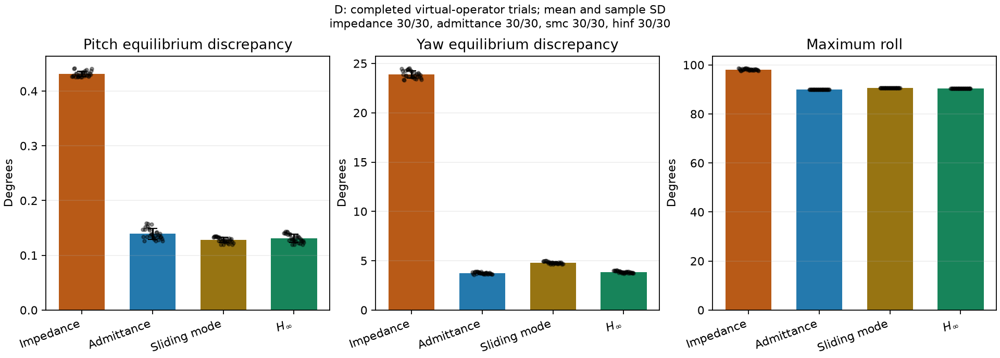

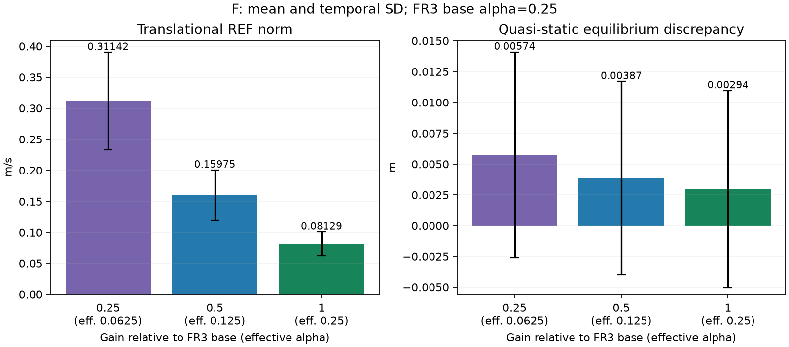

## MuJoCo 回放

[A 自由轨迹](A_hinf.mp4) · [B 斜墙接触](B_hinf.mp4) · [C 白板与挡块](C_hinf.mp4) · [D 旋转交互](D_hinf.mp4) · [F 基准增益](F_hinf.mp4)（均为 H∞，2 倍速；控制器对比见上方图表）。

回放使用保存的真实关节轨迹；绿色为期望路径，橙色为实际路径。显示用半透明墙不改变实验碰撞几何。

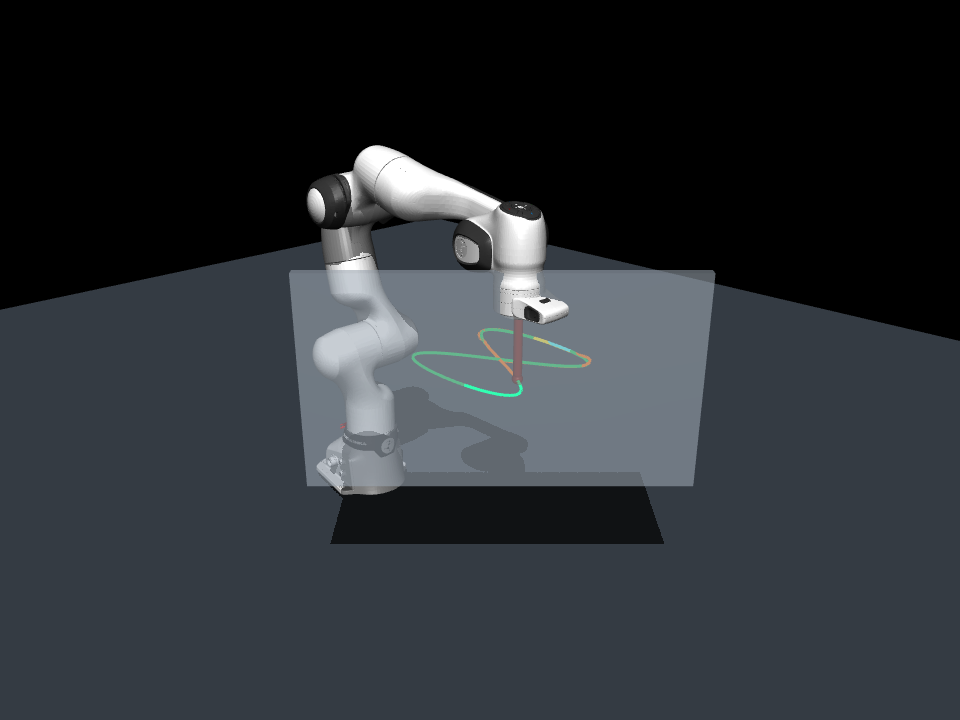

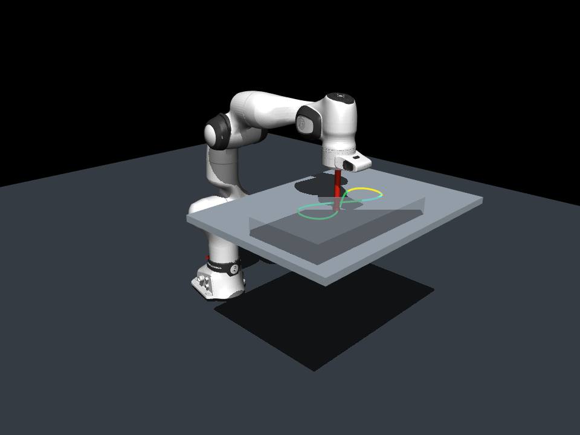


## 重跑

```bash
OPENBLAS_NUM_THREADS=1 .venv/bin/python scripts/validate_reproduction.py --resume --profile fr3v2 --output outputs/reproduction-fr3v2
OPENBLAS_NUM_THREADS=1 PYTHONPATH=scripts .venv/bin/python scripts/report_reproduction.py --root outputs/reproduction-fr3v2 --output docs/results/reproduction-fr3v2
```

时序、有限值、矩阵完整性、位置 RMS、峰值力和实际限幅已逐运行核对。单元/集成测试见 `VALIDATION.txt`；E 测试依当前范围默认跳过。D 的误差棒是虚拟操作者重复间样本标准差，不是真人统计置信区间。敏感性运行的提前终止保留，不能把部分时长指标与完整 30 s 直接等同。