# FR3 A–F：1 kHz 修订与验证

正式矩阵 137 次（D 每控制器 30 次），固定敏感性矩阵 65 次；状态：{'completed': 201, 'terminated': 1}。
运行时代码 SHA256：`b71d9601c33cf08de5f9de070f1706812bda542e77fb033570d89134b2b54e57`。

**这些是 FR3 仿真结果。A/F 的主要趋势已出现；B–E 仍有明确的论文差距，不能称为完整复现原机性能。**
用户确认将工具质量、接触材料和命令滤波作为明确仿真假设保留。默认控制、关节测量和 F/T 都是 1 kHz，物理 250 μs，公共命令低通 100 Hz。D 是虚拟操作者，E 使用内部偏心转子和旋转圆盘接触，不是真人/材料去除实验。
[E 的 36 次机制验证](../grinding/REPORT.md) · [B/C/D 的 48 次惯量与握持对照](../portability/REPORT.md) · [上一版 202 次记录](../reproduction/REPORT.md)。

## 结果与剩余差距

|组|当前证据|与论文的差距|
|---|---|---|
|A|普通阻抗/导纳/H∞ 位置 RMS：21.670 / 0.351 / 0.375 mm；低增益下两种鲁棒控制显著优于普通阻抗|FR3 与 Indy7 的绝对误差不相同|
|B|斜墙、约 13–18 s 接触；H∞/SMC 稳定适应，普通阻抗偏差大，双向调制损失阻抗精度|普通导纳没有复现论文的失稳急停；不能把它写成失败|
|C|导纳/双向/H∞ 的法向力 RMS：2.305 / 1.730 / 0.765 N|普通导纳主要在挡块段抖振，没有源图的全程抖振；幅度与误差比仍不同|
|D|恢复正负旋转、握持/释放、约 90° 翻转，30 次统计；H∞ 保持期望旋转响应|普通导纳和 H∞ 的差别仍小于论文；普通阻抗受限幅和滚转漂移影响|
|E|H∞ 接触段 x RMS 1.363 mm，双向 7.325 mm；H∞ 接触丢失 0.013%；SMC REF 更大|内部转子产生自由空间测力波动；双向 β/高力与 SMC 明显反弹尚未匹配|
|F|α=.25/.5/1 的 REF 均值：0.030 / 0.015 / 0.008 m/s，接近翻倍增益、误差减半|绝对幅值随机器人摩擦与惯量变化|

## 修复了什么

- 新 `paper` 配置统一接入已验证的 100 Hz 命令接口、物理外力能量端口和 RK4 阶段耦合；保留 `legacy` 重跑旧配置。论文 α=1、NRIC G 和 Λ/D/K 保留，F 单独改变 α。
- 从 PDF 矢量图恢复 A/B/F 的 260×260 mm 轨迹和斜墙，C 保留 100×300 mm 轨迹与转角挡块。A/B/F 改用可达的 FR3 起始姿态，真实/名义/零空间状态一致，避免直接扩大轨迹导致伸直奇异。
- B/E/F 共用有限接触柔顺性，约 26 N / 0.7 mm，明显高于任务刚度；并非原机材料标定。C 为更软笔尖。所有控制器使用同一环境。
- D 使用显式有限刚度虚拟握持，物理力矩与欧拉广义力矩保持功率对偶；E 恢复约 70 mm 接近行程及表面以下 8 mm 目标。
- E 的 0.4 kg 点接触工具改为 1.8 kg 工具、100 mm 旋转圆盘和内部偏心转子。自由空间真实外力与工具产生的 F/T 振动分开，摩擦作用于圆盘，显式校验耗散功率与摩擦上限。名义控制器仍只有七轴，完整八轴状态另存供回放。
- 增加独立的完整阻抗微分方程响应、接触状态与持续限幅指标。F 使用论文的均值±时间标准差；接触下的位置偏移不再单独作为控制好坏判据。力图保留 1 kHz 样本，避免绘图抽样掩盖振荡。

## 正式结果

|组|控制器|位置 RMS / mm|动态阻抗位置偏差 / mm|REF 均值 / m·s⁻¹|采样峰值力 / N|限幅比例|
|---|---|---:|---:|---:|---:|---:|
|A|impedance|21.670|21.657|13.27984|0.00|0.000%|
|A|admittance|0.351|0.185|0.03180|0.00|0.000%|
|A|hinf|0.375|0.215|0.00777|0.00|0.000%|
|B|impedance|43.865|39.884|11.05247|20.79|0.000%|
|B|admittance|21.186|0.081|0.01238|50.34|0.017%|
|B|bidirectional|25.041|12.680|1.18182|32.68|0.000%|
|B|smc|21.191|0.440|0.01221|39.81|0.000%|
|B|hinf|21.187|0.246|0.00754|46.58|0.023%|
|C|admittance|21.896|0.117|0.01644|50.02|6.250%|
|C|bidirectional|29.764|61.248|3.60934|31.77|0.000%|
|C|hinf|23.340|0.310|0.01009|29.92|0.000%|
|D|impedance|2.188|2.188|13.20034|0.00|12.009%|
|D|admittance|0.035|0.035|0.12726|0.00|0.044%|
|D|smc|0.197|0.197|0.02091|0.00|0.011%|
|D|hinf|0.074|0.074|0.00412|0.00|0.029%|
|E|bidirectional|10.290|7.414|1.96238|28.60|0.000%|
|E|smc|7.419|0.313|0.04029|49.74|0.000%|
|E|hinf|7.414|0.093|0.01523|37.73|0.000%|
|F|hinf_0.25|21.205|0.804|0.02969|41.46|0.000%|
|F|hinf_0.5|21.192|0.446|0.01499|43.54|0.020%|
|F|hinf_1|21.187|0.246|0.00754|46.58|0.023%|

动态偏差由 1 kHz 记录的真实外力零阶保持驱动 `Λ ë + D ė + K e = Fdes − Fext` 独立积分得到，包含惯性/阻尼，而静态 F/K 关系仅用于描述。角度力矩采用功率对偶变换。峰值只涵盖保存的 1 kHz 样本。REF 包含误差积分，不是末端实际速度；普通阻抗不使用此反馈，不能把其积分积累当作机器人高速运动。
C 表格评价真实接触力；论文对照图则使用 F/T 测量通道，避免把测量值与物理真值混为一谈。测量包含噪声和工具惯性，相关 RMS 单独保存在 metrics.json 的 diagnostics。

## 固定敏感性检查

|案例|状态|位置 RMS / mm|REF 均值 / m·s⁻¹|限幅比例|最长连续限幅 / ms|
|---|---|---:|---:|---:|---:|
|filter_off_A_admittance|completed|0.512|0.09378|99.987%|29974.0|
|filter_off_B_hinf|completed|21.191|0.00892|59.530%|2394.0|
|filter_off_C_hinf|completed|22.689|0.00962|95.367%|474.0|
|filter_off_D_hinf|completed|0.085|0.00730|71.163%|1677.0|
|filter_off_E_hinf|completed|7.412|0.01512|0.000%|0.0|
|physics8_B_admittance|completed|21.186|0.01238|0.017%|5.0|
|physics8_B_bidirectional|completed|25.048|1.18104|0.000%|0.0|
|physics8_B_hinf|completed|21.187|0.00754|0.023%|7.0|
|physics8_B_impedance|completed|43.869|11.06081|0.000%|0.0|
|physics8_B_smc|completed|21.192|0.01221|0.000%|0.0|
|physics8_C_admittance|completed|21.887|0.01634|6.087%|5.0|
|physics8_C_bidirectional|completed|29.770|3.61221|0.000%|0.0|
|physics8_C_hinf|completed|23.340|0.01008|0.000%|0.0|
|physics8_E_bidirectional|completed|10.214|1.81380|0.000%|0.0|
|physics8_E_hinf|completed|7.414|0.01524|0.000%|0.0|
|physics8_E_smc|completed|7.420|0.04009|0.000%|0.0|
|physics8_F_hinf_0.25|completed|21.205|0.02969|0.000%|0.0|
|physics8_F_hinf_0.5|completed|21.192|0.01499|0.020%|6.0|
|physics8_F_hinf_1|completed|21.187|0.00754|0.023%|7.0|
|rigid_contact_B_admittance|completed|21.390|0.01250|0.090%|15.0|
|rigid_contact_B_bidirectional|completed|24.881|1.19043|0.093%|2.0|
|rigid_contact_B_hinf|completed|21.398|0.00739|0.107%|17.0|
|rigid_contact_B_impedance|completed|43.574|10.85815|0.000%|0.0|
|rigid_contact_B_smc|completed|21.395|0.01233|0.027%|8.0|
|rigid_contact_E_bidirectional|completed|10.341|1.96610|0.000%|0.0|
|rigid_contact_E_hinf|completed|7.490|0.01529|0.013%|4.0|
|rigid_contact_E_smc|terminated|5.990|0.04901|0.009%|1.0|
|seed101_A_admittance|completed|0.353|0.03230|0.000%|0.0|
|seed101_A_hinf|completed|0.377|0.00778|0.000%|0.0|
|seed101_A_impedance|completed|21.655|13.25930|0.000%|0.0|
|seed101_B_admittance|completed|21.186|0.01273|0.020%|6.0|
|seed101_B_bidirectional|completed|25.012|1.17038|0.000%|0.0|
|seed101_B_hinf|completed|21.187|0.00754|0.020%|6.0|
|seed101_B_impedance|completed|43.860|11.04324|0.000%|0.0|
|seed101_B_smc|completed|21.191|0.01220|0.000%|0.0|
|seed101_C_admittance|completed|21.891|0.01641|6.110%|5.0|
|seed101_C_bidirectional|completed|29.750|3.61663|0.000%|0.0|
|seed101_C_hinf|completed|23.340|0.01009|0.000%|0.0|
|seed101_E_bidirectional|completed|10.281|1.92716|0.000%|0.0|
|seed101_E_hinf|completed|7.413|0.01523|0.000%|0.0|
|seed101_E_smc|completed|7.420|0.04028|0.000%|0.0|
|seed101_F_hinf_0.25|completed|21.206|0.02971|0.000%|0.0|
|seed101_F_hinf_0.5|completed|21.192|0.01500|0.017%|5.0|
|seed101_F_hinf_1|completed|21.187|0.00754|0.020%|6.0|
|seed102_A_admittance|completed|0.346|0.03183|0.000%|0.0|
|seed102_A_hinf|completed|0.371|0.00778|0.000%|0.0|
|seed102_A_impedance|completed|21.653|13.25894|0.000%|0.0|
|seed102_B_admittance|completed|21.185|0.01242|0.017%|5.0|
|seed102_B_bidirectional|completed|25.048|1.17557|0.000%|0.0|
|seed102_B_hinf|completed|21.187|0.00754|0.020%|6.0|
|seed102_B_impedance|completed|43.872|11.03973|0.000%|0.0|
|seed102_B_smc|completed|21.191|0.01220|0.000%|0.0|
|seed102_C_admittance|completed|21.895|0.01639|6.197%|5.0|
|seed102_C_bidirectional|completed|29.761|3.63183|0.000%|0.0|
|seed102_C_hinf|completed|23.337|0.01008|0.000%|0.0|
|seed102_E_bidirectional|completed|10.266|1.90850|0.000%|0.0|
|seed102_E_hinf|completed|7.413|0.01523|0.000%|0.0|
|seed102_E_smc|completed|7.419|0.04029|0.000%|0.0|
|seed102_F_hinf_0.25|completed|21.205|0.02971|0.000%|0.0|
|seed102_F_hinf_0.5|completed|21.191|0.01500|0.017%|5.0|
|seed102_F_hinf_1|completed|21.187|0.00754|0.020%|6.0|
|virtual8_B_bidirectional|completed|25.021|1.17225|0.000%|0.0|
|virtual8_C_admittance|completed|21.896|0.01644|6.250%|5.0|
|virtual8_C_bidirectional|completed|29.755|3.60710|0.000%|0.0|
|virtual8_E_bidirectional|completed|10.286|1.95597|0.000%|0.0|

固定种子 100/101/102，物理子步 4→8、虚拟积分 4→8、旧硬接触、命令滤波关闭均保留。关闭滤波可能产生持续力矩限幅；运行完成不能作为该配置可用的证明。没有按排名选择种子或删去负面配置。
物理步长减半时，以 C 的力 RMS、B/E/F 的 REF 均值比较，最大相对变化为 physics8_E_bidirectional 的 -7.57%。这支持所报告指标的数值稳健性，不代表非线性振荡逐样本一致或严格的无源性证明。

## 图与复核

[完整配置、指标、原始轨迹哈希](metrics.json) · [A/B/F 图示几何恢复证据](../reproduction/paper_ab_geometry.json) · [实现与假设](../../IMPLEMENTATION.md) · [此前 C 机制审计](../../C_MECHANISM_AUDIT.md)

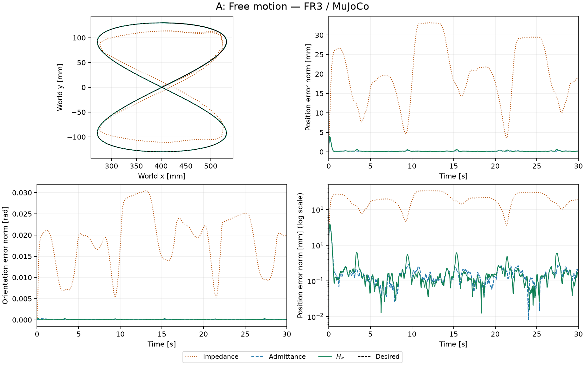

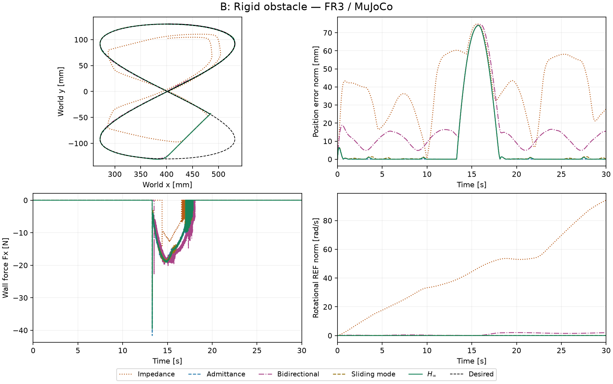

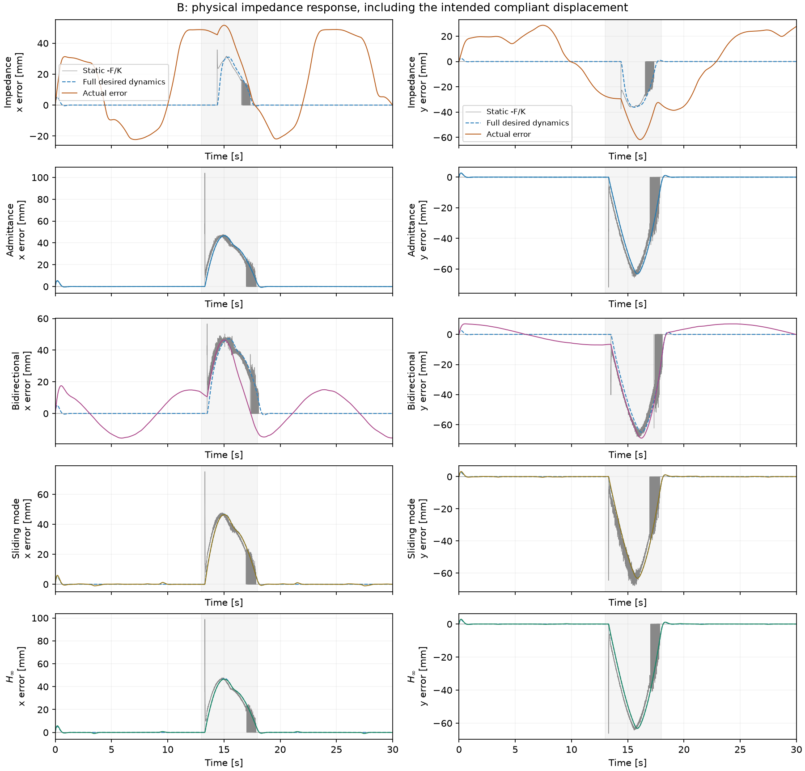

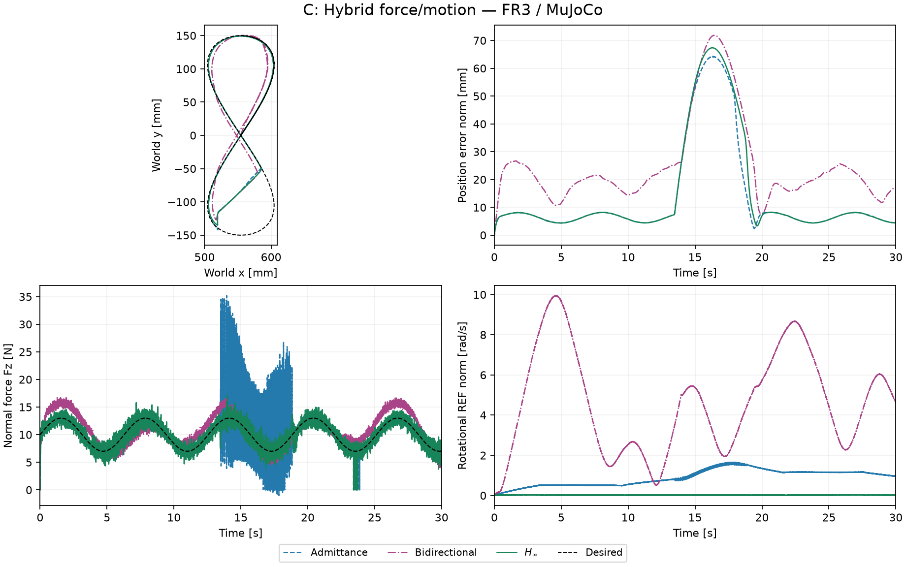

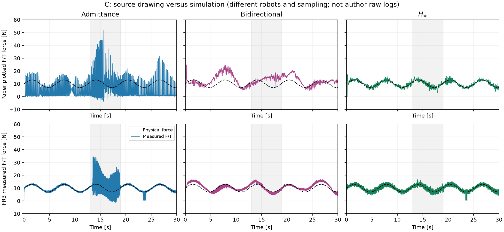

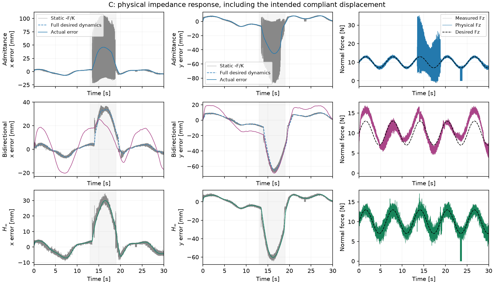

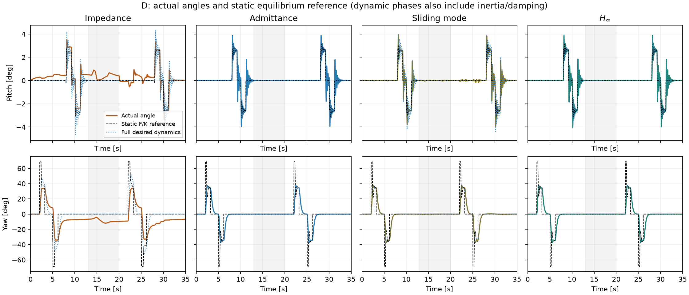

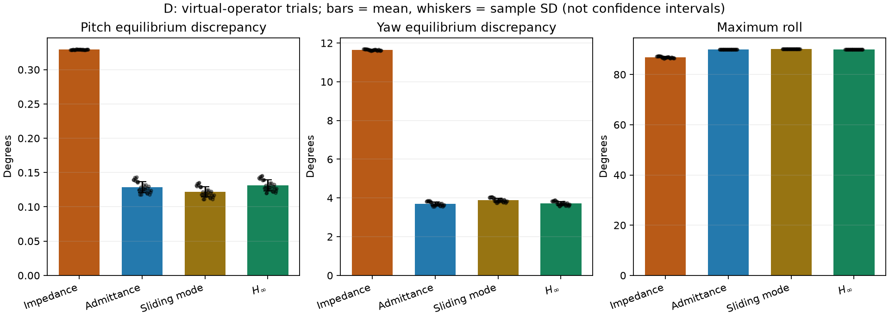

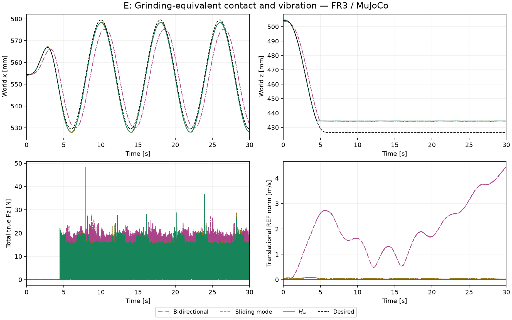

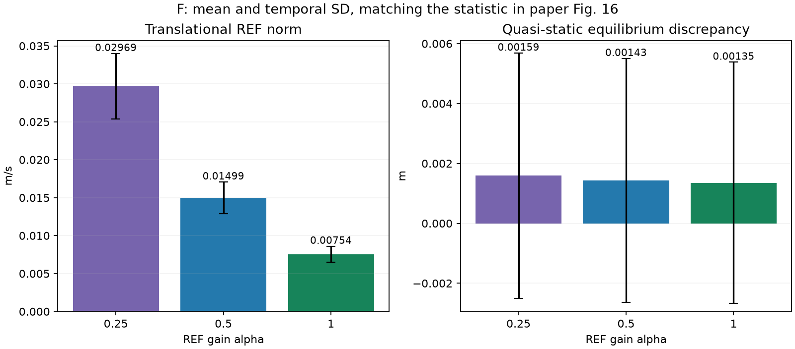

## MuJoCo 回放

[C 白板接触回放（2 倍速）](C_hinf.mp4) · [D 旋转交互回放（2 倍速）](D_hinf.mp4)

回放使用保存的真实关节轨迹；绿色为期望路径，橙色为实际路径。显示用半透明墙不改变实验碰撞几何。

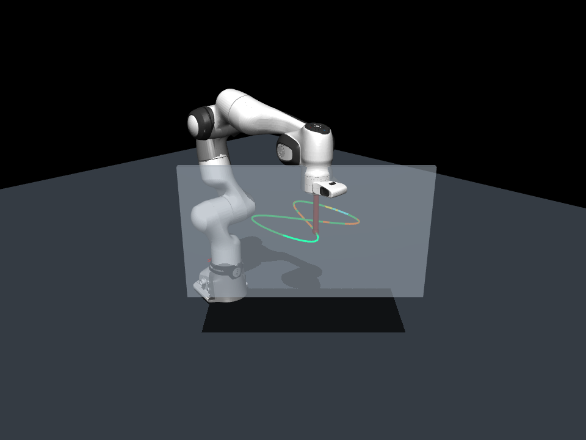

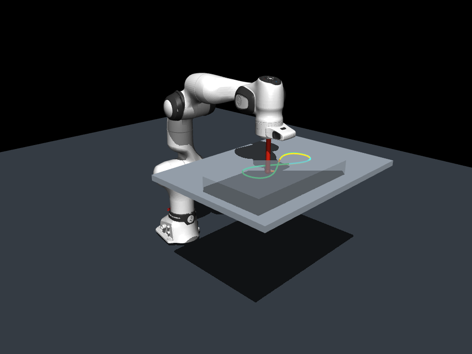

## 重跑

```bash
OPENBLAS_NUM_THREADS=1 .venv/bin/python scripts/validate_reproduction.py --resume
OPENBLAS_NUM_THREADS=1 .venv/bin/python scripts/report_reproduction.py
```

时序、有限值、矩阵完整性、位置 RMS、峰值力和实际限幅已逐运行核对。27 项单元/集成测试见 `VALIDATION.txt`；D 的误差棒是虚拟操作者重复间样本标准差，不是真人统计置信区间。敏感性运行的提前终止保留，不能把部分时长指标与完整 30 s 直接等同。